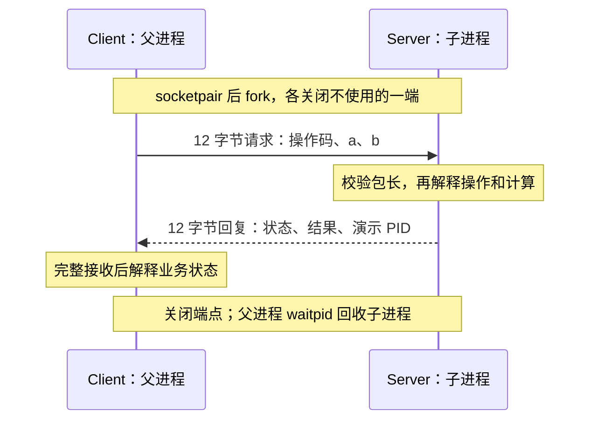

# 第 01 章｜为什么需要 Binder？

本章的目标不是证明“没有 Binder 就不能跨进程调用”。恰恰相反，我们先用 Linux 已有的 Socket 实现一次 RPC，再明确这个实验已经解决什么，以及哪些需求将推动后面的设计。

前置知识见 [P01](p01-process.md)。实验需要 Linux、C 编译器、Make 和 Python 3，系统调用观察另需 strace。所有命令在仓库根目录执行，不需要 root。

## 1. 为什么 add(1, 2) 不能直接搬过去？

在一个进程里，函数调用已经隐含约定了参数怎样传递、执行哪个函数、结果怎样返回、从哪里继续执行。

当计算位于另一个进程时，我们不能直接跳进那个进程继续执行。需要让对方收到一份可理解的请求，由它自己的线程执行计算，再返回结果。

P01 已经排除了“子进程直接修改父进程普通变量”的方案。现在还缺四件事：通信通道、请求格式、服务端分发、回复格式。

## 2. 先比较可行方案

| 方案 | 能解决什么 | 当前需要额外设计什么 |
| --- | --- | --- |
| 两条管道 | 请求与回复分别传输 | 消息边界、双方关闭约定；多服务寻址仍需增加机制 |
| Unix Socket | 双向本机通信，可选保留消息边界 | 业务操作格式、结果及错误语义 |
| 共享内存 | 双方可访问共享的数据区域 | 同步、通知、区域分配、所有权和异常退出处理 |
| 专用字符设备 | 可由驱动统一管理通信状态 | 需要自己实现协议、队列、内存、安全和回收 |

本章选择 `socketpair(AF_UNIX, SOCK_SEQPACKET, ...)`。Socket pair 省去了路径注册与连接建立，SEQPACKET 保留消息边界，因此可以把注意力放在请求和回复上。

代价也很明确：此时只有一对预先创建的端点，由父子进程继承；尚不支持独立启动的服务、服务发现、多对象或并发调用。这是隔离问题的实验选择，不是面向完整服务系统的最终设计。

## 3. 把隐含调用约定写成协议

完整实现位于 [socket_rpc.c](../../examples/intro/socket_rpc.c)。请求与回复各有三个 32 位无符号整数，按网络字节序编码，每包正好 12 字节。

| 方向 | 第一个字段 | 第二个字段 | 第三个字段 |
| --- | --- | --- | --- |
| Client → Server | 操作码，1 表示 ADD | a | b |
| Server → Client | 状态，0 成功、1 溢出、2 未知操作 | 结果，仅成功时有效 | 演示用 Server PID |

为什么不直接发送一个任意 C struct？因为填充、成员宽度和指针的意义不能靠发送方的编译器布局自动保证。当前只用固定整数数组并显式转换字节序，让协议边界可以直接检查。以后加入字符串、变长数组和对象，就会遇到 Parcel 章节的问题。

本章把业务限定为 `uint32_t` 非负整数加法，并拒绝溢出，而不是悄悄回绕。与开头固定 `int add(1, 2)` 的示例相比，这是一项显式的协议范围选择。

为什么还不增加请求 ID？因为一个连接只有一个进行中的请求，回复归属没有歧义。如果同一个连接允许同时发出多个请求，这个假设就需要重新审视，不能把当前简化推广到并发系统。

回复中的 PID 只是服务端自己填写的普通数据，不能用于安全认证。生产协议必须使用可信机制获取身份；Android Binder 的内核提供身份信息与这里的业务字段不是一回事。

## 4. 两个进程各自做什么？

父进程先创建 Socket pair，再 fork。父进程关闭服务端端点，子进程关闭客户端端点。各自只保留需要的一端，避免额外持有的端点掩盖对方退出。



客户端编码请求并发送，然后阻塞接收回复。服务端接收后检查操作码和溢出条件，在自己的进程中计算，再编码回复。客户端收到数据后解释状态，成功时取出结果。

发送和接收遇到 `EINTR` 会重试。发送使用 `MSG_NOSIGNAL`，避免对端关闭时程序直接被 SIGPIPE 终止，给调用方机会把它表示成通信错误。

接收使用 Linux 的 `MSG_TRUNC` 获取实际包长；非 12 字节消息，包括 EOF，都被视为传输/协议失败。已经加入短包、超长包、未知操作的受控注入，分别检查结构与业务边界。它们覆盖明确列出的输入，不能代表所有恶意报文已经验证。

## 5. 实验一：真正跨过进程边界

```sh
make
./build/socket_rpc 1 2
./build/socket_rpc 19 23
```

预期分别得到 `result=3` 与 `result=42`，同时输出不同的 `client_pid` 和 `server_pid`。两个程序均返回 0。

失败判据：结果错误、两个 PID 相同、非零退出或不能在测试截止时间内结束。结果值与不同 PID 结合源码说明计算发生在子进程；仅相信远端任意填写的 PID 则不足以证明这一点。

清理：程序关闭端点，父进程等待并回收子进程，无文件系统 Socket 路径残留。

## 6. 实验二：远端拒绝执行，不等于通信失败

```sh
./build/socket_rpc 4294967295 1
echo $?
./build/socket_rpc -1 2
echo $?
```

第一次应输出 `remote error: overflow`，退出码 2。服务端确实收到并处理了请求，只是业务结果超出了协议范围。第二次输出 `invalid argument`，退出码也为 2，但错误发生在客户端，尚未创建通信端点。

退出码在这个小程序里只区分总体错误类别，文字标记区分发生位置；未来用户态库应该返回结构化状态，不能让业务解析 stderr。

这两个反例揭示：一个返回整数已经不够同时表示全部成功结果与失败原因，协议需要独立状态。不能为了模仿本地 `add()`，假装远端执行不会失败。

## 7. 实验三：服务端在回复前退出

```sh
./build/socket_rpc 1 2 --server-exit
echo $?
```

子进程关闭端点并退出，不处理请求。客户端可能在发送时输出 `transport error: request send failed`，也可能在接收时输出 `transport error: no complete reply`；具体调度次序不固定，均应退出 3，自动测试因此检查共同的 `transport error` 类别。

这验证的是“对端关闭能被观察到”，不是通用死亡通知，也不是调用超时机制。对端仍存活而不回复，需要另一个实验区分。

## 8. 实验四：结构合法与操作合法是两层检查

```sh
./build/socket_rpc 1 2 --short-request
echo $?
./build/socket_rpc 1 2 --long-request
echo $?
./build/socket_rpc 1 2 --unknown-op
echo $?
```

短包发送两个整数，共 8 字节；超长包发送四个整数，共 16 字节。服务端接收缓冲区只有 12 字节，但 `MSG_TRUNC` 让它看到原始包长，避免把长包的前 12 字节当成合法请求。两个模式都应输出 `server protocol error: malformed request`，客户端输出 `transport error: no complete reply`，退出码 3，并且没有 `result=`。

未知操作发送长度正确、操作码为 99 的包，预期 `remote error: unknown operation`、退出码 2，没有 `transport error`。它经过完整协议往返，被服务端明确拒绝；与结构都无法接受而关闭连接，是不同结果。

这里有一个设计选择：长度不对时关闭当前一次性会话，操作未知时用状态字段回复。也可以设计可恢复的结构错误回复，但需要规定如何识别请求、如何避免读取不完整字段，以及是否继续处理连接；本例没有这种恢复协议。失败判据是非法长度得到业务结果、长包被截断接受、未知操作按 ADD 执行、错误类别不符或等待不结束。

每次执行关闭端点并回收子进程。自动测试为这些命令设置 5 秒截止；该截止负责发现程序挂起，不是协议的超时能力。

## 9. 实验五：收到请求，不等于一定有回复

若服务端没有死，只保持连接却不返回结果，EOF 就不会替我们结束等待。运行带清理的测试入口，避免直接裸跑无回复模式：

```sh
python3 -m unittest discover -s tests -p test_intro.py -k live_server_without_reply -v
```

`--server-no-reply` 模式里，服务端完整接收请求后，通过独立控制 Socket 发送就绪字节，然后故意不发送业务回复。父进程收到握手才输出 `event=request_received_no_reply server_pid=...`，测试由此确认“请求已收到”，而不是靠任意 sleep 猜执行位置。

测试检查服务端仍存活，给客户端一个 0.2 秒的观察窗口；预期 Python 等待抛出 `TimeoutExpired`，客户端与服务端仍未结束。这只证明在该窗口连接存活没有自动产生回复，不是对无限未来的断言。客户端的 `pselect()` 没有设置协议截止时间，0.2 秒属于外部测试。

随后测试向客户端父进程发送 `SIGTERM`。信号处理函数只设置标志；等待采用 `pselect()` 配合信号屏蔽，避免终止通知恰好落在检查与等待之间而丢失。父进程输出 `harness interruption: no protocol timeout`，关闭控制端点，服务端看到控制连接 EOF 后退出；父进程回收子进程并返回 124。测试检查子 PID 已不存在，就绪与清理还各有 5 秒上限，异常时清理独立进程组。

完整的[边界实验](../labs/intro-boundaries.md)记录了握手、错误判据和清理顺序。若没有就绪事件、服务端提前退出、客户端自行给出结果，或清理后仍有子进程，实验均失败。测试没有用无限等待来证明“不回复”。

| 观察 | 说明了什么 | 还没有解决什么 |
| --- | --- | --- |
| RPC 端点读到 EOF | 对端已关闭相应连接 | 对端存活但不回复 |
| 外层测试截止 | 观察窗口到期，测试停止继续等待 | 在途请求是否已执行、能否撤销 |
| 收到测试信号后退出 124 | 本实验按外部要求完成清理 | RPC 超时、取消消息、迟到回复或业务恰好执行一次 |

独立控制 Socket 是取证和清理工具，不是新增对外 RPC 功能。本例还没有每次调用的超时或取消协议；这些机制需要明确谁终结请求、服务端能否继续执行、资源归谁回收，不能只在 `recv()` 外面加计时就宣称完成。

## 10. 用 strace 观察，而不只看结果

```sh
strace -f -e trace=socketpair,clone,sendto,recvfrom,close,wait4 ./build/socket_rpc 1 2
```

观察父子进程的两个 PID、客户端发送 12 字节、服务端接收同一请求、服务端发送 12 字节回复、客户端接收，然后关闭与等待。不同 libc/架构下 fork 底层可能使用其他进程创建系统调用，必要时去掉 `-e` 过滤。

如果服务端尚未发送，客户端的接收会等待；某些运行中能看到 `<unfinished ...>` 和 `resumed`，但调度可能让发送先完成，所以不能要求每次都出现这种输出。

跟踪输出前面的若干 `close()` 可能来自动态加载器。不是每条系统调用都属于 RPC 设计。也不能从 send/recv 数量直接推断内核实际复制次数，本实验没有测量它。

## 11. 已经能 RPC，为什么还研究 Binder？

对于本章这一次加法，Socket 已经足够。写一个专用驱动并不会自动让程序更简单、更快或者更安全。

后续我们会逐个加入新的需求：一个服务进程提供多个对象；客户端把对象引用转交给第三个进程；内核提供可信调用身份；同步调用中发生回调；对象拥有者退出后通知引用持有者；传输 FD 时建立正确的新引用。

这些需求也可以在其他 IPC 上组合实现。值得研究 Binder 的原因，是观察它如何把其中一部分职责放入内核，以统一维护跨进程对象引用、事务交付和资源转换，同时让用户态负责业务协议和执行。

内核知道进程、线程和文件对象，但驱动也必须付出内存管理、锁、ABI、安全审计与退出清理的成本。之后每次引入机制，都要说明为什么值得承担这一成本。

因此，下一章进入字符设备是一项明确的教学设计选择：我们希望亲手探索受内核管理的 IPC。**本章没有证明专用驱动是 RPC 的必要条件，也没有证明它比 Socket 性能更高。**

## 12. 本章与 Android Binder 如何对应？

| 本章动作 | 真实源码与固定版本 | 概念相近处 | 不能混同的地方 |
| --- | --- | --- | --- |
| 客户端发送请求、服务端回复 | Linux v6.6：[BC_TRANSACTION / BC_REPLY 分支](https://github.com/torvalds/linux/blob/v6.6/drivers/android/binder.c#L4014) | 请求与回复分别进入驱动处理 | 真实事务还携带目标引用、flags、对象偏移等；Socket 格式不兼容 Binder ABI。 |
| 服务端收到请求、客户端收到回复 | Linux v6.6：[BR_TRANSACTION / BR_REPLY 交付](https://github.com/torvalds/linux/blob/v6.6/drivers/android/binder.c#L4650) | 请求和同步回复是不同协议事件 | 驱动交付后，用户态才按 code 分发方法或解释结果；线程路由不等同本例固定父子端点。 |
| 本例分别观察“收到”与“有回复” | Linux v6.6：[BR_TRANSACTION_COMPLETE](https://github.com/torvalds/linux/blob/v6.6/drivers/android/binder.c#L4486) | 完成类事件不能直接当业务返回值 | 控制握手不是 Binder 完成通知的实现，不能据本例断言其完整时序或失败语义。 |
| ioctl 承载读写协议 | Linux v6.6：[binder_ioctl_write_read](https://github.com/torvalds/linux/blob/v6.6/drivers/android/binder.c#L5049) | 一次入口可处理读写缓冲区 | BC/BR 不是每个各有一个同名 ioctl，也不保证每次业务调用只需一次 ioctl。 |
| 编码三个整数 | AOSP Parcel 用户态版本尚未固定，本节不声称已核查源码 | 普通数据编解码由用户态完成 | 本例没有实现 Parcel、对象/FD 转换或兼容性；具体用户态源码对照留到相应版本锁定后。 |

核查入口见[源码基线](../reference/android-binder.md)。本章只运行了 Socket 实验，没有 Android 运行时验证。驱动阅读基线不代表任意设备版本，也不替代 AOSP 用户态版本；不能由本实验推导真实 Binder 一定提供或不提供某种通用超时。

## 本章验收

```sh
make test
```

当前统一 `make test` 验收的结果见[阶段报告](../reports/m0-m1-progress.md)。本章覆盖本地计算、fork 隔离、线程 join、退出状态、RPC 正常结果、数值边界、非法参数、远端溢出、服务退出、8/16 字节请求、未知操作和受控无回复。[测试源码](../../tests/test_intro.py)与[边界实验](../labs/intro-boundaries.md)给出具体断言。测试数量不代表所有故障路径均已覆盖。

普通调用均关闭端点并 waitpid 回收；无回复模式的测试还负责握手、终止与检查回收。当前没有并发、安全认证、服务发现、协议超时/取消或生产可靠性保证；fork/分配失败等路径也没有全部动态注入。初学者独立重放与整章发布验收尚未完成。

练习：如果一次调用的测试已超时，服务端能否仍然完成加法？能，因为停止等待不等于远端取消。再考虑加法换成扣款：简单重试可能重复副作用，未来协议必须明确请求身份、去重或取消边界，不能只添加一个错误码。

读完后应能自己回答：为什么不能直接使用另一个进程的函数地址？请求与回复为什么需要格式和错误状态？哪些现成 IPC 已能完成任务？如果转向内核驱动，我们究竟想探索哪些额外职责？
