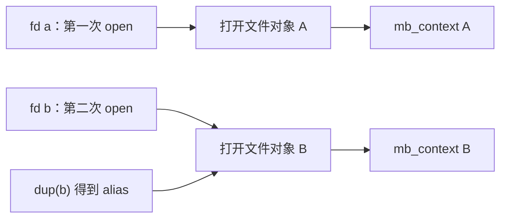

# 第 02 章｜设计第一个字符设备驱动

第 01 章证明 Socket 已能完成 RPC。现在转向驱动，是为了亲手探索由内核管理的通信状态。本章先只实现一件事：进程打开设备、查询该次打开的状态，再安全释放。还没有请求队列、服务端注册或远程 add。

本章代码固定为提交 **`6406d8d42e45358a9b289d080376ad858d4c2465`**，下文简称 `6406d8d`。主线正继续演进，当前 [driver/mini_binder.c](../../driver/mini_binder.c)、[UAPI](../../include/uapi/mini_binder.h)、[device_test.c](../../tests/kernel/device_test.c)可能已经包含下一章功能；阅读本章时应先查看该提交，而不是把最新源码当成本章快照。

```sh
git show 6406d8d:driver/mini_binder.c
git show 6406d8d:include/uapi/mini_binder.h
git show 6406d8d:tests/kernel/device_test.c
```

这是开发快照，不是已发布、不可移动的章节标签。前置知识见 [P02](p02-syscalls.md)、[P03](p03-module.md) 和 [P04](p04-environment.md)。

## 1. 先定义最小问题

已有模块只能在装载/卸载时打印日志。用户程序怎样提出一个明确请求，并获得与自己这次打开有关的数据？直接读 dmesg 不合适：它是诊断通道，可能有旧记录和其他进程事件，也没有每个调用的结构化结果。

最小需求不是“实现 Binder 全部入口”，而是以下四点：一次独立打开有独立状态；查询返回固定布局；未知命令和不可写的用户地址被拒绝；最后一个文件引用释放后，状态有明确清理者。这样的入口才值得继续承载 RPC。

## 2. 为什么选 miscdevice 和 ioctl？

| 方案 | 合理用途 | 本章选择的代价 |
| --- | --- | --- |
| `read/write` 字节流 | 适合顺序数据与简单流协议 | 若复用为控制请求，需要另设计命令、边界、部分读写和状态。不是不能实现，只是会增加当前问题。 |
| `ioctl` 控制命令 | 按不同操作约定参数布局和结果 | 必须自行规定命令号、布局、长度和错误；并不自动提供 RPC 或输入安全。 |
| 自行分配字符设备号与 cdev | 可直接管理更完整设备注册细节 | 本章暂不需要这套注册规模。 |
| `miscdevice` | 复用杂项字符设备的注册框架 | 简化设备号管理，仍须编写 file_operations 和生命周期规则。 |

本章用 `misc_register()` 注册名为 `mini_binder` 的设备，动态选择次设备号，访问模式为 0600。客户机挂载 devtmpfs 后提供 `/dev/mini_binder`。权限限制只是入口约束，不能替代以后对对象转交、调用者身份和业务方法的授权。

选择 ioctl 并不意味着以后每个业务方法都要有一个 ioctl。这里先建立控制入口，之后再设计它承载的通信协议。

## 3. 必要补给：fd、file 与打开上下文

`open()` 返回的 fd 是用户态表中的整数索引；VFS 把操作分发给设备的 `file_operations`。一次独立打开对应一个打开文件对象，驱动可在 `file->private_data` 存放自己的状态。本例的 `mb_context` 保存打开者身份引用和一个 `open_id`。



关闭 b 后 alias 仍可使用，因为它还持有同一个打开文件对象。`.release` 对应最终文件释放，不是每次 `close(fd)` 都调用一次。fork 继承也会持有已有文件对象，不能把子进程的每个 fd 视为新执行一次驱动 open。

`.owner = THIS_MODULE` 让正常文件持有关系参与模块引用管理，避免仍有打开使用者时随意卸载处理代码；它不替代上下文中的资源清理。本章没有 mmap 或独立异步工作，所以生命周期还不涉及 VMA 和后台请求。

## 4. 先写协议，再看驱动

快照使用 ABI 版本 1，只有以下查询结果：

```c
struct mb_query {
    __u32 version;
    __u32 features;
    __u64 open_id;
    __u64 live_contexts;
};

#define MB_IOC_QUERY _IOR('m', 0, struct mb_query)
```

该布局在本章 Linux x86_64 环境为 24 字节，测试用 `_Static_assert` 检查。`version` 为 1，快照没有功能扩展，清零后的 `features` 为 0。`open_id` 区分本次模块生命周期内的打开，`live_contexts` 是当次读取到的全局存活上下文数。

这不是跨重启永久标识，也不是 Node、Handle、PID 或文件 fd。计数适合本章无其他干扰者的资源实验，不是承诺并发世界中的多个查询构成原子全局快照。编号递增也不表示设计了任意长运行下的回绕协议。

`_IOR` 的方向表示用户态从内核读取这个结果；宏编码类型、编号、方向和大小。它既不会自动执行复制，也不会让内核自动认可调用者传来的内存。驱动必须核对完整命令值，并显式 `copy_to_user()`。

先运行 [普通 C 命令分发模型](../../examples/models/command_dispatch.c)：找不到完整命令就返回错误；命令匹配才按约定解释参数。它也使用 `_IOR/_IOW` 编码，但不打开设备：

```sh
make all
./build/command_dispatch
```

预期依次看到正常查询、`unknown_number`、`wrong_encoded_size`、`wrong_direction` 和 `short_local_buffer`，最后为 `COMMAND_MODEL_PASS`。前三种拒绝返回 `ENOTTY`；最后一种用可信的本地 capacity 模拟容量不足，返回 `EFAULT`。每次拒绝还比较填充为 `0xa5` 的输出数组，`unchanged=1` 才通过；退出非零、结果字段错误或拒绝时修改输出都算失败。程序没有持久资源，退出即可清理，`make clean` 删除构建产物。

模型说明不能只核对命令编号，还要核对方向和编码长度；并不证明用户指针有效。真实内核无法通过用户宣称的容量判断该地址是否可访问，必须使用用户复制 API；即使调用失败，也不能承诺跨页复制前缀完全未变。模型里的 `memcpy` 只访问已知有效的本地数组，不能搬进驱动替代 `copy_to_user`。模型也没有模拟打开者身份，驱动还需执行以下检查：

```text
检查调用者是否属于打开者线程组
如果 command 不是完整 MB_IOC_QUERY：拒绝
准备一个全部清零的结果，填写字段
复制到用户缓冲区；复制失败则报告失败
```

## 5. 为什么要保存打开者身份？

最简单方案是“谁拿到 fd 都能查询”；另一个方案是保存打开者 PID 数字比较。但 fd 会被 fork 继承，PID 数字以后也会复用。这个阶段还没有定义跨进程共享通信上下文的协议，因此选择更窄的规则：查询者必须属于打开者线程组。

`mb_open()` 取得 `get_pid(task_tgid(current))` 的引用，释放时 `put_pid()`。ioctl 比较当前 `task_tgid(current)` 与所存对象是否相同，而不是只比较可复用的数字。同线程组可访问；fork 后的子进程可以关闭继承 fd，但对它发查询返回 `EPERM`。子进程独立重新 open 后又可正常查询。

这是教学版自己的边界，不是照抄真实 Binder 的所有权协议，也不是完整凭据/授权模型。对象转交与不同 UID 策略还没有实现。

## 6. 驱动入口与资源账目

| 入口 | 工作与失败语义 | 资源责任 |
| --- | --- | --- |
| `mb_init` | `misc_register()`；失败直接把错误返回模块装载者 | 成功后设备由模块持有，exit 调用 `misc_deregister()`。本章未注入注册失败。 |
| `mb_open` | `kzalloc(GFP_KERNEL)`，失败 `-ENOMEM`；成功分配 ID | context 持有一份 pid 引用，保存到打开文件对象，存活数加一。 |
| `mb_ioctl` | 先检查线程组，再核对完整命令，然后复制结果 | 查询不取得新持久资源，不改变 live_contexts；输出结构预先清零，避免返回未初始化字节。 |
| `mb_release` | 释放 pid 引用和 context，存活数减一 | 最终文件引用释放触发；继承者关闭引用也应安全，不要求它是打开者才能清理。 |

代码用原子计数器管理 ID 和存活数。上下文的 ID/owner 在 open 后不再修改，查询时打开文件对象仍有效；本章没有请求队列，不需要提前引入事务锁或等待队列。以后增加可变共享状态时，这个理由就不再足够。

`copy_to_user()` 可能因用户页访问失败返回未复制的字节数，不是返回负 errno；代码把非零结果转换成 `-EFAULT`。内核返回负错误码后，用户态 ioctl 通常看到 -1 并由 libc 设置 `errno`。不能在成功返回后根据旧 errno 宣布失败。

即使复制失败，也可能已写入部分用户缓冲区，因此调用方不得使用错误返回下的任何查询字段。本例查询没有排队/注册副作用；未来“先提交再复制回执”的命令需要另外设计部分成功，不能沿用“报错就是什么都没发生”。

| 输入/调用 | 驱动结果 | 为什么 |
| --- | --- | --- |
| 打开者的正确查询 | 0，填入 24 字节结果 | 完整命令与调用资格都符合。 |
| 未知命令 | `-ENOTTY` | 设备不实现该操作。 |
| 编号相同但 `_IOR` 大小错误 | `-ENOTTY` | 完整命令值不符，不能只比较编号。 |
| 正确命令，地址 1 或 PROT_NONE 区域 | `-EFAULT` | 用户缓冲区不可写。 |
| fork 子进程查询继承 fd | `-EPERM` | 线程组不符；该检查先于命令与指针检查。 |

## 7. 用冻结快照重放，避免读到下一章

在主工作区修改开发中的代码会混淆章节边界。可从仓库根目录建立独立工作树，以该提交作为起点：

```sh
git worktree add --detach ../binder-c02-6406d8d 6406d8d
cd ../binder-c02-6406d8d
bash tools/kernel/build.sh
bash tools/qemu/build-rootfs.sh
ACCEL=tcg bash tools/qemu/run.sh
ACCEL=kvm bash tools/qemu/run.sh
```

新工作树需要自己的构建产物，首次编译有时间与磁盘成本；KVM 需要 [P04](p04-environment.md) 所列条件。不要把已有 C03 镜像拿来声称重放了本章代码。若相同路径已存在，先确认它是否为所需快照，不要强制覆盖已有工作。

这里的执行脚本来自同一提交，客户机自动加载模块并运行 `/device_test`。该测试依次检查两次独立 open 的 ID 不同、存活数增加；dup 后关闭原 fd，别名查询 ID 与计数不变；未知命令/错误编码大小；两个不可写地址；fork 继承查询拒绝与子进程独立打开成功；关闭后回到初始计数。

这些断言直接对应第 1 节的需求。只打印一遍查询结果，无法证明别名释放或失败路径；只检查没有崩溃，也无法证明没有遗留上下文。

## 8. 证据、失败判据与清理

本机查询阶段的 TCG/KVM 日志均出现 `DEVICE_TEST_PASS open_id=1`，卸载时为 `mini_binder: device removed live_contexts=0`，并最终 `MINI_LAB_PASS`；产物摘要见 [P04](p04-environment.md)，归档位置见[阶段报告](../reports/m0-m1-progress.md)。这些是特定快照及环境的证据，不能把初始 ID 值固定成所有运行必然相同，也不能把后续主线覆盖后的同名日志当成本章证据。

任一断言失败会打印测试位置与 errno，init 进入 `MINI_LAB_FAIL`；运行器还拒绝内核告警、非零 QEMU 退出、缺失成功标记及截止时间耗尽。预期错误必须被测试识别成 ENOTTY/EFAULT/EPERM，不能仅凭命令非零退出就算负例通过。

正常清理由用户程序关闭所有 fd、子进程退出并被回收、模块卸载完成。测试失败时客户机关机，本轮环境不再复用；它只能使整体 VM 资源收回，不能替代正常路径的资源账目证据。

当前没有长时间重复 open/close 压力、真实分配失败注入、注册失败回滚注入或并发退出的穷尽验收。`live_contexts=0` 只覆盖本模块记账资源，不能证明整个内核零泄漏。也没有声明初学者独立重放或正式章节发布已经完成。

## 9. 回到 Android：入口相近，语义不等价

以下核查绑定 Linux **v6.6**，不表示 mini-binder 与真实 Binder ABI 兼容，也没有使用 Android 用户态运行测试。

| 教学机制 | 固定版本源码入口 | 对应与差异 |
| --- | --- | --- |
| 注册杂项字符设备 | [init_binder_device，6526 行](https://github.com/torvalds/linux/blob/v6.6/drivers/android/binder.c#L6526) | 旧设备创建路径同样使用 miscdevice，但真实 v6.6 配置启用 Binderfs 时走另一路径；不能认为每次启动必有传统 `/dev/binder`。 |
| file_operations | [binder_fops，6476 行](https://github.com/torvalds/linux/blob/v6.6/drivers/android/binder.c#L6476) | 打开、ioctl、mmap、poll 等入口交给驱动；本章只实现打开、查询、释放。 |
| 每次打开的状态 | [binder_open，5612 行](https://github.com/torvalds/linux/blob/v6.6/drivers/android/binder.c#L5612) | 新建 `binder_proc` 并存到文件私有数据；真实结构还组织线程、对象、引用、分配器等。我们的 ID 不是 Binder 对象身份。 |
| 命令分发与用户访问 | [binder_ioctl，5328 行](https://github.com/torvalds/linux/blob/v6.6/drivers/android/binder.c#L5328)、[binder_ioctl_write_read，5049 行](https://github.com/torvalds/linux/blob/v6.6/drivers/android/binder.c#L5049) | 内核入口核对协议并访问用户数据；真实 BINDER_WRITE_READ 还能承载多项 BC/BR 工作，本例只返回一个结果结构。 |
| 最终文件释放 | [binder_release，5737 行](https://github.com/torvalds/linux/blob/v6.6/drivers/android/binder.c#L5737) | 真实驱动安排延迟回收，本例资源简单而直接释放；不能把我们的立即计数归零推广成真实全部释放时序。 |

尤其不能从本例的线程组检查，推导真实 Binder 对继承 fd 的每条 ioctl 都统一返回 EPERM。真实上下文、线程和映射有各自限制，见 [P01 的源码对照](p01-process.md)。驱动也不会替应用创建业务线程、解释普通 Parcel 数据或按服务名执行业务。

## 10. 练习与下一章问题

1. 为什么不能在 `close(b)` 时就减掉 context 数量？alias 还持有同一打开文件对象；提前回收会让合法别名指向已释放状态。
2. 为什么错误大小返回 ENOTTY，而不是已经进入复制后才返回 EFAULT？完整命令值属于协议识别，驱动尚未认可该命令，不能按另一个布局解释它。
3. 能否拿 `open_id` 直接当所有进程共享的对象句柄？不能。它现在只是诊断标识，没有对象注册、引用有效域、权限或编号复用协议。

本章让用户进程能够进入驱动，但查询还是“内核直接回答我”。真正的 RPC 需要把工作交给另一个进程：服务端如何等待、请求由谁持有、回复如何找到调用者、退出时谁终结它？下一章据此设计最小同步 RPC，而不是先把最终 Binder 结构全部装进来。
