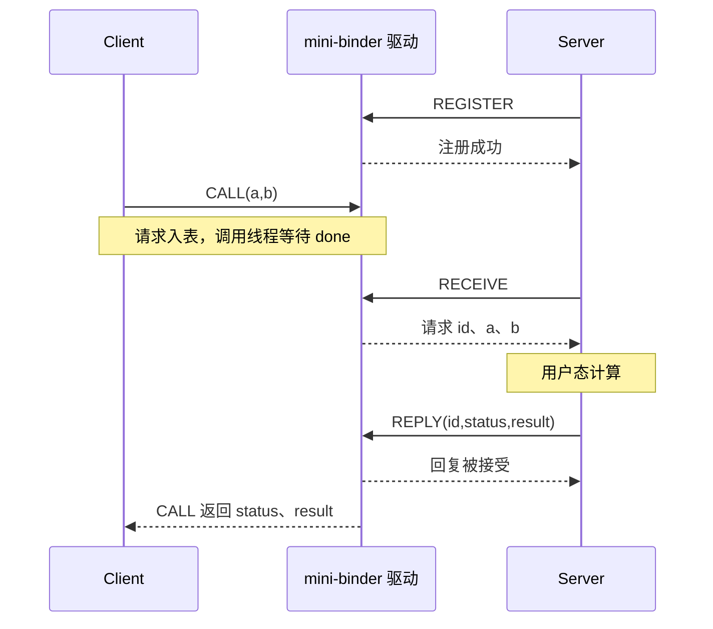
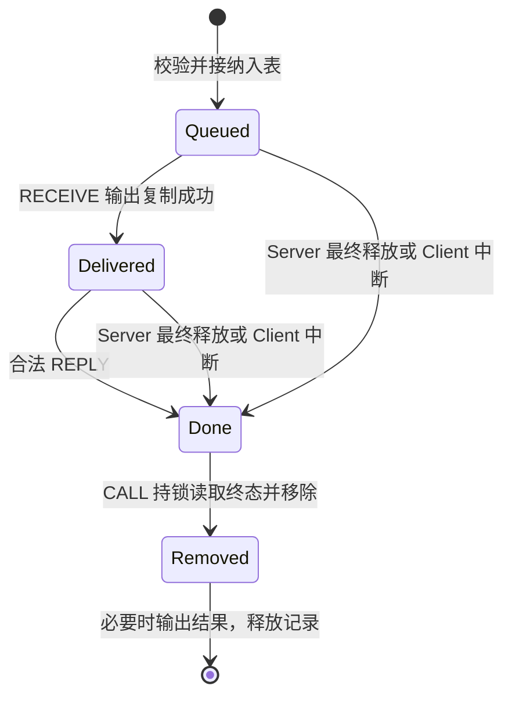

# 第 03 章｜实现第一个同步 RPC

第 02 章的查询由驱动直接回答。现在改成两个独立程序：Server 注册后等待请求，在用户态计算；Client 把参数交给驱动，阻塞等待自己的结果。新增问题不是“怎样算加法”，而是请求放在哪里、谁领取、回复交给谁、失败后谁回收。

源码入口是 [driver/mini_binder.c](../../driver/mini_binder.c)、[教学 UAPI](../../include/uapi/mini_binder.h)、[add_server.c](../../userspace/add_server.c) 和 [add_client.c](../../userspace/add_client.c)，设计记录见[最小 RPC 决策](../design/minimal-rpc.md)。这是继续演进的开发版，具体测试版本与日志见[阶段报告](../reports/m0-m1-progress.md)，不把工作区最新代码称为已经发布的章节标签。

## 1. 查询接口为什么还不够？

设两名 Client 都调用 add：A 要算 1 + 2，B 要算 19 + 23。如果驱动里只有一份“当前参数”，第二次写入可能覆盖第一次；如果只有一份“最新结果”，两个等待者又可能取到错误的回复。让 Client 轮流调用虽可避开问题，却不能满足本章多客户端同时提出请求的需求。

仍然有几种合理方案：

| 方案 | 可以正确工作所需的规则 | 本章取舍 |
| --- | --- | --- |
| 单槽加拒绝 | 槽满就明确拒绝，调用方决定是否重试 | 很简单，但不能同时保留多笔已接受请求。 |
| 单槽加等待 | 等空槽、处理信号、退出和唤醒 | 仍需状态与所有权；只有一笔保留容量。 |
| 有界队列 | 每笔记录有归属和状态，容量耗尽时明确失败 | 本章选择，允许同时保留有限多笔工作；付出内存、关联与清理成本。 |
| 无界队列 | 持续分配以接纳请求 | 接收速度长期超过处理速度时会耗尽资源，本章不采用。 |

队列只解决工作暂存，不能单独解决回复关联。即使先领取 A 再领取 B，B 也可能先完成；不能把下一份结果无条件交给第一个等待者。我们需要每笔记录有唯一关联标识，并检查回复者和状态。

寻址先保持最小范围：同一设备只注册一个 Server，没有服务名、Node、Ref 或 Handle。每个打开上下文只允许一笔尚未从全局表移除的调用；需要并发的 Client 独立 open。后面再用具体需求推导对象网络，不提前放入最终 Binder 结构。

## 2. 先用普通 C 看见覆盖、拒绝和关联

[request_queue.c](../../examples/models/request_queue.c) 把问题缩成固定顺序的普通函数调用；[模型实验](../labs/queue-model.md)提供完整观察和限制。在仓库根目录运行：

```sh
mkdir -p build
cc -std=c11 -O2 -Wall -Wextra -Werror -pedantic examples/models/request_queue.c -o build/request_queue
./build/request_queue overwrite
./build/request_queue refuse
./build/request_queue fifo
python3 -m unittest discover -s tests -p test_queue_model.py -v
```

`overwrite` 明确记录请求 101 丢失，只有 Client 2 获得 42。`refuse` 保留 101、拒绝 102，直到模型显式重试后，双方才得到 3 和 42。拒绝方案本身可以正确，代价在于接受容量和重试协议；不能把它称为天然错误。

`fifo` 容量为 2，按 101、102 领取，拒绝第三笔 103；随后故意先回复 102，再回复 101。输出中的归属仍应正确：

```text
event=delivered request_id=101
event=delivered request_id=102
event=client_result client=2 request_id=102 result=42
event=client_result client=1 request_id=101 result=3
```

未知 ID、未领取就回复、重复回复也分别被拒绝，不生成有效结果。五项自动测试已通过，失败判据包括 FIFO/拒绝重试模式丢失或错配结果、覆盖模式没有明确记录丢失、非法回复产生结果、满队列仍接受请求、未知模式未返回 2。有效模型模式退出 0，是正确展示了现象，不表示覆盖方案没有丢请求。

模型中的记录由 main 的数组一直保留，领取只移除队列指针，不销毁记录；因此已领取请求仍可按 ID 找到。真实驱动必须给这件事指定保活和释放责任。模型没有线程、内核用户指针、信号或退出竞态，也不能证明没有丢失唤醒。模型限制 2 个待领取指针，驱动限制全局表中的 64 笔记录，两种容量不是同一口径。测试用临时目录编译并清理；手动生成的 `build/request_queue` 可单独删除。

## 3. 先补等待与同步，再写内核队列

Server 没请求时可以轮询，但空转会持续消耗 CPU；本章让它睡眠，直到条件可能变化。Client 同样等待自己的记录完成。等待队列是内核组织睡眠/唤醒的机制，不是请求数据队列；数据仍在 `transactions` 链表里。

| 机制 | 本章用途 | 不能省略的前提 |
| --- | --- | --- |
| `mutex` | 保护注册者、链表、状态和计数 | 可以睡眠；不能在等待业务回复时一直持有它，否则 Server 无法推进请求。 |
| `wait_event_interruptible` | 等待条件成立，允许信号打断 | 必须围绕条件使用，处理返回值；一次唤醒不保证当前线程一定拿到工作。 |
| `wake_up_all` | 通知等待者重新检查 | 先提交相关状态，再通知；唤醒本身不携带业务结果。 |
| `READ_ONCE` / `WRITE_ONCE` | 表达无锁条件检查中的单次字段访问 | 不替代锁，也不自动保护整份对象；真正处理状态和结果时仍重新取得 mutex。 |

Client 入队后释放锁、唤醒 Server，再等待 `done`。如果 Server 已在 Client 进入等待前回复，等待宏先检查到条件成立，不会因为“错过一次 wakeup”永远睡下去。

Server 在锁内扫描队列；没有可领取工作就释放锁，等待 `queued != 0` 或注册关系变化，然后重新扫描。即使提交恰好发生在释放锁与进入等待之间，条件检查也能发现它。多个服务线程被同时唤醒时，仍要在锁内决定谁取得请求，不能凭唤醒次数分配工作。

这些规则解释为什么“检查为空→随意睡眠→等别人唤醒”不够。当前代码没有用户态线程池或嵌套路由；“有等待队列”也不等于实现了第 10 章线程模型。

## 4. 把需求写成最小接口

第 02 章的 QUERY 保留，`features` 增加 `MB_FEATURE_RPC`。标志表明接口的设计能力，实际行为仍要靠对应测试验证。

| ioctl | 主要输入/输出 | 语义 |
| --- | --- | --- |
| `MB_IOC_REGISTER` | 无参数结构 | 把当前打开上下文注册为唯一 Server。 |
| `MB_IOC_CALL` | `mb_call`：a、b；返回 result、status | 接受请求后等待回复或通信失败。 |
| `MB_IOC_RECEIVE` | 输出 `mb_request`：id、a、b | Server 领取下一笔尚未交付的请求；无工作时阻塞。 |
| `MB_IOC_REPLY` | `mb_reply`：id、result、status | Server 回复已领取且仍有效的记录。 |
| `MB_IOC_STATS` | 输出 queued、delivered、live_requests、server_registered | 受控实验观察状态，不是服务发现或完整诊断协议。 |

请求、回复与调用结构在本环境分别为 16 字节，统计结构为 32 字节，字段使用定宽类型。完整定义以 UAPI 为准，命令仍核对方向和大小编码，不支持的命令返回 ENOTTY。

ioctl 的返回值与业务状态必须分开：没有 Server、信号中断、复制失败属于通信/系统错误；Server 正常处理到溢出后，CALL 可以成功返回 0，同时 `call.status == -EOVERFLOW`。驱动转发业务状态，不自己计算加法，也不替服务解释全部 status 值。独立 Client 在业务失败时退出 2，设备/通信失败退出 3，成功时输出 `result=...`。

| 场景 | 本版约定 |
| --- | --- |
| 无注册者 | CALL 返回 ENOTCONN。 |
| 已有 Server，或同上下文已有调用却尝试注册 | REGISTER 返回 EBUSY。 |
| 注册的同一上下文调用自己 | CALL 返回 EDEADLK。 |
| 同上下文已有一笔登记中的调用 | 第二笔 CALL 返回 EBUSY。 |
| 全局表已有 64 笔记录 | 新 CALL 返回 EAGAIN，不自动等待空位。 |
| 请求编号将耗尽 | 返回 EOVERFLOW，不默默回绕重用旧编号。 |
| 非 Server 领取/回复 | EPERM；具体输入复制与资格检查次序仍以实现为准。 |
| 未知、未交付、已完成或已移除的回复 ID | ENOENT。 |

参数拷贝发生在部分状态检查之前，例如 CALL 的坏输入指针可先得到 EFAULT，而不是无 Server 的 ENOTCONN。错误码是协议的一部分，不能只按表格里的场景标签猜执行顺序。



图示只表达协议关系，Server 的 REPLY 返回与 Client 被调度继续的先后次序不固定；驱动不是替三个参与者执行的一条串行主线程。

## 5. 状态与所有权：完成为什么还没有释放？

Client 的 CALL 线程分配 `mb_transaction`，其中保存请求、调用结果、等待队列与状态。Server 只在 mutex 保护下查找记录，返回用户态的是复制后的 id/a/b，不得在锁外保存没有保活保证的内核裸指针。最终移除和释放始终由 CALL 线程负责。



实现用 `delivered`、`done` 和 `error` 表达这些关系，不要求每个状态都有独立枚举值：

| 事件 | 状态及计数变化 | 谁最终回收 |
| --- | --- | --- |
| CALL 接纳 | 入链表，queued 与 live_requests 加一，context.busy 置位 | CALL 持有记录。 |
| RECEIVE 成功复制 | queued 减一，delivered 加一，记录仍在表中 | 不释放；等待回复。 |
| REPLY、服务退出或中断终结 | queued 或 delivered 减一，done 置位，通知 Client | 仍不释放；Client 可能尚未被调度。 |
| CALL 取得终态 | 移除记录，live_requests 减一，busy 清除 | 解锁后复制结果并 `kfree`。 |

所以 `queued=0, delivered=0` 不必然表示 `live_requests=0`：可能还有已完成但 Client 尚未移除的记录。测试在等待者退出或回收之后，再检查归零，而不是把一次唤醒当作资源已消失。

64 的限制实际约束 `live_requests`：已入表且尚未移除的记录，包含 done 等待清理的记录。它不包含入表前的临时分配，也不包含移除后仍在输出复制中的内存，更不限制打开上下文总数，因此不是对整个驱动内存的严格上界。同理，busy 在移除时清除，不意味着从 ioctl 入口到用户态返回的所有步骤全程互斥。

同一把 mutex 内检查 done 并提交终态，使合法回复与退出/信号不会分别终结同一记录。`mb_finish()` 本身依赖调用点遵守“尚未 done”的前提；不能把这个辅助函数当成允许任意重复调用的幂等接口。

## 6. 一把全局锁：为什么简单，又贵在哪里？

早期用一把 `mb_lock`，可以在一处推演 Server 注册、请求查找、计数与终结的关系。与多锁、额外引用和阶段提交相比，它减少了初版同步组合；代价是不同 Client 和 Server 的短操作会串行，链表查找也是线性扫描。本章没有用吞吐数据宣称这种选择性能更高。

最值得审查的是用户复制的三个位置：

| 位置 | 设计与理由 | 接受的代价 |
| --- | --- | --- |
| CALL 输入 | 入表前 `copy_from_user`；失败直接释放临时记录 | 不接纳无效请求，但分配发生在容量检查之前。 |
| RECEIVE 输出 | mutex 内复制；成功后才置 delivered | EFAULT 后原请求仍可重领；但用户页故障可能睡眠并长期占住全局锁。 |
| CALL 最终输出 | 已取终态、移除记录并解锁后复制 | 不持全局锁等待用户写入；EFAULT 时服务端可能早已执行，不能安全假定重试无副作用。 |

RECEIVE 的选择是一个明确取舍：若先标为已交付再解锁复制，失败后必须定义如何回滚，期间还要防止 Client 退出释放记录；若先复制后提交，又要解决复制时并发领取同一请求。当前选择持 mutex 保住记录与领取资格，使错误路径短且可测试。

mutex 允许睡眠，所以此处没有把可能故障的用户复制放进自旋锁。但“允许睡眠”不等于没有可用性风险：一个故意延迟的用户页故障能拖住全局操作，`mutex_lock()` 本身也不是本版的可中断等待点。因此本章不保证面对恶意阻塞的进度或固定中断时延。后续改锁粒度前，先要明确保活与状态提交责任，不能只把复制搬到锁外。

## 7. 中断、重启与取消不是一件事

Client 等待时，Server 可能已领取并开始业务。信号使等待结束，不会自动倒转远端业务。当前规则在 mutex 下裁决：若 done 已提交，返回已完成结果或错误；否则中断者终结并移除记录。Server 后来按旧 ID 回复得到 ENOENT。

这个规则保证记录有确定终结者，不保证取消远端副作用，也不保证业务恰好执行一次。最终输出 EFAULT 同样可能发生在服务端执行之后。独立 Client 因此没有“遇到 EINTR/EFAULT 就重新 CALL”的循环；加法无副作用，换成扣款就不能这样重试。

### 一个真实回归：SA_RESTART 默默创建第二笔请求

`wait_event_interruptible()` 遇信号可能返回内核内部的 `-ERESTARTSYS`。如果 CALL 原样向系统调用层返回，而用户安装了带 `SA_RESTART` 的处理函数，系统调用可能在处理信号后重新执行；重新进入 CALL 会分配新的记录与 ID。这不是继续等待原请求，而是提交第二笔业务。

本版在尚未完成的中断路径明确转换：

```c
if (error == -ERESTARTSYS)
    error = -EINTR;
```

受控回归实验曾移除这项转换。测试先确认 Client 请求已领取，再发送 SIGUSR1，且 Client 安装了 SA_RESTART：预期用户态收到 EINTR，实际观察到 5 秒报告等待断言失败，VM 输出 `MINI_LAB_FAIL: synchronous RPC assertions`。对照重启规则与 CALL 入表路径，能解释重新提交后为何没有报告；日志本身没有逐笔打印两个 ID，更没有演示真实业务副作用重复。恢复转换后，同一测试得到 EINTR，旧 ID 的迟到回复被拒绝，记录归零，整套验收通过。

红版日志中的 `rpc_test ... errno=9` 只是断言现场保留的 errno；超时返回并不保证重写 errno，不能把它误读成根因是 EBADF。根因来自控制代码差异、已领取同步点、SA_RESTART 配置和等待行为的共同证据。

当次 KVM 原始记录为 `/tmp/mini-binder-restart-red.log` 和 `/tmp/mini-binder-restart-green.log`，长期归档与版本/差异说明见[阶段报告](../reports/m0-m1-progress.md)。当前回归已经包含在 `/rpc_test`，不是另一个未实现的计划。

要重放红/绿，应在独立工作树中只撤掉这项转换，分别重建 rootfs 并运行相同入口保存日志，再恢复转换重跑；不要修改正在工作的驱动后忘记恢复。每次构建后可使用以下 KVM 命令，红版应由运行器拒绝，恢复后才应通过：

```sh
bash tools/qemu/build-rootfs.sh
ACCEL=kvm bash tools/qemu/run.sh > artifacts/restart-check.log 2>&1
echo $?
```

每次先归档日志再进行下一轮，预期失败命令不要放进直接遇错退出的串联流程。TCG 上重放需要单独记录新证据。本例 RECEIVE 在尚未领取工作时重启等待，不会像 CALL 那样重新提交业务；不能把 CALL 的修复笼统改写成“任何 ioctl 都禁止重启”。

## 8. Server 的结束跟随文件，不是 PID 死亡瞬间

注册者保存在打开上下文中。Server 的最终文件引用释放时，`mb_release()` 清掉注册关系，把尚未 done 的排队或已交付请求终结为 EPIPE，唤醒等待者；已回复的记录不会再次完成。这是 last-close 驱动的失败传播，不是完整死亡通知。

前章的两个边界现在直接影响进度：fork 子进程即使无权操作继承 fd，也可能因保留引用而延迟最终 release；正在执行的 ioctl 本身也持有文件引用。另一个线程关闭最后一个用户 fd，不一定当场销毁上下文，更不能靠它取消仍阻塞在 RECEIVE 的线程。实验及时关闭继承端点，并通过可控中断或终止线程完成清理，没有独立进程死亡钩子。

EDEADLK 也只是窄检查：注册 Server 的**同一打开上下文**不能 CALL 自己。同一进程再独立 open 得到另一个上下文，仍能发 CALL；如果该进程只有一条执行线程，它被 CALL 阻塞后无人 RECEIVE，仍可能死锁。本章既不追踪调用链，也不把“同进程”视为一切调用的统一路由单元。

## 9. 在 VM 内运行真实请求与负例

按 [P04](p04-environment.md)准备内核后，在仓库根目录执行：

```sh
bash tools/qemu/build-rootfs.sh
ACCEL=tcg bash tools/qemu/run.sh
ACCEL=kvm bash tools/qemu/run.sh
```

构建入口会编译驱动、[rpc_test.c](../../tests/kernel/rpc_test.c)和两个独立程序。它们在客户机运行；不要在宿主假设已经有 `/dev/mini_binder`。每种模式有独立日志与宿主截止时间，外层失败不能被某一行子测试 PASS 覆盖。

### 内核接口验收怎样控制顺序？

测试用管道握手控制“Server 注册完成”“请求已领取”“允许回复”；用 STATS 等待指定 queued/delivered/live_requests 关系，使用单调时钟和截止检查，轮询时 `sched_yield()`。这仍有测试轮询成本，但没有靠任意 sleep 猜业务执行位置；Client 报告用 poll 设置 5 秒上限，整套程序另有 alarm 截止。

| 实验 | 核心观察与失败判据 |
| --- | --- |
| 8 个 Client 并发 | 全部入队后再允许 Server 处理，各自得到 i+100；错配、缺失结果或计数不归零均失败。反序回复另由普通 C 模型验证，不假装串行 add_server 已并行执行业务。 |
| 同上下文并发 | 工作线程在 observer 上等待 CALL 时，另一线程同上下文再 CALL 得 EBUSY；完成并 join 后恢复。 |
| 64 笔容量 | 保留 64 笔排队记录，第 65 笔 EAGAIN；再给原 Client 发信号，要求 EINTR 并全部归零。 |
| 入口和资格 | 无 Server 为 ENOTCONN；重复注册 EBUSY；非 Server RECEIVE/REPLY 为 EPERM；同上下文自调用 EDEADLK。 |
| 回复校验 | 未知 ID、重复回复及中断后的迟到回复为 ENOENT，不生成第二份结果。 |
| 用户复制失败 | CALL 输入坏指针为 EFAULT；RECEIVE 输出坏指针后仍可用正常缓冲领取；CALL 输入可读但输出不可写时，业务后返回 EFAULT且记录归零。 |
| 业务溢出 | UINT32_MAX+1 经领取与回复后，CALL 成功且业务 status=-EOVERFLOW，不伪装成传输失败。 |
| Client 退出/中断 | 排队与已领取两种状态下发 SIGUSR1；另有排队 Client SIGKILL，均检查回收。SA_RESTART 单独验证不自动重发。 |
| Server 退出 | 用命令控制 Server 在未领取/已领取时关闭并退出，Client 得 EPIPE；不是穷尽所有突发崩溃方式。 |
| fork 所有权 | 保留前章 device_test 的继承查询 EPERM、子进程独立打开成功，以及别名的最终释放检查。 |

EFAULT 的最后一种实验很关键：用户页先允许写入 a/b，再改成只读，输入复制仍能成功，结果输出却不能写回。它证明“业务已执行但调用失败”不是空想，自动重试缺乏依据。测试把记录归零与返回错误分别检查。

### 独立 Server 与 Client 的使用边界

客户机 init 还自动运行 `/add_server 3`，等待日志中完整的 READY 行后才发起 Client。READY 在注册成功后输出并 flush，不是靠固定启动延迟。随后运行两笔成功调用和一笔溢出：1+2 得 3，19+23 得 42，UINT32_MAX+1 为业务错误、退出 2。Server 已回复三笔后关闭退出，再调用一次应为通信错误、退出 3。

这些是 init 自动执行的 VM 内命令；完整顺序与清理见 [tools/qemu/init](../../tools/qemu/init)，不是要求在宿主运行 `/add_server`。COUNT 取 1 到 1000000，表示成功提交回复的次数；若配置过大而请求不足，Server 会继续等待，不会自动完成实验。

两个程序在 SIGINT/SIGTERM 下只用 `_exit()` 退出，结束码为 128 加信号编号，设备引用由进程退出收回。Server 对已取消请求回复得到 ENOENT 时会报告通信失败并退出；这是有限演示的策略，不是长期服务的容错实现。用户态参数错误、业务错误和 ioctl 错误不能混为一类。

## 10. 本轮证据与未覆盖部分

本机 TCG/KVM 两种模式均观察到以下摘要，并由外层运行器通过：

```text
RPC_TEST_PASS concurrent=8 capacity=64 errors=validated requests=0
RPC_DEMO_PASS result=3 result=42 business_error=2 transport_error=3
mini_binder: device removed live_contexts=0 requests=0
MINI_LAB_PASS
```

独立程序当次原始记录为 `/tmp/mini-binder-demo-tcg.log`、`/tmp/mini-binder-demo-kvm.log`，长期归档、构建输入与产物校验以[阶段报告](../reports/m0-m1-progress.md)为准。同名工作日志可能被后续重跑覆盖，不把临时文件路径当作永远有效的发布物。

通过条件是这些断言与最终状态同时成立；请求、上下文应回到零，没有内核 BUG/WARNING/Oops/panic，宿主未超时且 QEMU 正常退出。正常清理先回收 Client/Server、关闭设备并卸载模块，再关闭客户机；失败的客户机销毁后重新启动，不沿用半失败状态。模块自己的计数归零不证明内核中不存在其他泄漏。

尚未覆盖真实分配失败、请求 ID 耗尽、用户故障页无限延迟、全部回复/退出交错、完整进程死亡语义、调用链死锁、长期压力和调试内核验收；没有业务取消、通用 RPC 截止或恰好执行一次保证，也没有初学者独立重放和正式 M1 发布验收。普通 C 模型、VM 功能证据和生产可靠性是不同结论。

## 11. 回到 Android Binder：关联问题相同，协议不是同一个

以下核查绑定上游 Linux **v6.6**。mini-binder 采用阻塞 CALL 把“提交并等待结果”包装在一个教学 ioctl 中；真实 Binder 的 BINDER_WRITE_READ 承载命令缓冲和返回事件，用户态库还要组织同步调用。不能把一次 ioctl 返回直接等同于 BR_REPLY。

| 教学机制 | Linux v6.6 源码入口 | 对应问题与语义差异 |
| --- | --- | --- |
| 提交与回复入口 | [BC_TRANSACTION / BC_REPLY，4014 行](https://github.com/torvalds/linux/blob/v6.6/drivers/android/binder.c#L4014) | 都要区别请求和回复；真实命令还带目标、对象和缓冲信息，不兼容本章结构。 |
| 请求关联与回复资格 | [binder_transaction 回复分支，2946 行](https://github.com/torvalds/linux/blob/v6.6/drivers/android/binder.c#L2946) | 真实同步回复依据线程事务栈及调用关系校验，不是照抄一个全局 ID 查找表；本章 ID 也不是完整 binder_transaction 身份模型。 |
| 无工作时等待 | [binder_wait_for_work，4290 行](https://github.com/torvalds/linux/blob/v6.6/drivers/android/binder.c#L4290)、[binder_thread_read，4374 行](https://github.com/torvalds/linux/blob/v6.6/drivers/android/binder.c#L4374) | 都围绕条件和工作交付等待；真实实现区分线程/进程待办、looper 与嵌套关系。 |
| 交付请求与回复 | [BR_TRANSACTION / BR_REPLY，4650 行](https://github.com/torvalds/linux/blob/v6.6/drivers/android/binder.c#L4650) | 用户态领取后执行业务；真实线程路由、对象寻址不是本章固定 Server 的等价物。 |
| 完成事件与业务结果 | [BR_TRANSACTION_COMPLETE，4486 行](https://github.com/torvalds/linux/blob/v6.6/drivers/android/binder.c#L4486) | 完成通知不等于业务回复；本章没有独立实现同名协议事件，done 只是内部终态。 |
| ioctl 层读写进度 | [binder_ioctl_write_read，5049 行](https://github.com/torvalds/linux/blob/v6.6/drivers/android/binder.c#L5049) | 真实实现分别维护 write/read consumed 等协议进度，不能直接套用教学 CALL 的 EINTR 转换规则。 |

本章没有实跑 Android Binder 用户态，也没有固定 libbinder 的 AOSP 版本；不会由 SA_RESTART 实验推导真实 Binder 相同或相反的重试行为。驱动交付、用户态方法分发和服务业务是不同责任。后面新增 mmap、Transaction、Node/Ref、线程和生命周期时，都要重新核查哪些教学简化还能成立。

## 12. 练习与下一步

1. 已回复的请求为什么可能仍占 64 个名额中的一个？done 只确定终态，Client 尚未从表中移除；容量检查因此会受调用者调度影响。
2. 能否把 RECEIVE 的 `copy_to_user()` 原样移到自旋锁内来提高速度？不能。用户访问可能睡眠；换锁还必须重新设计保活、领取提交与失败回滚。
3. 用户态装了 SA_RESTART，为什么驱动仍可能要返回 EINTR？CALL 重启意味着新业务提交，不只是继续原等待；需要按协议副作用决定可否重启。
4. Server 使用同进程另一个 open 发起调用，EDEADLK 一定保护它吗？不会。当前只认同一个上下文，不理解调用链或是否还有线程能领取请求。
5. Client 得到 EFAULT，能否断言 Server 未计算？不能。若失败在最终输出，业务已经发生；必须区分入队前、领取时和结果返回时的失败。

现在我们已有经过边界验收的最小同步 RPC，但请求与结果仍经普通用户复制路径传输。下一章追问接收数据是否需要再次复制：先画清复制点，再比较映射换来的生命周期与权限责任，而不是凭耗时变化宣布“零复制”。
