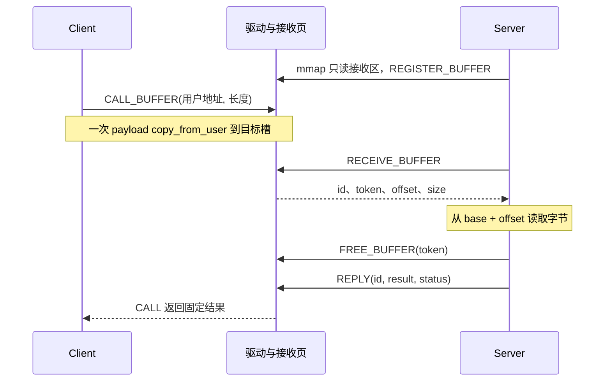
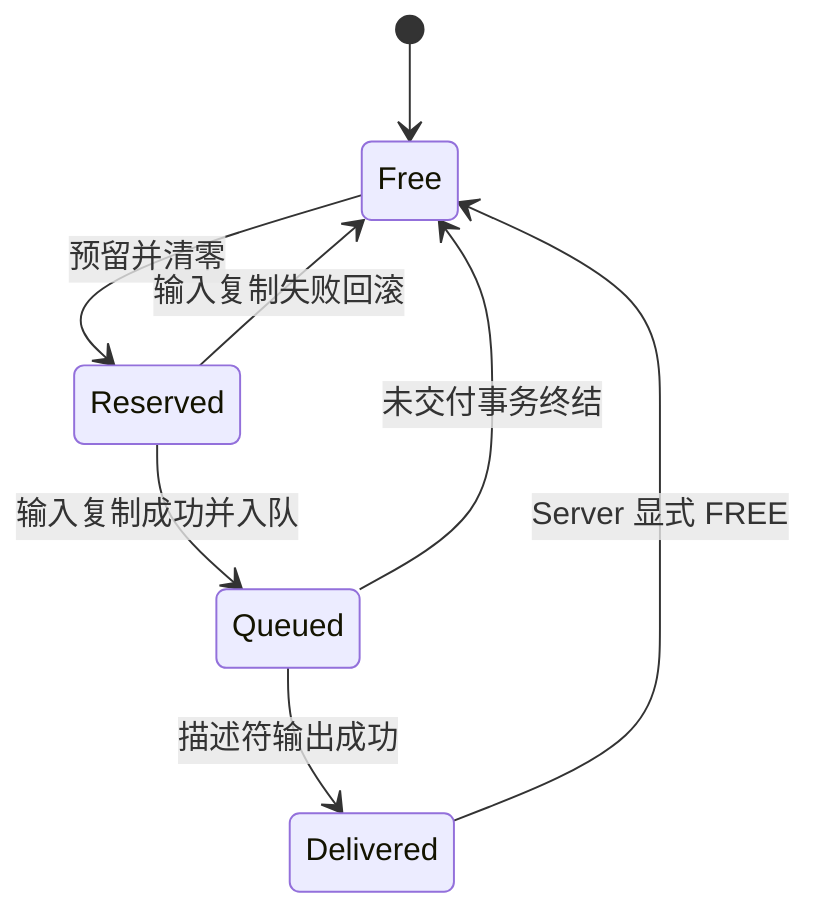

# 第 04 章｜把请求放进只读接收区

第 03 章的同步 RPC 快照是 `cfd7f42`：Client 提交两个整数，驱动排队，Server 领取、计算、回复，Client 等待自己的结果。它已经处理关联、中断和退出。本章保留这条路径，增加最长 4096 字节的请求，让 Server 从映射接收区读取业务字节。回复仍是固定的 `result/status`。

本章对应当前 C04 开发实现，尚不冒充一个已发布的 Git 标签。源码见 [mini_binder.c](../../driver/mini_binder.c)、[UAPI](../../include/uapi/mini_binder.h) 和 [mapping_test.c](../../tests/kernel/mapping_test.c)；决策见[只读接收区设计](../design/receive-region.md)，构建输入、最终测试版本及日志见[阶段报告](../reports/m2-mapping-progress.md)。真实 Binder 的对照固定为上游 Linux **v6.6**，不是随本机内核浮动。

## 1. 先数复制，再决定是否需要映射

设 Server 改成校验一段字节并返回校验和。沿用上一章的方法，CALL 把 payload 从 Client 复制到内核事务，RECEIVE 再把它复制到 Server 的用户缓冲。Server 还需要先提供足够大的缓冲，协议需要规定容量不足时是否保留请求。这个方案可以正确实现；固定两个整数时，它甚至非常合适。

新增约束是：驱动接纳一次请求后，在 Server 明确读完前保留其字节；Server 能直接查看接收区；多个 Client 不能覆盖尚未释放的请求；接收者不能通过这份映射改写内核保存的数据。这里要检验的是复制路径和所有权，尚未提出一个必须胜过 Socket 的吞吐指标。

| 合理方案 | 能满足什么 | 新约束下还要付出什么 |
| --- | --- | --- |
| 继续复制接收 | 接收者有自己的可写副本，读完后的内存归属直接 | 两次 payload 复制；增加接收容量、长度不足及重领规则。本章保留旧 RPC 作为对照。 |
| Client、Server 共用可写内存 | 双方可以从同一后备对象查看内容 | 发送者在校验后仍可能改写；需解决发布顺序、隔离、并发和复用。共享区不自动构成安全的消息协议。 |
| 驱动写入、Server 只读的接收区 | 驱动将 payload 直接复制到接收区，Server 领取描述符后读取 | 增加映射权限、槽分配、显式归还和 VMA 生命周期。本章选择它。 |

这项选择没有消除所有复制。`CALL_BUFFER` 的输入结构、`RECEIVE_BUFFER` 的描述符和固定回复仍经用户复制；payload 仍从 Client 复制一次。只读接收也不阻止应用自行再复制。不要把它叫作零复制，更不能仅凭复制点减少就声称性能提高：建映射、分配、清零、锁和缓存访问都可能影响实际成本。

## 2. 用普通 C 先拆开地址、权限和生命周期

[mapping.c](../../examples/memory/mapping.c) 不需要 root 或设备。它用 `memfd_create()` 创建匿名内存文件，用 `ftruncate()` 设为一页，父进程建立 RW 映射，子进程建立同一文件偏移的 RO 映射。完整操作解释见[映射模型实验](../labs/mapping-model.md)。在支持这些接口的 Linux 仓库根目录运行：

```sh
mkdir -p build
cc -std=c11 -O2 -Wall -Wextra -Werror -pedantic examples/memory/mapping.c -o build/mapping
./build/mapping
./build/mapping --abort-after-map
python3 -m unittest discover -s tests -p test_mapping.py -v
```

正常模式退出 0；主动中止预期退出 1；未知选项退出 2，并在建立资源前打印 usage。主动中止不要放入遇到非零就停止的命令链。五项自动测试自己在临时目录编译，编译限时 30 秒，每次运行限时 8 秒，不依赖手动生成的文件。

实验按三个假设观察，地址值不写死：

| 问题 | 观察及失败判据 | 可以推出什么 |
| --- | --- | --- |
| 不同进程能否查看同一后备数据？ | 两轮 `published → read_ack` 分别确认首尾为 7/70、42/420；任一不匹配即失败 | 同一后备文件偏移的共享和同步关系有效；不能靠虚拟地址相同或不同判断物理页身份。 |
| 关闭 fd 是否立刻撤销映射？ | `fd_closed parent=1 child=1` 必须先于两轮读写确认 | 映射可继续持有后备对象；不证明每个物理页何时归还空闲列表。 |
| 读权限和边界是否生效？ | RO 写、后侧保护页读都由父进程 waitpid 确认 SIGSEGV，随后确认原数据未被改写 | 这两次受控访问违反了权限；不是任意映射尾后访问都必定故障。 |

父进程先预留三页 `PROT_NONE` 地址范围，只用 `MAP_FIXED` 替换自己预留的中间页，保留两侧保护页。输出 `guards=none` 表示保护页权限为 `PROT_NONE`。不能随意对任意地址使用 MAP_FIXED；也不能以“读过末尾没有崩溃”证明没有越界，因为末尾之后可能恰好是另一个有效 VMA。

子进程解除 fork 继承来的 RW 别名后，才另建 RO 映射。否则它即使有一份 RO 视图，仍可从另一份 RW 视图改写。两条单向管道规定 ready、发布、读取确认和下一轮覆盖的先后；`volatile` 只保留实验访问，不能代替同步。管道本身还复制控制 token 和确认值。

程序内部以单调时钟限定五秒协议等待，关闭 fd、解除映射，并杀死和 waitpid 回收残留子进程；正常清理报告回收两个故障探针，主动中止报告回收一个仍等命令的子进程。`RLIMIT_CORE=0` 与 `PR_SET_DUMPABLE=0` 避免故障探针生成 core。中止若仍打印 `read_ack`、遗漏回收或超时，都不是通过。手工产物可用 `rm -f build/mapping` 清理。

这个模型与 Binder 有三个关键区别：父进程直接修改共享对象，Binder 则由驱动从发送者普通缓冲复制到目标接收页；memfd 当前 RO 视图仍可能通过 mprotect 升权，本例未建立完整安全隔离；模型允许 fork 后另建视图，Binder 接收 VMA 则设置 DONTCOPY。模型没有事务、FREE_BUFFER、内核分配器和驱动并发，也没有读取 PFN，不能证明物理连续、常驻或实际分配页数。

## 3. 写映射代码之前，补齐这几个 VM 概念

一个 C 指针首先是当前进程中的虚拟地址。页表把虚拟页与后备页联系起来，并参与权限检查；同一个后备页可以在内核和用户态有不同地址、不同访问权限。用户态只读不妨碍驱动从自己的内核地址写入。相反，它也不自动给用户态一份永不变化的快照。

VMA 是内核对一段地址范围、访问权限和后备关系的描述，不等于一页，也不等于一条消息。解除中间一页可能把一个 VMA 分成两个；全区长度除以页大小是页数，不能当成 VMA 数。本章测试的 `mapped_vmas` 用来观察映射结构数量，`used_slots` 用来观察协议缓冲数量，它们没有一一对应关系。

| 接口或机制 | 本章所需知识 |
| --- | --- |
| `mmap` | 返回当前进程的映射基址，失败为 MAP_FAILED。映射成功和物理页分配时机取决于后备实现，普通按需映射不能推导成已经预分配所有页。 |
| `vmalloc_user` | 本驱动一次分配并清零 64 KiB 后备存储，内核虚拟地址连续，不保证物理连续；可能睡眠，失败返回 NULL。 |
| `remap_vmalloc_range` | 把 vmalloc 的后备页关联到调用者 VMA，返回 0 或负错误；失败须撤销驱动本次分配，不发布半初始化接收区。 |
| 当前权限与 `VM_MAYWRITE` | 只拒绝本次 PROT_WRITE 还不够；清除 MAYWRITE 才阻止以后 mprotect 加写。本章也拒绝执行并清除 MAYEXEC。 |
| `VM_DONTCOPY` | fork 不复制该 VMA。子进程可能仍继承 fd，但 fd 权限和映射继承是另一条规则。 |
| `munmap` 与 `close` | 前者撤销地址范围，后者撤销一个 fd 引用；文件可仍被 VMA、其他 fd 或活动调用持有，最终 `.release` 不能按一次 close 推定。 |
| 用户复制 | `copy_from_user/copy_to_user` 返回未复制字节数，可能触发缺页并睡眠。失败可能已复制部分字节，不能当作什么都没发生。 |

本实现明确依赖 4096 字节页：PAGE_SIZE 不等于 MB_MAX_PAYLOAD 时拒绝映射。16 槽各占一页，哪怕请求只有 1 字节也独占 4096 字节。固定大小使范围、容量、回收更容易推演，浪费空间是已接受的代价；它不是 Binder 的真实区间分配算法。

## 4. 接口从“复制请求”变成“领取描述符”

旧 REGISTER/CALL/RECEIVE/REPLY 保留；QUERY 增加 `MB_FEATURE_MMAP`。每个打开上下文最多成功建立一次接收区，只有打开者线程组可 mmap/ioctl。入口只接受 offset 0、恰好 65536 字节、MAP_SHARED、PROT_READ，不接受当前写/执行权限；设置 DONTEXPAND、DONTDUMP、DONTCOPY，清除 MAYWRITE、MAYEXEC。

| 接口 | 本章语义 |
| --- | --- |
| `MB_IOC_REGISTER_BUFFER` | 必须已有活跃接收 VMA，无映射为 ENXIO；已有唯一 Server 或本上下文 busy 为 EBUSY。 |
| `MB_IOC_CALL_BUFFER` | 输入 `u64 data/u32 size/u32 reserved`，size 为 1–4096，reserved 为 0；输出固定 u32 result/s32 status。data 是 Client 用户地址，不是 Server 地址。 |
| `MB_IOC_RECEIVE_BUFFER` | 返回 `id/token/offset/size/reserved`，Server 从自己的 `base + offset` 读取；不再输出 payload 副本。 |
| `MB_IOC_FREE_BUFFER` | 输入 u64 token，只归还本上下文已交付槽。未知、重复、错上下文或零 token 为 ENOENT；已知但尚未交付的槽为 EBUSY。 |
| `MB_IOC_BUFFER_STATS` | 输出本上下文槽数、VMA 数、成功 payload 复制次数/字节数，以及全局 live_regions/live_slots。 |

旧调用与映射 Server、映射调用与旧 Server 互不兼容，直接返回 EPROTOTYPE。不能让一种请求进入另一种接收循环，再把永久等待误作“Server 处理慢”。非 Server 领取仍是 EPERM；无 Server 调用为 ENOTCONN，同一 Server 上下文自调用为 EDEADLK。第 03 章的容量、关联、中断与最终输出 EFAULT 规则仍适用。

两个整数不能说明任意地址可跨进程传递，这里同样如此：`offset` 相对 Server 已建立的接收区，token 只是归还凭据，id 用于回复关联。三者职责不同。token 全局递增且不复用，耗尽返回 EOVERFLOW，不包含内核指针。

接收后至少检查 `size <= MB_MAX_PAYLOAD`、`offset <= MB_MAP_BYTES - size`，再计算 `base + offset`；先做减法界限避免 `offset + size` 溢出。当前驱动还保证 offset 页对齐并保留完整一页，测试同时检查这些不变量。偏移落在全区内，不意味着应用自己 munmap 的那一段又变有效。



图中 FREE 在 REPLY 前只是允许的一种顺序；测试还验证回复后槽依旧占用。FREE 后指针即使仍能读，也已经失去协议使用权，下一笔请求可能复用该页。若业务稍后还要读，应先复制到自己的存储，或延后 FREE。Client 也不应在驱动复制期间并发修改输入；单次 copy_from_user 不保证并发写入下的原子快照。

## 5. 两份所有权，四个不同结束时刻

新增一个缓冲区后，最危险的捷径是“事务结束就释放一切”。Client 信号取消时，Server 可能正在读已领取的数据；立即复用会把另一笔请求的字节放到它正在使用的地址。因此事务记录和接收槽需要分开结束。

| 事件 | 事务记录 | 槽及后备存储 |
| --- | --- | --- |
| 预留槽后 payload 复制失败 | 尚未入全局表，CALL 释放临时事务 | 回滚本次槽，不增加成功复制计数。 |
| payload 完整复制并入队 | CALL 线程保留最终释放责任 | 未交付槽暂由事务持有；Server 不得提前 FREE。 |
| RECEIVE 描述符输出 EFAULT | 继续排队，可重新领取 | 不转交槽，避免出现用户态没拿到 token 的泄漏。 |
| RECEIVE 成功 | delivered，等待回复或取消 | 槽独立交给 Server；事务不再保留接收上下文裸指针。 |
| 排队 Client 取消 | 提交终态，CALL 移除/释放记录 | 驱动回滚未交付槽。 |
| 已交付 Client 取消 | 同样结束事务，迟到回复 ENOENT | Server 可能还在读，必须由它显式 FREE，或等最终 release 清理。 |
| REPLY 成功 | 唤醒 CALL；CALL 最终移除/释放记录 | 不自动 FREE，可在回复前或后归还。 |
| Server 最终文件释放 | 未完成请求 EPIPE，通知 Client 清理记录 | 清理剩余槽，再 vfree 接收区。 |

槽的状态可以单独画成：



最终上下文清理还能回收遗留槽，图中省略这条公共销毁路径。REPLY、Client 取消不会把 Delivered 自动转成 Free。当前 `mb_finish()` 只对 buffered 且尚未 delivered 的事务做 rollback；事务 done 之后，仍由 CALL 移除并 kfree，与上一章一致。

还有两件事与上表不同：VMA 消失和后备区释放。`mb_vma_open/close` 仅调整计数。全部 munmap 后 `mapped_vmas=0`，已有 fd 仍持有 region，已交付 token 仍可 FREE；新的槽预留返回 ENXIO。同一上下文不支持重新 mmap，因为 region 已经建立过；应用应重新 open。若只移除一部分，剩余 VMA 非零并不保证任何返回偏移仍有用户映射，应用不能继续按完整接收区使用它。

反方向也成立：仅 close Server fd，VMA 还在时，最终 release 尚未发生，服务注册可能仍保留，新的 Client 仍能排队；Server 没有可用 fd 去接收，它们就可能等到映射销毁后才得到 EPIPE。这是本章可复现的限制，不能把 close 当作主动取消协议。推荐退出顺序是停止接纳业务、归还不再使用的槽、结束等待、解除映射、关闭 fd，并等待参与者退出。

每次 reserve 先把完整槽清零，再复制短消息，防止复用后的页尾暴露旧消息。FREE 自身只撤销 token，不承诺立即擦除全部旧内容；部分输入复制失败也可能写过槽的一部分。接收映射不是对同一个 Server 隐藏本区其他字节的保密边界，未领取槽的内容更不能当成已提交消息读取。

## 6. 沿着旧代码看本次增量

无需重写一个无关驱动。对照 `git diff cfd7f42 -- driver/mini_binder.c include/uapi/mini_binder.h tests/kernel/mapping_test.c`，按以下五处阅读；完整可编译版本在仓库，片段只展示关键约束。

第一处是 `mb_context.region`：保存 vmalloc 后备地址、16 个槽、VMA 计数和复制统计。每槽只保存 token 与 delivered；0 token 表示空闲。`mb_transaction` 增加 buffered 标记、描述符和只在交付前有效的 receiver 指针，保留原来的等待队列和最终释放责任。

第二处是 `mb_mmap()`。检查调用者和范围后，在 region mutex 下只做一次分配；remap 成功才设置 `vm_private_data`、`vm_ops`，显式统计初始 VMA，并增加 live_regions。分配/映射失败不留下已发布区域。VMA 分裂的回调负责后续增减，不能假定一次 mmap 永远只有一次 close 回调。

第三处是 CALL 新分支：

```c
error = mb_region_reserve(server, &transaction->buffer_request, &target);
if (!error && copy_from_user(target,
     u64_to_user_ptr(transaction->buffer_call.data),
     transaction->buffer_call.size)) {
    mb_region_free(&server->region,
                   transaction->buffer_request.token, true);
    error = -EFAULT;
}
```

target 已直接指向目标接收区，没有先复制进另一块中转 payload 再 memcpy。只有完整输入成功，才增加 payload_copies/payload_bytes 并入队。这里“每次成功 payload 一次”是本驱动这条路径的口径；失败复制可能已搬运字节，计数不是内核所有实际访存或复制 API 的总次数。

第四处是 RECEIVE：仍在全局锁内先输出描述符，成功后才修改事务和槽的 delivered，并清空 transaction.receiver。EFAULT 留在 queued，正常地址可以重新领取。此后事务结束不再解引用 receiver，避免 Server 最终退出后留下悬空指针。

第五处是 `mb_region_free()` 与 `mb_release()`。FREE 在自己的 region 内查 token，未交付普通释放为 EBUSY；rollback 可撤销尚未交付槽。最终 release 先在 mb_lock 下断开 Server 并终结请求，再清理所有遗留槽和 region。先结束依赖，后销毁后备区，顺序不能倒置。

## 7. 为什么不能随手把所有地方都放进一把锁

`mb_lock` 继续保护唯一 Server、事务表、计数与终态。CALL 从预留到 payload 复制到入队/回滚一直持有它，阻止 Server 最终 release 在复制中销毁目标上下文。这里用可睡眠 mutex，不能换成自旋锁。为 CALL 另持 Server 文件引用也不只是免费保活：Server 的最终 release 又是唤醒等待 Client 的断开事件，盲目保留引用可能阻止该事件发生。

region mutex 保护首次建立、槽和本区统计；嵌套顺序为 `mb_lock → region.lock`。region.lock 不跨用户复制持有，mmap/VMA 回调不取 mb_lock。原因来自新增的 mm 映射锁：

```text
RECEIVE: mb_lock → copy_to_user → 缺页时可能需要 mm 映射锁
mmap:    已持 mm 映射锁 → 若再等 mb_lock，就可能构成环
```

若 region.lock 也跨用户复制保留，同样可能与 mmap 持映射锁等待 region.lock 形成环。本章把用户复制放在 region.lock 之外，VMA 回调仅用原子计数，避免这条逆序。VMA 的文件引用和活动 ioctl 的文件引用共同保证回调期间上下文仍存在；不是靠计数本身代替文件保活。

全局 mutex 跨用户复制仍有代价：故意延迟缺页的调用者可阻塞其他 Client，锁获取也不提供有界中断延迟。测试没有证明恶意用户页故障下的进度。计数快照也不是全部资源同时冻结的全局原子状态；需要先用管道与等待者退出建立静止点，再核对归零。后续并发章要解决这些成本，不能仅把 copy 移出锁就宣布正确。

## 8. 在 VM 中验证成功、拒绝和清理

按 [P04 环境](p04-environment.md)准备 Linux v6.6 x86_64 构建树，在仓库根目录运行；不要在宿主加载教学驱动：

```sh
bash tools/qemu/build-rootfs.sh
ACCEL=tcg LOG_TAG=c04-tcg bash tools/qemu/run.sh
ACCEL=kvm LOG_TAG=c04-kvm bash tools/qemu/run.sh
```

KVM 需要本机可访问 `/dev/kvm`；不具备时保留 TCG 结果并明确 KVM 未运行。运行器默认 120 秒宿主截止，退出码必须为 0；日志分别为 `artifacts/qemu-c04-tcg.log` 与 `artifacts/qemu-c04-kvm.log`。只有子测试 PASS、没有全局 MINI_LAB_PASS，或 QEMU 超时、内核 WARNING/BUG/Oops/panic，都应判失败。同名日志会覆盖，比较版本前要另行归档。

[客户机 init](../../tools/qemu/init) 自动执行分配失败注入、device_test、rpc_test、mapping_test 以及原 add 演示。`mapping_test` 在客户机运行，不是宿主的 `/mapping_test`。它用管道命令和报告控制 R 领取、P 回复、D 归还、M 解除映射、C 关闭 fd；用 STATS 确认 queued/delivered，避免靠任意 sleep 猜时序。I/O 等待有 5 秒检查，全程序 alarm 30 秒，外层 VM 截止再限制整次运行。

| 实验问题 | 步骤与预期 | 明确失败判据及解释 |
| --- | --- | --- |
| 权限能否绕过？ | 拒绝错误长度、offset、MAP_PRIVATE、PROT_NONE、写/执行映射；mprotect 加写/执行失败；独立子进程写 RO 地址被 SIGSEGV 终止 | 错误映射成功、升权成功或故障子进程以其他方式结束均失败。通用 rejected_map 检查 MAP_FAILED，未对每个 VFS 前置失败硬写 errno。 |
| fork 能否取走映射/上下文？ | 子进程 mincore 父地址为 ENOMEM、继承 fd ioctl 为 EPERM，子进程抢先 mmap 父 fd 也为 EPERM | 子进程看到有效继承映射或操作成功即失败；mincore 用于探测 VMA，不证明 PFN。 |
| VMA 数是否等于页数？ | 去掉第二页后观察 2 个 VMA，再去掉两段剩余范围后为 0，同上下文再映射失败 | 数量不符或重新映射成功即失败；不把这个例子推广到所有拆分方式。 |
| 数据确实进入接收页吗？ | 请求长度为 1、7、511、4096、3；逐字节验证模式、长度、页对齐 offset 和页尾清零，回复校验和 | 数据/校验和错、offset 越界、页尾残留或复制计数错即失败。RECEIVE 前后 payload_copies 不变，成功输入按请求加一。 |
| 输入失败是否留槽？ | 结构坏地址、空 payload 地址、0/4097 长度、保留位非零；跨可读/PROT_NONE 页输入造成部分复制失败 | 对应 EFAULT/EINVAL；槽和请求仍非零或成功复制计数增长均失败。 |
| RECEIVE 失败能否重领？ | 先把描述符写到坏地址得到 EFAULT，确认 queued 未变，再正常领取 | 请求消失、重复交付或槽丢失即失败。 |
| 容量约束是什么？ | 连续领取并回复 16 笔却不 FREE，此时事务为零而槽满；第 17 笔 EAGAIN，FREE 一个后新请求成功且 token 更新 | 自动因 REPLY 腾槽、超容量接受或 FREE 后不能恢复均失败。 |
| FREE 的上下文和幂等边界？ | observer 用 Server token 得 ENOENT；Server FREE 成功，重复 FREE 得 ENOENT，零 token 也 ENOENT | 错上下文释放成功或重复改变计数即失败。未交付 token 的 EBUSY 分支见源码，当前没有直接构造该 token 的自动断言。 |
| Client 取消是否等于缓冲归还？ | 分别在 queued/delivered 发 SIGUSR1，Client 均 EINTR；queued 槽自动撤销，delivered 槽保留到显式 FREE，迟到回复 ENOENT | 两种情况槽状态相同、记录残留、迟到回复成功均失败。 |
| munmap 是否销毁后备区？ | 已领取后全部 munmap，槽仍在且 VMA 为 0；fd 仍可 FREE、回复；最终 close 后全局 region 清理 | munmap 时提前销毁、FREE/回复失败或最终计数不归零即失败。 |
| close 是否立刻断开服务？ | close 后仍有 VMA，确认服务注册并让 Client 入队，随后终止 Server 清理映射，Client EPIPE | 提前把 close 视为最终 release，或最终退出后不唤醒/不归零均失败。另一探针验证 close 后映射仍可读。 |
| Server 退出如何清理？ | 分别保留 queued 与 delivered 请求后控制 Server 解除映射、关闭并退出 | Client EPIPE，事务、槽、region 最终清理；本例是受控退出，不是穷尽所有崩溃交错。 |

分配失败的独立阶段在干净客户机内等价于以下命令，由 init 自动完成：

```sh
insmod /mini_binder.ko fail_region_alloc=1
/mapping_test --allocation-failure
rmmod mini_binder
insmod /mini_binder.ko
```

参数 `fail_region_alloc` 为加载时固定只读 bool。前两次合法 mmap 应得到 ENOMEM，本区 used_slots/mapped_vmas 和全局 live_regions/live_slots 都为零，并打印 `MAPPING_ALLOCATION_FAILURE_PASS attempts=2 regions=0 slots=0`；之后卸载并以默认参数重载，正常路径应恢复。不要在宿主照抄这些绝对路径。该实验只验证可控分配失败分支及清理，没有制造真实 OOM，也没有注入 remap 部分失败。

本地最早的 `artifacts/mapping-first.txt` 已记录 TCG 中正常矩阵、旧 RPC 回归、最终零资源和外层通过；它早于专用分配注入阶段，不能用来声称注入实验已经通过。日志不随正文自动发布，最终 TCG/KVM 与注入结果以[阶段报告](../reports/m2-mapping-progress.md)归档为准。正常矩阵的关键摘要是：

```text
MAPPING_STAGE permissions=ok split_vmas=ok dontcopy=ok
MAPPING_STAGE payloads=5 receive_rollback=ok slots=16 free_recovery=ok
MAPPING_STAGE cancellation=queued_auto_free,delivered_explicit_free
MAPPING_STAGE lifetime=munmap_free,server_exit,close_with_vma contexts=1
MAPPING_TEST_PASS slots=16 payload_copies=validated requests=0 contexts=clean
mini_binder: device removed live_contexts=0 requests=0 regions=0 slots=0
MINI_LAB_PASS run_id=...
```

`contexts=1` 是 lifetime 阶段仍保留 observer 的预期，不是最终泄漏；最终卸载才应为 0。受控 RO 写可能在客户机串口打印 userspace segfault，必须结合父进程确认 SIGSEGV 和后续完成标记解释，不能把它与内核 Oops 混淆。

自动清理会结束子进程、回收管道、解除映射并关闭设备；init 在所有程序退出后卸载驱动再关机。失败 VM 应销毁并重新启动，避免沿用半失败状态。计数归零只证明本实现维护的账目，不是内核泄漏检测器。当前没有真实物理页观测、KASAN/长期压力、实际 OOM、全部退出与并发交错、token 耗尽或恶意缺页阻塞验收；同线程组共享文件却使用不同 mm 的非常规 clone 也不在支持范围内。

## 9. 回到 Linux v6.6 的 Binder

下面行号直接核查本地 `build/kernel/linux-6.6/drivers/android/binder.c` 与 `binder_alloc.c`，链接固定为同版本。核查的是对应设计问题，不是宣称教学 UAPI 与 Binder ABI 兼容。

| 教学问题与机制 | Linux v6.6 实际入口 | 相同点及不能等同处 |
| --- | --- | --- |
| 打开者与只读映射：`mb_mmap` | [binder_mmap，5586 行](https://github.com/torvalds/linux/blob/v6.6/drivers/android/binder.c#L5586)，禁止标志定义 [95 行](https://github.com/torvalds/linux/blob/v6.6/drivers/android/binder.c#L95) | 检查打开者线程组，拒绝 VM_WRITE，清除 VM_MAYWRITE 并设置 DONTCOPY。v6.6 此处还设 MIXEDMAP；mini 额外禁止执行，不把两者全部权限规则写成相同。 |
| 建立接收范围：64 KiB vmalloc | [binder_alloc_mmap_handler，736 行](https://github.com/torvalds/linux/blob/v6.6/drivers/android/binder_alloc.c#L736) | 都需要一次初始化及失败回滚；真实实现还核对 vma->vm_mm，范围最多 4 MiB，建立空闲缓冲管理结构与页数组，不是预分配 16 个固定 payload 页。 |
| 按需页与缓冲分配：mini 固定槽 | [binder_alloc_new_buf，562 行](https://github.com/torvalds/linux/blob/v6.6/drivers/android/binder_alloc.c#L562)、[binder_update_page_range，181 行](https://github.com/torvalds/linux/blob/v6.6/drivers/android/binder_alloc.c#L181)，alloc_page/插页 [248 行](https://github.com/torvalds/linux/blob/v6.6/drivers/android/binder_alloc.c#L248) | 都分配目标接收空间；真实 Binder 按大小分配区间、按需要分配并插入页，还有异步空间预算与页回收机制。本章不模拟这些算法。 |
| 普通数据进入目标页：直接 copy_from_user | [binder_transaction 分配目标缓冲，3226 行](https://github.com/torvalds/linux/blob/v6.6/drivers/android/binder.c#L3226)、[binder_alloc_copy_user_to_buffer，1203 行](https://github.com/torvalds/linux/blob/v6.6/drivers/android/binder_alloc.c#L1203) | 发送者普通数据仍需复制进目标页；真实 helper 跨页循环、kmap_local_page 后复制，不意味着真实完整事务恰好只有一次复制函数调用，对象转换还会增加工作。 |
| 用户态领取数据位置：offset 描述符 | [交付 buffer/offsets 指针，4701 行](https://github.com/torvalds/linux/blob/v6.6/drivers/android/binder.c#L4701)、[描述符 copy_to_user，4721 行](https://github.com/torvalds/linux/blob/v6.6/drivers/android/binder.c#L4721) | 业务字节通过接收区读取，控制结构仍复制。真实协议返回本进程 buffer/offsets 地址且区分 BR_TRANSACTION/BR_REPLY，mini 返回相对 offset、只有请求映射。 |
| 显式归还：token 与 FREE_BUFFER | [BC_FREE_BUFFER，3970 行](https://github.com/torvalds/linux/blob/v6.6/drivers/android/binder.c#L3970)、[binder_alloc_prepare_to_free，170 行](https://github.com/torvalds/linux/blob/v6.6/drivers/android/binder_alloc.c#L170)、[allow_user_free 置位，4748 行](https://github.com/torvalds/linux/blob/v6.6/drivers/android/binder.c#L4748) | 交付与可归还是协议状态，不跟业务回复简单绑定；真实按用户缓冲地址查分配树并校验 allow_user_free，mini 按 token 查固定槽，两者错误码与对象清理语义也不同。 |
| VMA 结束与最终回收分离 | [binder_vma_close，5563 行](https://github.com/torvalds/linux/blob/v6.6/drivers/android/binder.c#L5563)、[binder_alloc_vma_close，964 行](https://github.com/torvalds/linux/blob/v6.6/drivers/android/binder_alloc.c#L964)、[binder_alloc_deferred_release，806 行](https://github.com/torvalds/linux/blob/v6.6/drivers/android/binder_alloc.c#L806) | VMA、事务、协议缓冲和最终清理是不同事件。真实 VMA close 清空分配器 VMA，阻止新增入站分配；mini 计数归零后拒绝 reserve、直到最终 release 才 vfree，不等同于 Binder 的延迟回收实现。 |

真实 Binder 的普通请求字节并不是发送者与接收者直接共享一个可写 memfd。驱动写目标接收页，用户态库读取并解释 Parcel。接收地址可读也不等于方法已经执行；Parcel 的普通字段编解码、用户线程与方法分发不是内核代劳。对象/FD 转换又与普通字节有不同职责，不能从本章省一次 payload 输出复制推演全部 Binder 对象语义。

本章没有运行 Android libbinder 事务，也没有固定 AOSP libbinder 版本；表格只为内核 v6.6 的机制对照。不要从 mini 的取消、FREE 或 close 测试推断全部真实 Binder 退出与重试行为。

## 10. 练习与下一章

1. 16 个请求已经回复，为什么下一笔仍可能 EAGAIN？回复完成的是事务，16 个已交付槽仍由 Server 持有；必须显式 FREE。可用容量实验同时观察 `live_requests=0` 与 `used_slots=16`。
2. Client 已收到 EINTR，为什么不能释放 Server 正在读的槽？EINTR 只结束本地等待，无法倒转远端业务或证明远端已读完。queued 可以回滚，delivered 必须独立归还。
3. 清除本次 VM_WRITE 是否足够？不够，必须考虑 MAYWRITE，否则后续 mprotect 可能加写；也要检查是否还有其他可写别名。普通 memfd 模型与驱动的权限保证不同。
4. `mapped_vmas=0` 能否推出 `live_regions=0`？不能，fd 仍可持有上下文；反过来 close fd 也不能推出 VMA 已销毁。用 munmap 与 close 两组实验分别检验。
5. FREE 后旧指针仍读到原字节，能否继续使用？不能，地址可访问与协议拥有权不是一回事；下一笔 reserve 能清零并覆盖。若需要保留，应在 FREE 前复制或延长持有。
6. payload_copies 加一是否证明整条 RPC 只有一次复制，或性能更高？不能，它只统计本驱动完整成功的 payload 输入。元数据、固定结果、失败的部分复制及应用自行复制另有成本，也没有吞吐对照。
7. 把 region.lock 跨 copy_from_user 持有是否更稳妥？会新增与 mm 映射锁的潜在逆序。先明确保活、锁顺序和提交点，不能把“加锁更安全”当作推导。

现在接收区能传递一段有长度、有归属的字节，但还不知道这些字节如何表示“两个整数加一个字符串”，如何处理对齐、越界和版本变化。请求是变长字节，回复却仍是固定结果；直接把 C struct 或用户指针放进 payload 也没有跨进程意义。下一章从这些具体问题推导 Parcel 的编码、读取游标与边界检查，把“字节已经送到”推进到“双方能一致、安全地解释字节”。
