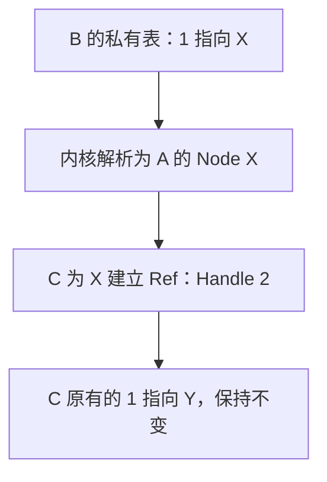
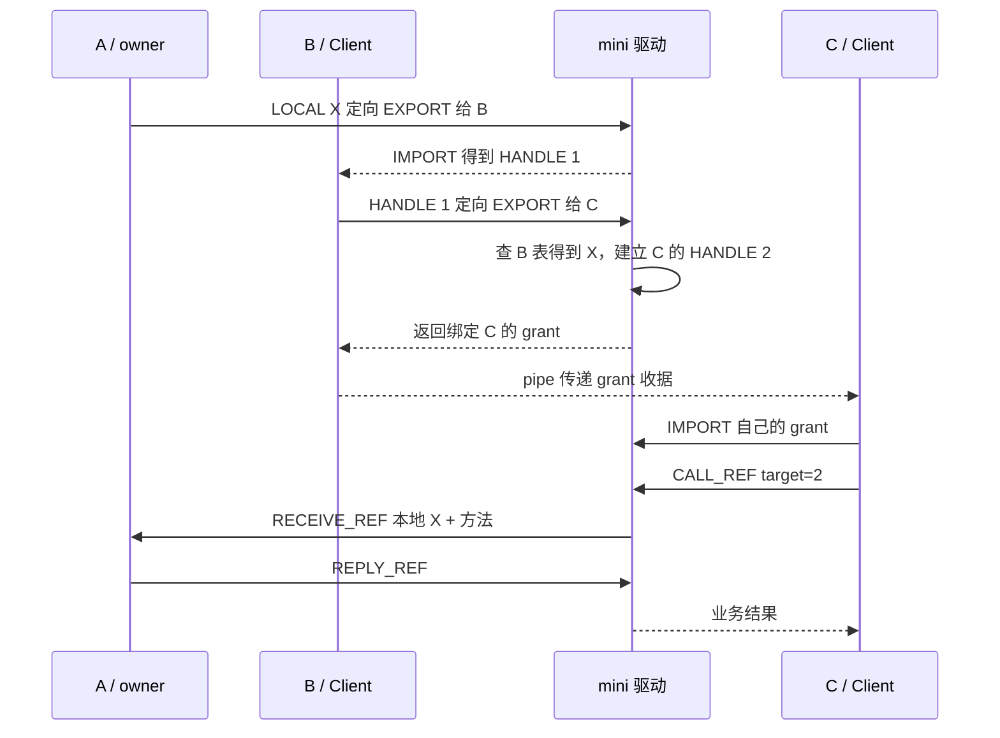

# 第 08 章｜把引用交给另一个进程，而不是复制一个整数

第 07 章用 Node 区分两个 counter 的状态，用事务 ID 区分每一次调用。但 Client 仍直接使用可猜的全局 Node ID。现在增加一个要求：B 只能使用 A 授予的对象，B 可以把已有对象交给 C；C 不能仅靠猜 Node ID 获得对象。

本章从一个会调用错对象的实验出发，推导进程私有 Ref 表、描述符转换和两种引用单位。[规范](../design/references.md)规定精确 ABI、错误优先级和资源归属；[模型实验](../labs/reference-model.md)展示对象图；[实测报告](../reports/m3-references-progress.md)区分已运行证据与限制。沿用 Linux v6.6，AOSP 用户态只做固定版本源码对照。mini 仍是教学协议，不兼容 libbinder。

## 1. 复制 Handle，甚至可能“成功”地调用错对象

让 A 发布 X、Y 两个 counter。初始 X=0、Y=100，各自的方法 1 都是 increment。B 先获得 X，再获得 Y；C 只获得 Y。每个接收者分配自己的最小空闲正编号：

| 打开上下文 | Handle 1 | Handle 2 |
| --- | --- | --- |
| B | X | Y |
| C | Y | 不存在 |

B 通过 pipe 把整数 1 给 C。如果 C 用自己的 `CALL_REF(target=1)` 调用，A 会对 Y 加一，返回 101；没有类型错误，也没有系统调用失败，但业务对象错了。把 B 的整数 2 给 C，则得到 EBADF。

这不是需要为整数加上一个全局前缀的编码问题。若将全局 Node ID 开放给所有人导入，C 又能绕过 B 的授予自行获取 X。私有 Handle 既是本地寻址，也代表内核已经为这个接收者建立的引用关系。整数只有放回所属表中才有含义。

## 2. 先比较方案，再引入 Ref

| 方案 | 能做到什么 | 代价或不足 |
| --- | --- | --- |
| 沿用全局 Node ID | 简单地访问多个对象 | 名字可猜；没有“谁曾向谁授予”的关系。 |
| 为每次分享发秘密 token | 可以构造 bearer capability | 还需秘密生成、泄漏、撤销和重放约定；不是本章选择。 |
| 内核维护每个接收者的 Ref 表 | 本地 Handle 解析到稳定 Node，支持定向转交和回收 | 必须转换描述符，维护计数、失败回滚和死亡对象。 |

本章选择第三种。每个 `(打开上下文, Node)` 最多一条 Ref，包含 Handle、`user_refs` 和 `buffer_refs`。Handle 从 1 开始，可在旧条目完全回收后复用。它不含 generation；一个陈旧整数可能在稍后指向新对象，用户态必须遵守自己的持有期限。

这里的“私有”精确到打开上下文。一个进程两次 open 有两张表；dup 共享同一打开文件对象。继承别的进程打开的 fd 仍受既有 TGID 检查，不允许借此冒用原上下文。不能把这个教学边界直接说成完整的 Android proc/thread 模型。

## 3. 用普通 C 先看见转换

无需设备或 root：

```sh
make build/references
./build/references raw
./build/references transfer
python3 -m unittest discover -s tests -p 'test_ref_model.py' -v
```

`raw` 真正查 B/C 的不同表；`transfer` 先解析 B 的 Handle 得到 X，再为 C 查找或创建 X 的 Ref。C 已有 1→Y，所以得到 2→X。Python 测试从输出的 Node、Ref、slot、hold 行重建引用关系，并核对固定业务结果，而不是只相信模型打印的“总数正确”。模型不执行 ioctl、不模拟内核调度或真实用户复制故障，真实三进程证据由后面的 VM 实验提供。



同一数字可以表示不同 Node；不同数字也可以表示同一 Node。驱动转交的是 X 的关系，不是 B 的编号 1。

## 4. 内核知识补给：查表、持有和接收区

**查表和取得持有必须同步。** 不能在锁外根据 Handle 得到 `mb_ref *`，再进入锁增加计数，因为中间可能已被 RELEASE/FREE 回收。教学实现沿用 `mb_lock`，在同一临界区完成查找、验证、取得持有与发布。

**映射能承载字节，不能自动建立权限。** 第 04 章的只读接收区让驱动写入、用户读取。发送者在普通字节中放一个 Node ID，并不会创建 Ref；只有 offsets 指定的、通过验证和转换的对象才改变引用关系。

**接收数据和长期保留对象是两项责任。** 接收槽保存对象时需要临时保活；应用若要在 FREE 槽后继续使用，必须显式 ACQUIRE。把两者合成一个计数会难以回答“释放这条消息是否也释放了应用主动保存的引用”。

**进程死亡与元数据回收不同。** 远程 Ref 不能阻止 A 退出。A 退出后 Node 的 owner 清空，旧 Ref 仍能被 RELEASE/FREE 清理，但新调用返回 EPIPE。不能立即释放尚被其他表指向的 Node。

## 5. 三种转换，而不是复制描述符

payload 的对象占 24 字节，字段使用小端编码：`type:u32, flags:u32, value:u64, cookie:u64`。LOCAL 表示发送者拥有的 `(node_id, cookie)`，HANDLE 表示发送者私有 Handle；远程 HANDLE 的 cookie 必须为 0。控制头、用户指针和 offsets 表沿用本机 ABI；不要把两层字节序混在一起。

| 输入 | 内核如何证明发送者持有 | 发给普通远程接收者 | 发回对象 owner |
| --- | --- | --- | --- |
| LOCAL | Node 已由发送者发布，cookie 一致 | 查找/创建目的 Ref，写目的 HANDLE | 保持 LOCAL，增加本地对象槽持有 |
| HANDLE | 仅查发送者 Ref 表，Node 未死亡 | 查找/创建目的 Ref，写目的 HANDLE | 还原 LOCAL(id,cookie)，不创建 owner Ref |

没有“先查本表，查不到再试全局 ID”的后门。猜别人的 Handle 只能按自己的表解释；伪造别人的 LOCAL 返回 EPERM。持有 Ref 表示可以尝试访问对象，业务方法仍需要服务自己的权限判断；本章没有完成第 13 章安全策略。

完整 offsets 表先复制到内核。payload 复制到接收者 backing 后，驱动从这个快照验证完整的 24 字节对象、对齐、不重叠、类型和字段，随后才进行语义转换。不能从仍可被发送者修改的用户地址再次读对象，以免验证和实际处理针对不同内容。

## 6. C 不是 Server，B 如何把引用交给它

只实现 CALL 的对象转换还不够。本章仍只有 A 一个 Server，B、C 都是普通 Client。若要求 C 先注册 Server 才能接收 B，就暗中引入了下一章的多 owner 路由。

因此增加明确的教学引导通道：接收者先 mmap、ENABLE_REF，并通过可信 pipe 公布 `QUERY.open_id`。发送者通过 EXPORT_REF 把自己持有的对象定向写入该上下文的 pending 槽，返回 grant 收据；C 对自己的 IMPORT_REF 领取槽描述符。这个地址与收据都不是秘密能力。



IMPORT 只查调用者自己的 pending 槽；别人拿到收据仍返回 ENOENT。成功 EXPORT 后，槽持有引用，B 随后释放甚至退出都不撤回它。未领取的槽占用接收者配额，最终 release 会清理；没有隐藏的自动超时。

**授予发生在发布槽时。** IMPORT 只是交付 token、offset、offsets 等元数据。同一上下文其他线程可以先读到自己的映射，也可能猜中已创建的本地 Handle 并调用。设计不承诺 pending 槽在同一上下文内部保密。EXPORT 的输出失败仍在大锁内回滚，不向其他 ioctl 暴露半转换状态。

这是为单 Server 阶段选择的显式旁路。真实 Binder 把对象转换放在事务数据处理里；不要把 EXPORT/IMPORT 当成 Android 命令。CALL_REF/REPLY_REF 也支持同一对象格式，使本章能同时验证请求和回复中的转换。

## 7. 两种 Ref 单位与五类 Node 持有

| Ref 单位 | 取得 | 归还 | 对应用的意义 |
| --- | --- | --- | --- |
| buffer_refs | 每个成功转换为 HANDLE 的描述符一份 | 对应槽 FREE、回滚或上下文最终 release | 借用消息内对象；重复对象各占一份。 |
| user_refs | ACQUIRE_REF | RELEASE_REF 或最终 release | 跨越 FREE 消息后的主动持有。 |

只要任一计数非零，Ref 就存在并允许查找；两者归零后删除条目。ACQUIRE 可以从槽借用取得用户持有。RELEASE 只能减 user_refs，不能偷减 buffer_refs；`user_refs=0` 返回 EINVAL。计数递增检查溢出，判断活性使用逻辑或，不能用可能回绕的 u32 加法。

Node 在上一章三类持有之外新增：每条 Ref entry 一份 `ref_entries`，以及 owner 收件槽内每个 LOCAL 一份 `local_object_refs`。

```text
Node 总持有 = publication + transaction_refs + target_slot_refs
            + ref_entries + local_object_refs
```

Ref 有 10 份 buffer 单位也只占一份 Node.ref_entries；这份 entry 会活到自身所有单位归零。请求槽的调用目标与嵌入对象是两份独立责任，即使指向同一个 Node 也分别记账。普通 reply 不保留调用目标，但 reply 中的对象可以保留对应 Node。

REMOVE 在其他持有存在时返回 EBUSY，且保持发布状态。Node 计数只保护内核元数据；应用的实际 C 对象仍需自己的互斥和活动持有协议。本章没有实现 Android 的 owner 强弱引用通知。

## 8. 为什么必须逐项记账并反向回滚

假设 B 发 `[X, 不存在的 Handle]` 给 C。第一项创建 C 的 Ref，第二项才发现 EBADF。如果只释放 payload 槽，C 会遗留一条没有消息归属的引用；若简单删除 X 的 Ref，又可能破坏 C 本来已有的 user_refs。

槽因此保存内核账本：每成功转换一项，立即记录实际取得的 Ref 或 LOCAL Node 及一份单位。后项失败，按逆序只撤销这些单位。新 Ref 归零才删；原有 Ref 的旧计数和 Handle 都保留。重复对象也逐项记录，不能去重后只减一次。

FREE 同样使用账本，不能在释放时重新解释 payload、重新查可能已复用的 Handle，或根据用户提供的 offsets 猜资源归属。EXPORT、请求和回复复用同一转换/回收逻辑，以减少三套规则发生分歧的机会。

CALL 一经接受，会独立持有固定的 Node。之后 Client RELEASE/FREE 原 Ref，甚至空闲 Handle 被新对象复用，都不能改变在途事务目标。取消仍沿用前章：QUEUED 的槽尚未交付，可以内部回收；DELIVERED 槽已属于 Server，保留到 FREE。

## 9. 代码从哪些边界增加能力

[UAPI](../../include/uapi/mini_binder.h)新增 feature 32 和命令 23–32，保留旧结构布局。[驱动](../../driver/mini_binder.c)主要增加以下边界：

| 入口/辅助函数 | 责任 |
| --- | --- |
| mb_find_ref / mb_ref_reap | 本地 Handle 查找；两种单位归零后归还 Node entry 持有。 |
| mb_ref_build / mb_ref_convert | 复制接收 backing、全表结构验证、逐项语义转换与前缀回滚。 |
| mb_export_ref / mb_import_ref | 定向授权提交与本 context pending 领取。 |
| mb_call_ref / mb_reply_ref | 固定私有引用目标；携带请求/回复对象表；输出失败回收。 |
| mb_slot_drop_objects | 唯一的逐项账本释放路径。 |
| mb_release | 先摘上下文地址、终结事务、清 owner，再还槽与 Ref。 |

上下文地址单调且不复用，耗尽返回 EOVERFLOW；不能让旧收件地址在计数回绕后指向另一个打开上下文。所有跨上下文元数据操作使用 `mb_lock → region.lock`；mmap/VMA 回调不取大锁，避免反向锁序。用户复制可能在大锁内阻塞，这是教学规模的工程限制。

ENABLE_REF 是不可撤销选择，防止旧 CALL_NODE 绕过私有表。已有旧 Server 时新 CALL/EXPORT 返回 EPROTOTYPE；REF Server 不接受旧事务命令。每个上下文仍只允许一次 mmap；munmap 后不能重新映射来恢复 pending 领取，IMPORT 返回 ENXIO，最终 release 负责清理。

## 10. 在虚拟机里验收完整关系

```sh
make test
make -C build/kernel/out M="$PWD/driver" W=1 modules
bash tools/qemu/build-rootfs.sh
LOG_TAG=ref-check-tcg bash tools/qemu/run.sh
ACCEL=kvm LOG_TAG=ref-check-kvm bash tools/qemu/run.sh
```

环境构建见 [P04](p04-environment.md)，KVM 依赖当前宿主可用；不要把 mini 模块直接装进宿主。[ref_test.c](../../tests/kernel/ref_test.c)包含真实 A/B/C 进程和控制 pipe，pipe 只承担启动同步、收件地址、grant 与观察结果，不代替驱动执行目标业务调用。

验收首先看业务反例：raw 1 在 C 调 Y，raw 2 无效；正确转交后 C 的 2 调 X。随后看引用变化：重复描述符共用 Handle、FREE 保留 user_refs、回到 owner 变 LOCAL、最后 RELEASE 后可复用编号。故障实验必须比较前后账目，而不是只核对 errno。

特别检查 `[有效对象, 无效 Handle]` 的第一项分别新建和复用 Ref；检查 IMPORT 输出故障保持 pending 可重试，EXPORT 输出故障取消新投递，REPLY 转换失败保持 DELIVERED 可重试，CALL 输出故障归还未交付 reply 对象。再覆盖取消、owner 退出及不同清理顺序。精确矩阵、通过标记、哈希与未覆盖分支以[报告](../reports/m3-references-progress.md)为准。

REF_STATS 的 user/buffer/local/pending 是活资源，BUFFER_STATS 的 payload_copies/bytes 是历史工作量；输出失败回滚不会倒扣已经做过的复制。最终验收应看到 Node、Ref、活槽、事务与上下文归零，而不是要求历史工作量归零。

## 11. 回到真实 Android Binder

基线固定为 [Linux v6.6](../reference/android-binder.md) 和 [AOSP Android 14 用户态](../reference/aosp-userspace.md)。以下是机制对应，不表示两者组成了本教程实际运行的 Android 镜像。

| 本章推导 | v6.6 入口 | 对应与差异 |
| --- | --- | --- |
| 私有 Handle 查表 | [binder_get_ref_olocked](https://github.com/torvalds/linux/blob/v6.6/drivers/android/binder.c#L1015) | 按发送 proc 的 desc 查 Ref；mini 按打开上下文链表。 |
| 同 Node 复用 Ref、选择空闲编号 | [binder_get_ref_for_node_olocked](https://github.com/torvalds/linux/blob/v6.6/drivers/android/binder.c#L1056) | 真实 context-manager 可能用 0；mini 的 0 始终无效，发现机制留给下一章。 |
| LOCAL 转接收者 HANDLE | [binder_translate_binder](https://github.com/torvalds/linux/blob/v6.6/drivers/android/binder.c#L2129) | 真实格式使用 binder ptr/cookie 和安全钩子；mini 是受 owner 校验的 id/cookie。 |
| HANDLE 转另一 Handle / 回 owner | [binder_translate_handle](https://github.com/torvalds/linux/blob/v6.6/drivers/android/binder.c#L2182) | 都先查发送者私有 Ref，再决定接收者表示。 |
| 调用目标必须查本表 | [target.handle 路径](https://github.com/torvalds/linux/blob/v6.6/drivers/android/binder.c#L3016) | 真实驱动另有 handle 0 特例；Node debug ID 不是通用导入入口。 |
| 目标与嵌入对象分别释放 | [binder_transaction_buffer_release](https://github.com/torvalds/linux/blob/v6.6/drivers/android/binder.c#L1935) | 真实处理对象类型和强弱单位更丰富；mini 使用固定槽内核账本。 |
| 部分转换失败只清前缀 | [失败清理](https://github.com/torvalds/linux/blob/v6.6/drivers/android/binder.c#L3676) | 不能释放尚未成功取得的资源，也不能漏掉已转换对象。 |
| 引用协议 | [BC 引用命令](https://github.com/torvalds/linux/blob/v6.6/drivers/android/binder.c#L3830) | mini 的 user/buffer 单位不是完整 strong/weak、owner 通知和确认协议。 |

Android 的 Parcel flatten/unflatten 负责用户态对象表示，驱动负责跨进程转换；libbinder 的对象持有又与驱动协议配合。本章刻意只做能完整实验的强引用子集。内核保留 Node，不能替代 owner 用户态取得强引用后再执行方法的责任。

在固定 AOSP 提交中，[flattenBinder 的 kernel 分支](https://github.com/aosp-mirror-neo/platform_frameworks_native/blob/bfcf75076e562945bae131a4929f29a90d0d2481/libs/binder/Parcel.cpp#L252)把远程代理编码为 HANDLE，把本地对象编码为 BINDER，binder 字段来自 getWeakRefs()，cookie 来自本地 IBinder 指针。[unflattenBinder](https://github.com/aosp-mirror-neo/platform_frameworks_native/blob/bfcf75076e562945bae131a4929f29a90d0d2481/libs/binder/Parcel.cpp#L322)则根据转换后的类型，取得本地对象或按接收者 Handle 获取强代理。用户态没有直接把发送者的 Handle 当作接收者代理使用；中间那次内核转换正是本章实验所要求的关系维护。

## 12. 验收问题

1. B 的 Handle 1、C 的 Handle 1、Node ID 1 偶然相等，为什么仍不能互换？指出各自查哪张表。
2. C 先 ACQUIRE 再 FREE，与先 FREE 再 ACQUIRE 有什么不同？在每一步列出两种 Ref 单位。
3. `[X, X, 坏 Handle]` 的回滚为什么要还两份 buffer 单位，却不一定删除 X 的 Ref？
4. B 成功转交后退出，谁负责 C 尚未领取的 grant？若 C 已 munmap，如何收回这些资源？
5. CALL 已排队后原 Handle 被释放并复用，事务靠什么继续固定旧目标？
6. 对照 binder_translate_handle，解释“传回 owner”为什么不应继续交付一个远程 Handle。

这一章建立的是已知对象的授予与转交。名字发现、多 owner 路由及 Context Manager 尚未实现；不把 grant 旁路当成 ServiceManager。完成本章开发验收后，本轮在这里暂停。
