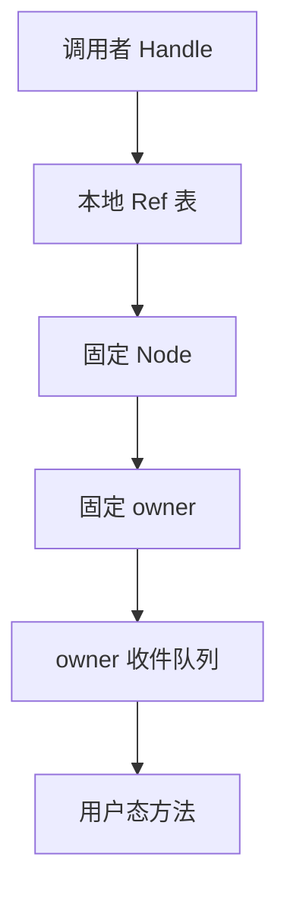
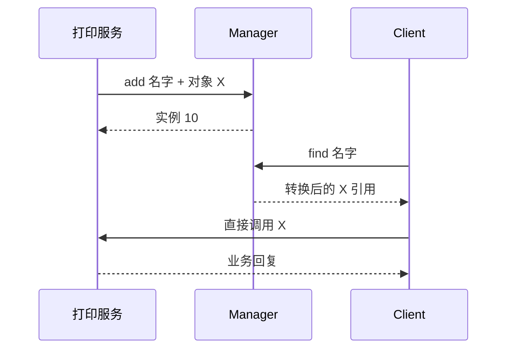

# 09｜第一次拿到服务引用

打印客户端启动后，要找到独立启动的 `photo.printer` 进程，再调用它的打印对象。上一章已经能把 A 的对象交给 B，再由 B 转交给 C；但启动脚本仍须用 pipe 告诉 B、C 收件地址和 grant。现在让客户端晚启动一分钟，原来的 pipe 已经不存在，它该向谁要第一个引用？

本章依次做四件事：让不同进程都能拥有可调用对象；给系统留下一个受控的管理器入口；让打印服务向管理器登记“名字与对象”；让后来启动的客户端查询并取得自己的引用。最终打印请求直接到打印服务，管理器只参与发现。

**版本边界：当前仓库驱动只实现到[第 08 章](08-references.md)。本章是尚未落地的设计阅读稿。** 多 owner、管理器引导和名字服务都没有现成 mini-binder 命令。下文的小写操作名是协议语义草案，不是可执行 API；普通 C 模型可以独立运行，不能据此声称服务发现已经通过 VM 验收。

## 1. 先看缺少哪一步

假设打印对象是 X。Client 知道字符串 `photo.printer`，却没有 X 的 Ref。直接把字符串塞进 CALL 的 target 不成立：驱动目前只接受调用者私有表中的 Handle，名字也不是一份访问资格。

把启动过程写成设计推演，缺口就很具体：

| 事件 | 已有能力 | 本章要补的能力 |
| --- | --- | --- |
| 打印服务发布 X | 创建 owner 的 Node | 允许它与其他 owner 同时存在。 |
| 服务告诉管理器“这是 X” | 事务对象转换 | 管理器自身也必须是另一个可调用 owner。 |
| Client 找管理器 | 没有起始 Ref | 受控 bootstrap，不让 Client 猜全局 Node ID。 |
| 管理器把 X 返回 Client | 回复中的对象转换 | 复用 C08，建立 Client 私有 Handle。 |

ServiceManager 在这里指一个用户态名字服务；Context Manager 指驱动记录的那个特殊引导对象。它们常由同一个进程承担，却不是同一层功能。驱动需要知道“引导入口是哪一个 Node”，不需要认识 `photo.printer`。

## 2. 名字发现有几种合理做法

| 方案 | 能解决的场景 | 新约束下的代价 |
| --- | --- | --- |
| 启动器逐个传引用 | 服务数固定、进程由同一个监督器启动 | 动态加入的 Client 仍需要和启动器建立联系；配置与重启关系由它维护。 |
| 广播名字并等待回应 | 对等发现、跨主机服务发现 | 需要定义回应者认证、多回应选择、重试、超时和消失检测。 |
| 集中名字表 | 一台机器内按名字查找服务 | 多一次发现 RPC；管理器不可用时不能做新发现，必须定义恢复流程。 |

本章选择集中名字表，因为要观察“对象转交如何组成服务发现”，而非构造分布式发现协议。启动器传引用仍是好方案；C08 的 grant 实验就是它的一个受控版本。

管理器返回 X 的引用后，后续业务调用不再绕经管理器。否则一个慢打印任务会占住所有服务的中转站，也把名字表和业务调度绑在一起。

## 3. 在名字表之前，先迁移路由

C08 的“唯一 Server”是实际实现限制：只有它能接收业务请求。让 Manager 注册为 Server 后，打印进程便不能再注册；仅写一个 `name → handle` 数组解决不了这个问题。

新模式应保留一个打开上下文的映射区、Ref 表和 owned Node 表，并为每个上下文增加收件队列。发布 Node 的上下文就是它的 owner；调用首先查发送者 Ref 得到 Node，再固定 `Node.owner`，最后进入该 owner 的队列。接收资格来自该上下文已启用新模式及有效映射，不再来自全局唯一 Server 指针。



这里的 Client、Server 变成一次事务里的角色。Manager 接收查询时是 Server，向其他服务发请求时又可以是 Client；打印进程也可以拥有回调对象。多 owner 只解决目的进程选择，线程内嵌套调用留给下一章。

迁移必须是显式的新模式和新 feature，具体编号留待实现设计冻结。旧模式继续按 C08 的规则工作；新模式不接受旧的全局 Node 调用。不同模式之间拒绝对象转交，不能在找不到新 Ref 时退回旧全局 ID。

原 grant 通道可以保留在 C08 回归实验中。新服务发现路径则完全使用事务请求、回复中的对象转换；不再用 EXPORT/IMPORT 给 Manager 偷送对象，也不依赖 Client 的 `open_id`。删去旧通道应是有迁移验收的后续步骤。

## 4. 给第一个引用一个受控入口

我们可以保留特殊 Handle 0，也可以增加“取得当前管理器引用”的引导操作。前者更贴近 Android；后者可以沿用 C08 中“普通 Handle 0 始终无效”的约定，把特殊处理集中在一个入口。

本章选择后者：`claim_manager(local_node)` 把当前上下文拥有的 Node 放入该通信域的唯一管理器槽；`bootstrap()` 把槽中的 Node 转成调用者私有 Ref，并返回一份明确的用户持有。两者都是**待实现语义**。`bootstrap()` 无管理器时返回 ENOENT，引用配额耗尽返回 ENOSPC。

`claim_manager` 至少满足四个条件：Node 确实属于调用者；调用者匹配启动配置中允许的管理器凭据；槽尚为空；Node 尚活着。只在一个受锁保护的提交点设置槽；第二个合法争抢者返回 EBUSY。不能用“谁最早 open 谁就是管理器”，也不能相信 payload 中自报的 UID。

通信域是共享同一个引导槽的一组打开上下文，不等于每个 open 自己一个管理器。第一版可以只设一个域；真正的多设备隔离与授权在第 13 章继续展开。

管理器槽持有自己的 Node 账目。引导时先取得 Node 与 owner 的稳定持有，再建立调用者 Ref；输出失败只撤销这次取得的用户单位，不破坏调用者原有 Ref。管理器退出时先清空槽，再终结指向它的事务；旧引用保持指向已经死亡的旧 Node。

## 5. 用普通 C 看“同名重启”问题

先把代码保存为 `/tmp/name_registry.c`。这个模型只检验名字表的条件删除，`instance` 是不可复用的实例标识，既不是 Handle，也没有模拟驱动、授权或多进程。

```c
#include <assert.h>
#include <errno.h>
#include <stdio.h>
#include <string.h>

struct entry { const char *name; unsigned instance; };
static struct entry current;

static int add(const char *name, unsigned instance)
{
    if (current.name) return EEXIST;
    current = (struct entry){name, instance};
    return 0;
}

static int remove_instance(const char *name, unsigned instance)
{
    if (!current.name || strcmp(current.name, name) ||
        current.instance != instance) return ENOENT;
    current = (struct entry){0};
    return 0;
}

int main(void)
{
    assert(add("photo.printer", 10) == 0);
    assert(add("photo.printer", 11) == EEXIST);
    assert(remove_instance("photo.printer", 10) == 0);
    assert(add("photo.printer", 11) == 0);
    assert(remove_instance("photo.printer", 10) == ENOENT);
    assert(current.instance == 11);
    puts("PASS: stale removal preserves the new instance");
}
```

```sh
cc -std=c11 -Wall -Wextra -Werror /tmp/name_registry.c -o /tmp/name_registry
/tmp/name_registry
```

成功应输出 `PASS: stale removal preserves the new instance` 并退出 0。断言失败或编译失败都不通过。最后删除这两个 `/tmp` 文件即可清理。

关键不是数组大小，而是删除条件：旧实例 10 的“我退出了”来迟时，不能删掉新实例 11 的同名记录。真实表项应保存固定对象身份及发布者身份，不能只保存一个可能复用的裸 Handle 数字。

## 6. 定义名字服务的业务协议

第一版用长度前缀编码 ASCII 服务名，长度 1–63，允许字母、数字、点、下划线和短横线；禁止内嵌 NUL，不做大小写折叠。限制是教学选择，不能冒充 Android 名字规则。对象仍使用 C08 的 offsets 表，普通字符串不由驱动解释。

| 方法 | 请求 | 成功结果 | 确定失败 |
| --- | --- | --- | --- |
| `add` | name、一个对象、发布序号 | 不可复用的实例号；相同发布的合法重试返回原实例 | 去重检查后仍同名则 EEXIST；配额满 ENOSPC；格式或重试内容错 EINVAL。 |
| `find` | name | 对象描述符、实例号 | 不存在 ENOENT；不允许发现 EACCES。 |
| `remove` | name、实例号 | 移除该实例 | 实例不匹配 ENOENT；不是发布者 EACCES。 |

`add` 接受调用者合法持有并可转交的对象，不强迫它必须是调用者自己的 LOCAL；发布者与对象 owner 是不同身份。`remove` 的资格以驱动提供的发布者上下文身份验证，不能仅比较可复用 PID，也不能由请求自报。

为此，新模式在每次创建打开上下文时生成通信域内不可复用的 `context_id`；编号耗尽则拒绝创建，不能绕回旧值。提交事务时，驱动从实际发送上下文采集 `sender_context_id`，随独立的只读请求元数据交给 Manager。复制或继承同一打开文件仍属于原上下文，重新 open 则取得新身份。payload 内即使放了同名字段也不参与判断。这只建立发布者身份关联，谁有权发布某个名字仍由管理器策略决定；UID 等凭据的来源在第 13 章展开。

每个表项拥有一份长期用户持有。处理 add 时，Manager 从请求槽借用对象，先校验名字和权限，再 ACQUIRE，最后提交表项，然后 FREE 请求槽。若插入或分配失败，释放刚取得的单位并 FREE 槽；不能 FREE 后才尝试把借用转成长持有。

处理 find 时，在表锁下取得表项的稳定持有和实例号，随后释放表锁再编码回复。回复转换建立 Client 的 buffer 单位；Client 若要跨 FREE 保存对象，必须 ACQUIRE。Manager 的那份持有不会因为某个查询完成而减少。

管理器不应拿着名字表锁发起远程同步调用。即使只是“先 ping 一下服务”，远端也可能回调管理器；名字表一致性应由短临界区及实例比较维持。

## 7. 结果丢失不等于注册失败

add 提交后，Client 可能在读取回复前退出或收到输出错误。驱动回滚回复槽不能撤销用户态已经提交的名字表，也不能替服务撤销已经发生的业务副作用。

因此 add 的发布序号在同一个发布者上下文内不可重复用于不同内容。Manager 为每个成功表项保存该序号：先查发布者与发布序号，同名字及对象的重试返回原实例号，内容不符返回 EINVAL；没有匹配的重试记录，再判断普通同名冲突并返回 EEXIST。记录随表项删除释放，配额与表项一起限制。

这只保证表项仍存在且 Manager 未重启时的注册重试。发布者须串行化 add 重试与 remove；表项删除后不能把旧 add 当成安全重试，否则可能重新登记。Manager 重启后内存日志消失，不承诺跨重启恰好一次；发布者必须重新 bootstrap 并登记。需要持久化发现协议时，必须另设版本、恢复和写盘提交语义。

## 8. 沿一次真实需求推演资源

以下是未来实现应能产生的事件顺序，不是本仓库已经执行过的测试日志：

1. Manager M 发布管理对象并取得引导槽；打印服务 P 发布 X，M 与 P 各有独立收件队列。
2. P bootstrap 得到自己的管理器 Ref，add 的 LOCAL X 转成 M 的 HANDLE 7；请求槽暂持一份 buffer 单位。
3. M ACQUIRE 7，表中登记 `photo.printer → X@实例10`，然后 FREE 请求槽，保留自己的 user 单位。
4. Client C bootstrap，find 的回复把 M 的 7 转成 C 的 HANDLE 3；7 与 3 不要求相同。
5. C ACQUIRE 3、FREE 回复槽，CALL 3 由 Node.owner 路由到 P；M 不接收该业务请求。
6. C RELEASE 3。P 撤销登记时，M 按实例删除并 RELEASE 7；P 再按 Node 的在途持有规则撤销发布。



## 9. 服务消失与管理器重启

**服务先退出。** 远程 Ref 不阻止进程退出，M 的记录可能暂时陈旧。C 的 find 即使取得对象，随后调用仍可能 EPIPE；“查到时活着”无法保证“调用时活着”。在没有第 12 章死亡通知时，只能依靠显式撤销、管理器受控重建或有凭据的条件失效报告；不能把任意 Client 自报失败当成删除授权。

若增加驱动提供的“对象已死亡”检查，Manager 可在 find 前剔除已死实例，但检查之后仍存在死亡窗口。它只减少陈旧结果，不提供活性租约。陈旧删除必须匹配对象实例，不能只按名字删。

**服务同名重启。** 新服务产生新 Node、实例号与 Ref。旧 Client 的旧引用继续死亡，不允许按名字偷偷改绑到新对象；Client 自己重新发现并决定是否重试业务，尤其不能自动重放打印这样的有副作用操作。

**Manager 先退出。** 已拿到 X 引用的 Client 仍可直接调用存活的 P；新发现失败。受授权的新 Manager 占据空槽后得到空表，存活服务重新登记。旧管理器 Ref 不跟随新槽改变；新 bootstrap 返回新引用。

**Client 退出。** 它的 Ref、请求、回复槽按上下文退出路径清理；不会删除共享服务名。**Manager 退出**则丢弃整张表及它持有的 Ref。对象元数据是否最终回收仍取决于其他持有。

## 10. 未来实现怎样验收

实验必须在新模式已经实现后才接入 VM。当前不要尝试凭空运行 `service-manager-test`；仓库尚无这个程序。

| 检查 | 观察与通过条件 | 失败说明 |
| --- | --- | --- |
| 两个 owner | M、P 同时发布并独立 RECEIVE；调用日志目标为 P | 仍发给唯一 Server，路由迁移未完成。 |
| 引导争抢 | 允许者唯一成功；第二个 EBUSY；不允许者 EACCES | 仅凭先到或用户字段决定资格。 |
| 对象发现 | Client 不持有启动 pipe、open_id 或 grant 仍能 find 并调用 | 仍依赖 C08 旁路。 |
| 注册失败 | 重复名、格式错、表满后，Ref 与槽计数恢复 | 失败路径泄漏长期持有。 |
| 同名重启 | 旧 Handle EPIPE；新 find 指向新实例；迟到删除无效 | 名字替换了旧引用身份。 |
| Manager 重启 | 旧业务引用仍可用，新发现等待重登记 | 名字表被误当成业务中转点。 |

用显式同步点控制“已提交但未回复”“旧实例删除迟到”，并给整个测试设置截止时间。清理所有参与者、FREE 槽和 RELEASE 引用后，应回到基线活资源数；历史复制计数不要求归零。

## 11. 对照固定版本 Android

阅读基线分别为 [Linux v6.6](../reference/android-binder.md) 与 [Android 14 固定提交](../reference/aosp-userspace.md)，没有把两者组合成运行过的 Android 镜像。

| 教学问题与机制 | 实际源码入口 | 相同点与差异 |
| --- | --- | --- |
| 唯一引导槽及注册资格 | [v6.6 binder_ioctl_set_ctx_mgr](https://github.com/torvalds/linux/blob/v6.6/drivers/android/binder.c#L5109) | 驱动校验唯一性、LSM 与 UID；本章拟用启动配置约束，尚无对应实现。 |
| 第一个引用 | [v6.6 target.handle 为 0](https://github.com/torvalds/linux/blob/v6.6/drivers/android/binder.c#L3029)、[Android14 getContextObject](https://github.com/aosp-mirror-neo/platform_frameworks_native/blob/bfcf75076e562945bae131a4929f29a90d0d2481/libs/binder/ProcessState.cpp#L160) | Android 使用特殊 Handle 0；本章草案选择显式 bootstrap 后返回普通私有 Ref。 |
| 用户态承担名字表 | [Android14 ServiceManager::tryGetService](https://github.com/aosp-mirror-neo/platform_frameworks_native/blob/bfcf75076e562945bae131a4929f29a90d0d2481/cmds/servicemanager/ServiceManager.cpp#L285) | `mNameToService` 在用户态，并做查找授权；驱动不解析服务名。 |
| 服务注册与重复名 | [Android14 ServiceManager::addService](https://github.com/aosp-mirror-neo/platform_frameworks_native/blob/bfcf75076e562945bae131a4929f29a90d0d2481/cmds/servicemanager/ServiceManager.cpp#L336) | 都保留对象；该版本允许覆盖旧同名项，本章选择 EEXIST。真实名字上限为 127，非本章 63。 |
| 引导进程怎样启动 | [Android14 servicemanager main](https://github.com/aosp-mirror-neo/platform_frameworks_native/blob/bfcf75076e562945bae131a4929f29a90d0d2481/cmds/servicemanager/main.cpp#L114) | 创建用户态管理对象，再 becomeContextManager；名字 `manager` 的自注册不是驱动识别该字符串。 |
| 清理死亡服务 | [Android14 ServiceManager::binderDied](https://github.com/aosp-mirror-neo/platform_frameworks_native/blob/bfcf75076e562945bae131a4929f29a90d0d2481/cmds/servicemanager/ServiceManager.cpp#L633) | 按对象匹配删除名字；本章尚未实现死亡订阅，第 12 章补其协议。 |

Android 的 lazy service 启动、VINTF 声明、SELinux 名称策略和客户端回调不在本章教学子集中。它们解释了真实名字服务为何远多于一个 map，不能从本章三方法协议推断兼容性。

## 12. 练习与解析

1. **Manager 把自己的 Handle 7 作为普通整数回给 C，行不行？** 不行。7 只能查 Manager 的 Ref 表；必须放进对象偏移表，经驱动转换为 C 的 Handle。
2. **为什么 add 要先 ACQUIRE 再 FREE？** 请求槽的 buffer 单位随 FREE 归还；长期表项必须提前取得独立持有，否则保存的是失去归属的编号。
3. **旧服务的退出事件按名字删表，有什么错误？** 同名新实例可能已登记。比较实例或固定对象身份，才能避免迟到事件破坏新记录。
4. **bootstrap 后 Manager 马上退出，是不是引导不正确？** 引导只保证取到特定对象身份，不保证远端永生。后续调用应有确定的死亡错误，不能重新解释旧引用。
5. **只实现名字表、仍保留唯一 Server，能否完成本章？** 不能。Manager 与业务服务必须同时拥有可调用对象，先完成 owner 路由才有三进程闭环。

现在客户端知道该找谁，但打印服务可能正忙于一个慢任务；更麻烦的是，它同步调用另一个服务时，对方又回调回来。下一章[线程模型](10-thread-model.md)处理“请求交给哪一个线程，以及等待期间谁来执行回调”。
