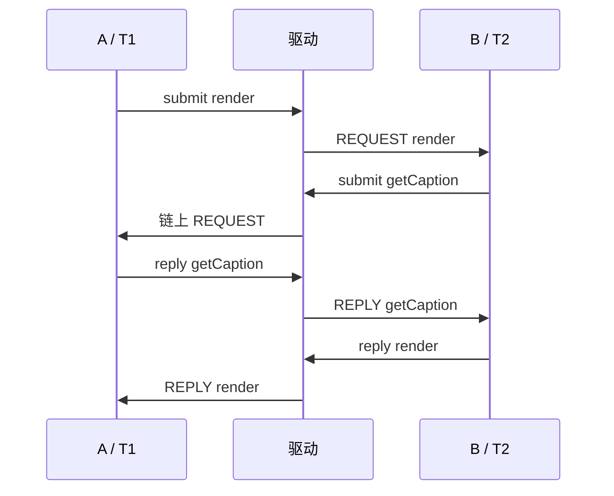

# 10｜等待回复时，谁来执行回调

照片应用 A 已经通过[名字服务](09-service-manager.md)找到排版服务 B。A 调用 `render()`，B 处理时又需要调用 A 的 `getCaption()` 回调。A 唯一的线程正在等 render 的回复；如果它只能睡在原来的 CALL 中，getCaption 就无人执行，B 也永远无法回复。

我们先把这条等待链逐步排出来，再增加处理独立请求的工作线程；随后把“提交调用”和“领取事件”分开，让等待中的线程能接收属于这条调用链的回调，最后约束回复资格、栈深、退出及用户态锁。要解决的是一组明确的阻塞场景，不能把“开一个线程池”当成完整答案。

**本章是设计阅读稿，mini-binder 当前实现仍停在 C08。** 第 09 章的多 owner 路由也尚未实现；本文所有线程事件及操作名都是未来协议草案。现有 CALL_REF 是阻塞 ioctl，没有本章描述的事件泵；不能用现有多 Client 测试声称嵌套回调已成立。

## 1. 把单线程卡住的顺序写出来

用 `T1` 表示 A 的线程，用 `T2` 表示 B 的线程；这里的箭头表示同步依赖，不表示 CPU 一直在运行。

| 步骤 | A / T1 | B / T2 | 结果 |
| --- | --- | --- | --- |
| 1 | 发出 render，等待回复 | 领取 render | A 的外层调用未完成。 |
| 2 | 仍等待 | 发出 getCaption，等待回复 | B 的外层处理暂停。 |
| 3 | 不能执行 getCaption | 等待 A | A 等 B，B 等 A。 |

这已经是确定的设计反例，不需要随机 sleep 才能复现。未来实验应在“B 已提交回调”处设同步点，用截止时间观察基线未完成，然后终止两个参与者。截止时间说明测试发现了无进展；真正原因仍要由等待链与事件记录证明。

另一个需求更普通：B 的一个慢请求不能阻止完全无关的快请求。这个问题增加工作线程通常有帮助；它和上面的调用链问题要分别验收。

## 2. 线程、队列与睡眠的必要知识

同一进程的 pthread 共享地址空间和大多数资源，却有各自的栈、寄存器及调度状态。一个线程阻塞在 ioctl，别的线程仍可能执行；但共享内存中的对象是否允许并发访问，仍由程序同步规则决定。

“等待队列”记录等待条件变化的线程；“工作队列”保存尚未处理的工作。唤醒只让线程有机会重新检查条件，不保证某个线程立即运行，也不保证醒来时工作仍属于它。领取必须在保护队列的锁下完成。

睡眠前应先登记等待，再检查条件；醒来后用循环复查。否则“检查为空”和“进入睡眠”之间到达的请求可能丢失唤醒。内核不能握着自旋锁睡眠，也不能拿着队列锁跨越用户态业务执行。

线程 ID 是观察线索，不足以作为长期对象身份。内核应按当前 task 找线程上下文，并持有适当的 task/线程记录；不能由 payload 中的 TID 指定“我就是原调用者”，也不能让复用后的 TID 继承旧线程的回复资格。

## 3. 比较三种调度方案

| 方案 | 有用之处 | 需要补的约束 |
| --- | --- | --- |
| 一个串行事件循环 | 对象状态容易维护，适合短小且不阻塞的处理 | 同步出站调用若停止泵事件，会形成回调等待环。 |
| 有界工作线程池 | 独立请求可并行，慢任务不必独占整个进程 | 池中每个线程都可能等待回调，仍会耗尽；锁环也仍存在。 |
| 线程池加调用链重入 | 独立请求用空闲线程，嵌套回调回到链上等待线程 | 用户方法可能在同一个线程上重入，必须约束栈、对象状态与锁。 |

本章选择第三种，保留线程池的并行能力，同时把同步调用关联到线程。它适合需要同步对象回调的模型；如果业务可以改成异步状态机，串行事件循环同样合理，只是接口、错误与取消方式都会变化。

无论池大小是多少，都能构造更深的同步依赖或让全部线程等待相同资源。线程数是资源预算，不能充当正确性证明。

## 4. 为什么原来的阻塞 CALL 不够

C08 的 CALL_REF 在驱动里等业务回复，再把回复元数据写回用户内存。等待期间，驱动没有办法安全地替调用者运行 `getCaption()`：C 函数、对象分发和业务权限检查都在用户态。

因此新模式需要一个事件协议。下面只冻结语义，不分配 ioctl 编号；旧 ABI 保持原模式，不能悄悄改变一次阻塞 CALL 的返回类型。

| 草案操作或事件 | 责任 |
| --- | --- |
| `enter_worker()` / `leave_worker()` | 当前线程加入/退出可领取进程工作的集合。 |
| `submit(target, code, parcel)` | 校验并提交调用，返回稳定事务标识；不等待业务结果。 |
| `next_event()` | 可阻塞地领取本线程事件，或在符合条件时领取进程工作。 |
| `REQUEST` | 方法、目标本地身份、请求槽、事务关联，以及驱动采集的只读 `sender_context_id`。 |
| `REPLY` / `FAILED` | 某笔出站调用的终结结果，送回原调用线程。 |
| `reply(transaction, parcel)` | 只允许当前线程回复栈顶已领取的同步请求。 |

用户态 `call()` 包装 submit 与事件循环：等待本笔 REPLY 时，如果遇到合法 REQUEST，就暂存外层等待状态，分发回调、回复它，再继续等待外层。普通对象数据仍按 Parcel 规则编解码。

同步 submit 还需一个栈前置条件：当前线程的同步栈为空，或者栈顶是已经交付给它、正在由它处理的入站请求。若栈顶是等待回复的出站调用，再次直接 submit 返回 EBUSY；不能因接口本身不阻塞，就连续压入两个彼此无嵌套关系的出站调用。收到合法入站回调后，线程才能在该回调之上再发同步请求。用户态若需要独立并行调用，应使用其他线程，或另行设计不依赖这个同步栈的异步接口。

这个循环不是“收到任何东西都随便执行”。驱动先检查线程栈及调用关联；等待线程只领取其专属链上工作和必要控制事件。无关请求交给空闲 worker，避免一个等待者不断执行无关业务而迟迟无法返回。

## 5. 三份状态分别记录什么

| 结构 | 保存的状态 | 谁拥有 |
| --- | --- | --- |
| 进程上下文 | 公共待办、可用 worker、线程预算、退出标记 | 打开上下文，最终 release 清理。 |
| 线程上下文 | 专属待办、worker 状态、同步事务栈、等待条件 | 当前上下文中的真实线程；线程退出时摘除。 |
| 同步事务 | from、to、两侧父链接、交付状态、终结状态 | 在途记录；栈、队列和缓冲持有分别记账。 |

“事务栈”表示未完成的同步调用嵌套关系，不是发送者可自报的调用路径。内核根据已接受与已交付事件建立父链接；用户态 C 调用栈与它协作，却不能用一个用户栈地址替代这份记录。

一个线程只有在没有同步栈、没有专属待办、已经登记为 worker 时，才参与普通进程工作分配。同步等待线程即使是 worker，也不能被当作空闲线程，随意交付不相关请求。

第一版可限定每个上下文最多 4 个 worker、每线程最多 16 层同步嵌套、每上下文有界待办；数字是草案预算，不是 Android 默认值。达到预算时，在提交前返回可辨别错误并回滚，不先投递半笔请求。

## 6. 先处理普通请求，再处理嵌套请求

**普通请求。** submit 固定目标 Node 和 owner，分配接收槽并转换对象；在同一受锁保护的提交点把工作放进 owner 公共队列。选择一个空闲 worker 时，要原子地把它从可用集合摘掉，并把工作转给它，避免两个请求同时把它当成空闲者。

**同步回调。** B 当前线程正在处理来自 A 的请求。它向 A 提交同步调用时，驱动沿真实事务父链接寻找目标进程中的原调用线程；找到仍存活的 A/T1，便把回调放进 T1 专属队列并唤醒它。没有匹配祖先时，按普通请求分配，而非凭对象名猜测回调线程。

**回复。** 核对当前线程是交付线程，且目标事务位于它的栈顶，再弹出这一层并把结果交回对应的 from 线程。其他线程知道事务 ID 也无权回复。跨线程接管任务需要额外协议，本章不隐式支持。



图中的 A/T1 在一次 `call(render)` 内又执行了 `getCaption()`。这是重入：外层方法尚未返回，同一个对象或同一线程就再次进入业务代码。它没有增加一个 A 线程，也没有意味着外层状态已经提交。

## 7. 逐步核对嵌套栈

用 R 表示 render，用 C 表示 getCaption；栈顶写在右侧。A 的“发出等待”与 B 的“正在执行”是同一笔 R 的两端，不是两笔业务。

| 同步点 | A/T1 栈 | B/T2 栈 | 可接受事件 |
| --- | --- | --- | --- |
| R 已交付 | `[出站 R]` | `[入站 R]` | B 可调用 A 的对象。 |
| C 已交付 | `[出站 R, 入站 C]` | `[入站 R, 出站 C]` | A 只能回复 C，不能把它当成 R 的结果。 |
| C 已回复 | `[出站 R]` | `[入站 R]` | B 从内层 call 返回，继续执行 R。 |
| R 已回复 | `[]` | `[]` | 两线程按登记状态重新成为候选 worker。 |

请求槽 FREE 与栈弹出仍是两项操作。回调完成后忘记 FREE，会泄漏缓冲及对象持有；提前 FREE 后继续读取请求地址，则是应用生命周期错误。业务分发器应使用作用域清理，在所有返回路径释放已领取槽。

来自同一个进程但不属于这条祖先链的请求，不应自动送给 T1。本章也不把单进程内的直接函数调用包装成驱动自调用；新模式先拒绝这种 submit，由库在明确允许时走本地分发，避免引入另一套未说明的自调用栈。

## 8. 回到原线程仍可能死锁

考虑 A 在持有普通非递归互斥锁 L 时调用 B；B 回调 A，而 `getCaption()` 也要拿 L。即使回调正确到达 T1，它仍会等待自己尚未释放的 L。若换另一个 A 线程执行，则变成等待 T1 持有的 L，依赖环同样存在。

```text
T1 持有 L → 等 B 的回复
B 等回调回复 → 回调等 L
```

解决办法应在业务边界选择：在锁内复制所需状态和版本，解锁后 RPC，再拿锁检查版本并决定提交；或者把操作改成可分段的异步状态机。版本冲突后的重试也要考虑副作用，不能直接重复发送已经打印成功的请求。

递归锁只允许同线程再次加锁，不能自动修复“外层状态更新了一半、回调读到了中间值”。因此接口必须说明哪些方法可重入、回调可以看见哪个阶段的状态、哪些锁禁止跨 RPC 持有。

这也是为什么本章不承诺消除所有死锁：驱动能维护调用链，却不知道业务锁、数据库事务、应用线程 join 或外部设备的依赖。

## 9. 谁创建线程，谁决定预算

用户态库用 pthread_create 创建 worker，worker 自己登记并进入事件循环。内核只能观察待办和等待者，发送“可以增加 worker”的控制事件；它不能凭空调用用户方法或创建一个已经准备好业务环境的 pthread。

若保留扩池提示，应在上下文中记录已发出但未兑现的提示，限制并发提示数量；新 worker 登记或创建失败反馈后再更新预算。达到上限则让请求留在有界队列，队列满时拒绝提交。不能一边限制线程数，一边允许无限积压。

扩池本身可能失败，例如地址空间不足或 pthread_create 返回资源错误。已有 worker 继续工作；提交者仍需要等待、取消或处理队列满错误，不能把“提示已发出”当作“线程已经建立”。

## 10. 分配、失败和线程退出

submit 的准备阶段持有目标 Node、接收区槽、对象转换账本、父事务与相关线程。准备失败按逆序归还；提交之后资源归属移交到事务及队列。父事务和线程都必须有稳定持有，不能只存裸指针后睡眠。

next_event 输出 EFAULT 时，尚未交付的 REQUEST 保持可重试；不能先把线程栈推进，再把无人知道的请求遗留在栈顶。它原有的请求槽、对象账本和发送者身份快照都必须保留。第 11 章增加 FD 后，输出 EFAULT 也只撤销本轮目标编号预留，保留事务最初固定的文件持有；FD 配额不足等无法准备交付的错误则显式终结事务并清理。这两类失败不能共用一个无条件销毁分支。交付提交点、复制输出与队列状态的具体锁策略，需要实现时明确记录，不能假设 copy_to_user 永不失败。

线程退出区分两类工作：尚未交付的普通工作可以回到公共队列；已交付请求可能已有副作用，必须标为失败并唤醒原等待者，不自动交给另一线程再执行。链上定向回调的原线程已死时，也不能靠同号 TID 找替身。

已接受的栈层按依赖从内向外终结，保证每笔事务只有一个终态。旧线程记录先从调度索引摘下，等队列、事务、正在输出事件的临时持有归还后再释放。进程退出则先禁止新提交和领取，再终结全部相关工作。

内核并不会因为保存了 task 引用就自动获得退出回调。实现必须为实际线程退出接入可靠的清理入口，再调用同一终结路径；正常 leave 与库的线程析构只覆盖主动退出。若模块阶段只依靠它们和整个上下文 release，就必须把未显式 leave 的单线程异常退出列为未支持，不能宣称下表的强制退出用例已通过。

信号中断只表示本次等待被打断。库可在上下文仍有效时重新等待同一事务；若用户选择取消，就使用显式取消语义。已经交付的调用取消只能终结等待关系，不能保证远端停止业务或撤销副作用。

存在嵌套层时不能随意拆掉中间一层并保留所有裸父链接。第一版应只允许取消当前最深的出站等待；外层取消记录意图，待内层返回后处理。需要立即终止整个上下文时，则走统一退出清理。

## 11. 用确定顺序验收，不只看吞吐

这些是未来实现的验收场景；每个场景使用控制 pipe 或测试栅栏建立顺序，用宿主截止时间处理无进展，不能靠 sleep 猜线程恰好走到哪一步。

| 场景 | 预置顺序与观察 | 通过条件 |
| --- | --- | --- |
| 独立慢快请求 | worker1 领取慢请求后停在栅栏，再提交快请求 | worker2 完成快请求；回复 ID 不串线。 |
| A→B→A | A 只有一个可用线程，B 提交回调 | A 原线程执行回调，内外层分别返回。 |
| 多层嵌套 | A→B→C→A，记录每层父标识 | 回到匹配祖先，回复按栈顺序展开。 |
| 深度耗尽 | 在最后一个允许深度再 submit | 明确拒绝；原有栈仍能正常退完。 |
| 跨 RPC 持锁 | 在指定业务锁位置建立等待环 | 基线被截止时间捕获；解锁方案完成，不能宣称驱动消除锁环。 |
| 交付线程退出 | 领取后、回复前退出 | 等待者收到失败；请求不被重执行；持有最终回收。 |
| 池与队列满 | 全部 worker 阻塞，填满预算 | 有界拒绝，恢复后可继续调用。 |

日志至少关联上下文、真实线程、事务及父事务、目标对象、入队/交付/终结/释放事件。测试末尾检查栈深、专属队列、公共队列、活事务与缓冲归零；未崩溃不能证明栈关联正确。

## 12. 对照固定版本 Android

[Linux v6.6](../reference/android-binder.md) 和 [Android14 固定提交](../reference/aosp-userspace.md)分别用于源码阅读；本章没有运行这两个输入组成的 Android 系统。

| 教学问题与机制 | 实际源码入口 | 相同点与差异 |
| --- | --- | --- |
| 独立线程记录和同步栈 | [v6.6 binder_thread](https://github.com/torvalds/linux/blob/v6.6/drivers/android/binder_internal.h#L476) | 真实线程有 todo、wait 和 transaction_stack；mini 新协议尚未实现。 |
| 谁可领取普通进程工作 | [v6.6 binder_available_for_proc_work_ilocked](https://github.com/torvalds/linux/blob/v6.6/drivers/android/binder.c#L560) | 检查无事务栈、线程 todo 为空且已进入 looper；不是所有 read 等待者都空闲。 |
| 嵌套调用选择祖先线程 | [v6.6 binder_transaction 的栈遍历](https://github.com/torvalds/linux/blob/v6.6/drivers/android/binder.c#L3099) | 按事务关联匹配目标 proc；不能推导任意跨线程回调都自动回原线程。 |
| 回复必须匹配栈顶 | [v6.6 reply 分支](https://github.com/torvalds/linux/blob/v6.6/drivers/android/binder.c#L2946) | 核对 to_thread 和调用方栈；mini 草案也限定交付线程回复。 |
| 等待期间继续处理命令 | [Android14 IPCThreadState::waitForResponse](https://github.com/aosp-mirror-neo/platform_frameworks_native/blob/bfcf75076e562945bae131a4929f29a90d0d2481/libs/binder/IPCThreadState.cpp#L1004) | 默认分支执行 executeCommand，可处理嵌套请求；不是驱动执行用户回调。 |
| 用户态创建工作线程 | [Android14 ProcessState::spawnPooledThread](https://github.com/aosp-mirror-neo/platform_frameworks_native/blob/bfcf75076e562945bae131a4929f29a90d0d2481/libs/binder/ProcessState.cpp#L406) | libbinder 创建 PoolThread；本章拟用 pthread，未实现池控制。 |
| 扩池提示与登记 | [v6.6 BR_SPAWN_LOOPER](https://github.com/torvalds/linux/blob/v6.6/drivers/android/binder.c#L4765)、[Android14 处理提示](https://github.com/aosp-mirror-neo/platform_frameworks_native/blob/bfcf75076e562945bae131a4929f29a90d0d2481/libs/binder/IPCThreadState.cpp#L1512) | 内核请求，用户态创建；BC_ENTER_LOOPER 与 BC_REGISTER_LOOPER 的合法状态也有区分。 |
| 正常线程结束的通知入口 | [Android14 threadDestructor](https://github.com/aosp-mirror-neo/platform_frameworks_native/blob/bfcf75076e562945bae131a4929f29a90d0d2481/libs/binder/IPCThreadState.cpp#L1533) | 库主动发 BINDER_THREAD_EXIT；不能把线程记录本身当成任何异常退出都已检测的证据。 |

真实 Binder 将多项 BC/BR 命令放入 BINDER_WRITE_READ；本章逐项列操作是便于说明语义，不代表一项命令必然一次 ioctl。调度优先级、实时策略和 poll looper 的细节不在本章范围，不能从线程图推断实时延迟保证。

## 13. 练习与解析

1. **把 A 的池从 1 扩到 4 就安全了吗？** 只能增加可用执行者。四个线程都等待回调，或全部需要同一把业务锁时，仍会失去进展。
2. **等待线程为何不能领取所有进程请求？** 它已有未完成栈。执行无关请求会扩大重入范围、改变状态可见性并可能造成饥饿；链上专属事件应单独识别。
3. **B 的另一线程拿到事务 ID 能直接回复吗？** 本章协议不允许。回复资格绑定交付线程和栈顶，跨线程接管必须显式扩展。
4. **回调回到同一线程，是否等于普通顺序调用？** 外层函数尚未结束，回调可能看到中间状态；必须按重入设计，而不能假设对象处于空闲态。
5. **工作线程领取后死亡，为何不重新入队？** 方法可能已经产生副作用。没有业务幂等协议，重执行可能重复打印；只能报告明确失败并回收事务。

线程能正确收取请求后，打印服务仍需要取得照片文件。把 `fd=5` 写进 Parcel，只得到一个进程私有整数；下一章[文件描述符传递](11-file-descriptors.md)说明如何把文件引用变成接收者自己的 FD。
