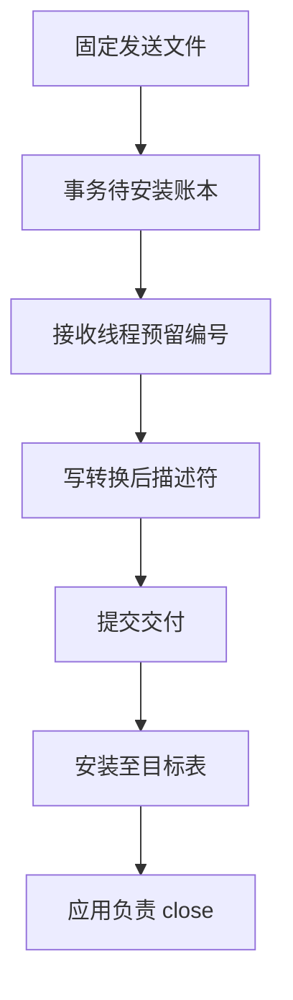

# 11｜传的是文件引用，不是 FD 数字

按[上一章的线程设计](10-thread-model.md)，照片应用已经找到打印服务，也能处理同步回调。现在它要打印一张已经打开的照片：应用手中只有 `fd=100`，照片可能没有可公开访问的路径。把整数 100 放进 Parcel 后，打印服务读自己的 100，得到的会是同一个文件吗？

本章先运行一个普通 Linux 程序：让两个进程的 100 指向不同文件，再用 Unix Socket 的 SCM_RIGHTS 真正转交文件引用，观察共享偏移和关闭行为。随后把同样的责任放到 mini-binder：识别 FD 描述符、取得文件引用、在接收线程中预留编号、成功提交后交给应用关闭，失败则完整回滚。

**普通程序可以独立运行；mini-binder 的 FD 支持仍是未实现的设计扩展。** 当前 C08 只接受 LOCAL/HANDLE 对象，不能把下文 FD 草案类型塞进现有 ABI。文中 Linux v6.6 Binder 的源码结论也不表示本仓库已经跑过 Android 文件传递。

## 1. 三种传照片的办法

| 方案 | 什么时候合适 | 需要付出的代价 |
| --- | --- | --- |
| 传路径，接收者重新 open | 文件有稳定名字，双方有相同目录视图和访问权 | 路径可能被替换，权限和 mount namespace 可能不同；重新打开通常得到独立偏移。 |
| 传全部内容 | 消息小、需要内容快照、接收者不应修改原文件 | 需要传输和存储字节，并明确大小限制；大文件要分块。 |
| 传已打开文件引用 | 没有公开路径、要共享设备/文件能力 | 接收者得到真实资源与访问权；必须限制接收、记账并关闭。 |

本章选择第三种，因为打印应用已完成打开和访问检查，想把这一份打开状态交给服务。它不是所有文件传输的必选项；要冻结内容快照时，单纯共享可写文件引用反而需要额外约束。

## 2. FD 表与打开文件描述

FD 是当前进程文件描述符表的索引；Linux 内核的 `struct file` 表示一份打开文件描述，保存偏移、打开状态及文件操作关系。不同进程可以恰好有相同索引，却指向完全不同的 `struct file`。

`dup()`、fork 继承和 SCM_RIGHTS 可以使不同 FD 指向同一份打开文件描述，因此普通 read 会推进共享偏移。对同一个路径分别 open，则通常产生不同打开描述；“同一个 inode”和“共享同一偏移”不是一回事。

close 归还当前 FD 对文件的那份持有，不负责撤销别的 FD。发送成功后，排队消息可以持有文件，即使发送者关闭原 FD，接收者仍能取得它。数字本身还能被复用，所以延迟处理时必须保存文件引用，不能保存裸数字以后重新查发送者表。

FD_CLOEXEC 是每个 FD 的标志，控制成功 exec 时是否关闭；它不同于共享打开描述上的状态标志。接收时应原子设置 close-on-exec，避免多线程中“先安装、后 fcntl”之间发生 exec 泄漏。

## 3. 运行真正的文件转交

在 Linux 上将下面完整程序保存为 `/tmp/fd_rights.py`，只需 Python 3 标准库。父子进程先建 socketpair；父进程在 fork 之后才打开测试文件，子进程不会通过继承偷偷拿到源文件。

```python
import array
import fcntl
import os
import socket
import tempfile
import traceback


def receiver(sock):
    raw = got = -1
    try:
        raw = int(sock.recv(32))
        with open('/dev/null', 'rb', buffering=0) as other:
            os.dup2(other.fileno(), raw, inheritable=False)
        assert os.read(raw, 1) == b''
        sock.sendall(b'RAW_IS_OTHER')
        data, control, flags, _ = sock.recvmsg(
            1, socket.CMSG_SPACE(array.array('i').itemsize),
            socket.MSG_CMSG_CLOEXEC)
        assert data == b'F' and not flags & socket.MSG_CTRUNC
        descriptors = array.array('i')
        for level, kind, payload in control:
            if level == socket.SOL_SOCKET and kind == socket.SCM_RIGHTS:
                descriptors.frombytes(payload)
        assert len(descriptors) == 1
        got = descriptors[0]
        assert got != raw
        assert not os.get_inheritable(got)
        assert os.read(got, 2) == b'AB'
        sock.sendall(b'READ_AB')
        assert sock.recv(32) == b'SENDER_CLOSED'
        assert os.read(got, 2) == b'EF'
        sock.sendall(b'READ_EF')
        return 0
    except BaseException:
        traceback.print_exc()
        return 1
    finally:
        if got >= 0:
            os.close(got)
        if raw >= 0:
            os.close(raw)
        sock.close()


left, right = socket.socketpair(type=socket.SOCK_SEQPACKET)
left.settimeout(3)
right.settimeout(3)
pid = os.fork()
if pid == 0:
    left.close()
    os._exit(receiver(right))
right.close()
source = -1
try:
    with tempfile.TemporaryFile() as image:
        image.write(b'ABCDEF')
        image.flush()
        image.seek(0)
        source = fcntl.fcntl(image.fileno(), fcntl.F_DUPFD_CLOEXEC, 100)
    left.sendall(str(source).encode('ascii'))
    assert left.recv(32) == b'RAW_IS_OTHER'
    rights = array.array('i', [source])
    assert left.sendmsg([b'F'], [(socket.SOL_SOCKET,
                               socket.SCM_RIGHTS, rights)]) == 1
    assert left.recv(32) == b'READ_AB'
    assert os.read(source, 2) == b'CD'
    os.close(source)
    source = -1
    left.sendall(b'SENDER_CLOSED')
    assert left.recv(32) == b'READ_EF'
finally:
    if source >= 0:
        os.close(source)
    left.close()
    _, status = os.waitpid(pid, 0)
assert os.waitstatus_to_exitcode(status) == 0
print('PASS: raw FD differs; shared offset; receiver survives sender close')
```

```sh
timeout 10s python3 /tmp/fd_rights.py
```

成功输出以 `PASS:` 开头并退出 0；AssertionError、异常、非零退出或 timeout 的 124 都是不通过。程序用消息确认先后顺序，没有以 sleep 猜接收是否完成。临时文件由上下文自动删除，进程退出归还资源；最后可删除 `/tmp/fd_rights.py`。

这次观察能支持三项结论：子进程的原始编号读取 `/dev/null`；真正接收的另一个 FD 读到 AB；父进程随后读到 CD，关闭后子进程仍读到 EF。它验证了 Unix Socket 文件引用传递的行为，没有模拟 Binder 的 offsets 校验、接收映射或事务清理。

## 4. 把 FD 标为特殊对象

mini Parcel 的普通整数不能自动成为 FD，否则业务里的照片张数 100 也可能被解释成资源转交。新模式应有明确 FD 描述符，并由 offsets 表标出，字段至少包括类型、保留标志和发送者 FD；必须固定宽度并校验全部保留位。

驱动先复制稳定快照、验证整张对象表，之后才按发送者当前文件表查 FD。无效描述符返回 EBADF；目标未声明接收 FD 返回 EACCES；单笔数量和上下文配额也必须有限。请求目标的接收许可与同步调用者“回复可含 FD”的许可分别定义，不能用同一个全局开关模糊处理。

得到 `struct file` 后立即把它放入该事务的待安装账本。发送者随后 close、再把原编号 open 成别的文件，都不会改变已固定的资源。文件访问与转交的安全钩子要在取得文件后、提交前检查；知道 FD 数字不是绕过策略的理由。

同一 FD 出现两次时，本章草案按两个描述符取得两份持有，最后在目标中安装两个 FD。它们可以共享一份打开描述，却各自需要 close；失败回滚也必须逐项，不能因“文件相同”就少归还一次。

## 5. 为什么要等到接收线程安装

文件表操作有执行上下文要求。发送者处理 submit 时，不应直接调用面向 current 的 FD 分配函数，误把新 FD 装到发送者表中。第 10 章的 next_event 在目标线程执行，正好是完成安装的边界。

本章选择“先全部准备，再一次性交付”。接收时为每个待安装项预留一个带 CLOEXEC 的空编号，把这些编号写入接收 backing 的对应对象字段；全部成功后完成协议交付，再把文件持有转入这些编号。整个顺序必须串行化同一事务的交付与取消。



这里“交付提交”需要精确定义：可失败的输出复制放在安装前；元数据复制成功也不会自动唤醒别的用户线程。内核完成 fd_install 后才结束 next_event。FD 预留不足等准备失败使事务 FAILED：归还预留编号与文件持有，撤销未交付槽，并通知发送者。输出复制 EFAULT 则遵循第 10 章的可重试规则：只归还本轮预留编号，把槽内 FD 字段恢复为无效占位，保留原文件持有、对象账本、请求槽和未交付状态，供下一次领取。

映射可能被同一进程的其他线程提前读取，所以待安装阶段的编号不承诺进程内部保密。接收者必须在收到成功事件后使用对象；EFAULT 可能已复制控制头前缀，但这些数字不代表成功交付。重试从事务保存的 file 重新预留编号，不能再查发送者原 FD；它可能已经被 close 或复用。终结失败才丢弃整块未交付缓冲。共享同一文件表的恶意线程仍可抢先关闭已安装 FD，本章不承诺 FD 对同进程其他线程隔离。

## 6. 谁在何时持有哪一份资源

| 阶段 | 文件持有归属 | 编号归属 | 退出或失败如何归还 |
| --- | --- | --- | --- |
| 发送前 | 发送者 FD 表 | 发送者 | 普通 close。 |
| 已接受、未安装 | 每个待安装项一份 file 引用 | 尚无目标编号 | 事务失败/取消/目标退出时逐项 fput。 |
| 编号已预留 | 仍由待安装项持有 | 目标线程预留，尚无 file | EFAULT 只退本轮预留并保留事务；终结失败再 fput、回收槽。 |
| 已成功安装 | 目标 FD 表持有 | 目标进程 | 接收者 close 或进程文件表退出清理。 |
| 应用另做 dup | 新 FD 表项另持一份 | 目标进程 | 每个 dup 都单独 close。 |

接收槽 FREE 只释放消息内存与对象账本，**不关闭已经成功交付的普通 FD**。否则应用 FREE Parcel 后继续使用文件，会突然 EBADF，甚至误用随后复用的编号。驱动也不能在某笔业务回复失败时关闭先前已交付给服务的 FD。

用户态库可以让 Parcel 拥有接收到的 FD，在 Parcel 析构时 close；这属于库的所有权约定。若 `read_fd()` 只借出编号，应用想跨 Parcel 生存必须 dup；若采用“取走”接口，库要清除自身所有权以免重复 close。两种接口都合理，但不能含混。

## 7. 失败必须能逐项撤销

考虑一个请求带三个 FD。前两项已经取得文件持有，第三项是无效 FD：提交前失败，只 fput 前两项，不访问第三项不存在的资源，也不影响发送者自己的 FD。

再考虑目标文件表只剩一个空位：第一项预留成功，第二项失败。应归还第一项预留位、释放所有待安装文件、回收未交付槽并通知发送者失败；不能把第一项作为“部分成功”交给目标，否则它根本不知道该关闭什么。

如果所有安装已提交，随后目标进程退出，普通文件表退出负责 close。驱动只能清理仍在账本里的未安装项，不能对已经移交的 file 再 fput。账本转移时应摘项或标记，形成唯一释放责任。

文件表上限失败、内存分配失败、对象表错误、FD 转交策略拒绝、输出指针错误与目标退出要能分别观察。返回值可以对上层做稳定映射，但报告必须记录实际失败点，不能只见一个 EINVAL 就声称覆盖了所有回滚。

## 8. 大文件与 DMA-BUF 没有免除同步

文件传递没有复制文件内容；随后 read 仍会读取数据，mmap 仍需处理映射和页的生命周期。若服务需要独立读位置，可用带显式 offset 的 pread，或由接口约定偏移；不能把共享 FD 当作独立 open。

DMA-BUF 是可经 FD 传递的共享缓冲机制，常用于图像在组件和设备之间流转。传 FD 只让接收者取得这份缓冲的能力；像素格式、尺寸、平面布局、修改权限以及生产者/消费者何时完成，都需要另一个协议。

尤其要区分缓存一致性和执行同步。某设备何时写完、另一设备何时可以读，需要适用的 fence 与 DMA-BUF 同步约定，不能由“Binder 回复到了”自动推导。无可用导出器及设备实验时，本章不提供虚构 DMA-BUF 实测，也不自行写一个分配器充当证据。

## 9. 未来 mini-binder 的验收顺序

普通 Socket 示例已经给出可运行对照；下表是驱动支持 FD 后才执行的验收规格，没有现成的 mini FD 测试命令。

| 场景 | 确定的同步点 | 通过条件 |
| --- | --- | --- |
| 原始数字 | 两进程准备同号不同文件 | 普通整数不被转换；目标读取自己的文件。 |
| 正常转交 | 目标成功领取后确认 | 得到自己的有效 FD，内容正确、CLOEXEC 已置位。 |
| 共享偏移 | 目标读 AB 后通知发送者 | 发送者接着读 CD；必要时用 pread 对照不推进偏移。 |
| 发送后 close | 提交已持 file、目标尚未领取 | 发送者关闭后，目标仍可领取并读。 |
| 拒收及坏 FD | 提交前固定接收策略 | 确定拒绝，无目标编号、file 持有或槽泄漏。 |
| 中途耗尽 | 限制目标 FD 表空位再领取 | 全部未安装项回滚，空位恢复，调用失败。 |
| 目标退出 | 分别停在排队、预留前、成功交付后 | 只有各阶段责任方清理，无重复释放。 |

测试用专用进程设置资源上限，结束后不污染当前 shell；用控制通道建立事件顺序，给测试总时长设限。统计应分别包含待安装 file、预留编号、已交付计数与活槽；还要在接收进程检查实际 FD 表，单看驱动内存没有覆盖用户态忘记 close。

## 10. 对照固定版本 Android

以下入口实际核对 [Linux v6.6](../reference/android-binder.md) 与 [Android14 固定提交](../reference/aosp-userspace.md)。这是静态源码证据，普通 Socket 示例不能充当这些入口的端到端运行结果。

| 教学问题与机制 | 实际源码入口 | 相同点与差异 |
| --- | --- | --- |
| FD 是显式特殊对象 | [v6.6 binder_fd_object](https://github.com/torvalds/linux/blob/v6.6/include/uapi/linux/android/binder.h#L99) | 驱动识别类型和字段；教学 FD 布局尚未冻结，不兼容此 ABI。 |
| 取得发送者文件并查许可 | [v6.6 binder_translate_fd](https://github.com/torvalds/linux/blob/v6.6/drivers/android/binder.c#L2255) | 检查目标接受策略、fget 和安全钩子；随后保存 fixup，而非立即装入远端表。 |
| 在目标上下文分配安装 | [v6.6 binder_apply_fd_fixups](https://github.com/torvalds/linux/blob/v6.6/drivers/android/binder.c#L4333) | 先 get_unused_fd_flags(O_CLOEXEC) 并改写，再统一 fd_install。 |
| 未安装事务回滚 | [v6.6 binder_free_txn_fixups](https://github.com/torvalds/linux/blob/v6.6/drivers/android/binder.c#L1542) | fput 文件、put_unused_fd 归还已预留位；转移后账本为空。 |
| 普通 FD 与缓冲释放分离 | [v6.6 BINDER_TYPE_FD 释放分支](https://github.com/torvalds/linux/blob/v6.6/drivers/android/binder.c#L2013) | 成功交付的普通 FD 由用户态关闭；FD 数组 FDA 有单独规则，不能一概而论。 |
| Parcel 编码与读取 | [Android14 writeFileDescriptor](https://github.com/aosp-mirror-neo/platform_frameworks_native/blob/bfcf75076e562945bae131a4929f29a90d0d2481/libs/binder/Parcel.cpp#L1442)、[readFileDescriptor](https://github.com/aosp-mirror-neo/platform_frameworks_native/blob/bfcf75076e562945bae131a4929f29a90d0d2481/libs/binder/Parcel.cpp#L2236) | 库负责 Parcel 内所有权约定，驱动负责跨表转换；read 返回的整数不自动成为应用独立所有。 |

v6.6 对 request 的许可来自目标 Node.accept_fds，对 reply 则检查原调用 TF_ACCEPT_FDS。真实实现还支持 FD 数组与父缓冲 fixup；本章先定义逐项普通 FD，以保持账目与失败边界可完整解释。

安装与输出的先后也有差异。本章草案把可失败的事件输出复制放在安装前，以保留上述 EFAULT 重试语义；v6.6 的 [binder_thread_read](https://github.com/torvalds/linux/blob/v6.6/drivers/android/binder.c#L4671)先调用 binder_apply_fd_fixups 完成安装，随后才在 [4721 行](https://github.com/torvalds/linux/blob/v6.6/drivers/android/binder.c#L4721)复制事件元数据。不能把教学草案的重试规则直接套到真实驱动。

## 11. 练习与解析

1. **父子进程都读 fd 100，是否证明共享？** 不能。编号只是各自表索引；应通过有序读出的 AB、CD、EF 证明这次转交共享打开描述的偏移。
2. **发送者 close 后文件为什么仍活着？** 排队事务或接收者 FD 表已经拥有另一份文件持有，不依赖发送者编号继续存在。
3. **第三项 FD 无效时，前两项需要 close 发送者 FD 吗？** 不需要。驱动只归还它为转换取得的 file 引用；发送者原有资源不属于回滚账本。
4. **FREE 接收槽后还能用 FD 吗？** 驱动层面的普通 FD 可以；如果用户态 Parcel 同时拥有并关闭它，借用者就不能继续用，应提前 dup 或显式取走。
5. **为什么传 DMA-BUF FD 不代表图像已经可读？** 资源可寻址与生产工作完成是两件事，还需要格式、权限与同步协议。

FD 的归属已经分成“发送者、在途事务、接收者”。对象引用也需要同样清晰的最终退出路径，而且远端进程随时可能消失。下一章[生命周期](12-lifetime.md)把强弱引用、owner 用户对象与死亡通知放到同一份账目里。
