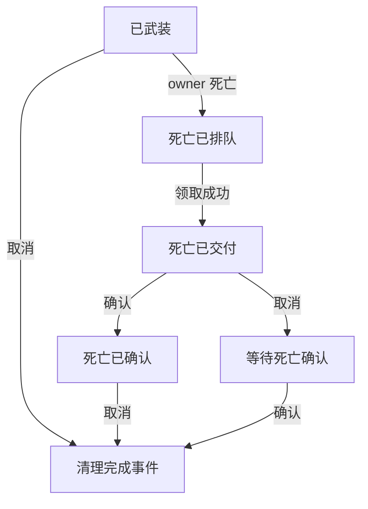

# 12｜引用还在，服务为什么会死

照片应用保存了打印服务的引用，还按[上一章的协议](11-file-descriptors.md)交付了照片 FD，并登记了打印结果回调。服务此时被终止：应用的引用数字还在，尚未完成的调用需要结束，名字表需要删除旧实例，回调注册也需要清理。如果把 Node 一起 free，应用稍后 RELEASE 就会访问不存在的元数据；如果永远不 free，又会不断泄漏。

本章先区分对象本体、身份记录、远程引用与进程四种存活，再用普通 C 模型观察强弱引用，随后整理跨进程保活与退出责任，最后设计死亡通知的注册、交付、确认和取消。结束时应能逐笔回答：现在谁还持有资源，哪个事件使它有资格释放。

**这是尚未实现的生命周期扩展。** 当前 C08 已有 owner 退出、EPIPE、Node/Ref/槽清理，但没有强弱引用协议或死亡通知；第 09–11 章也是设计阅读稿。本文所有新操作、事件与状态都是设计语义，不能作为现有 mini-binder ABI 使用。

## 1. 先拆开四种“还活着”

| 名称 | 本章含义 | 单独存在不保证什么 |
| --- | --- | --- |
| owner 用户对象 | 真正保存打印状态、执行业务方法的 C/C++ 对象 | 内核留着 Node 不代表这块用户内存还在。 |
| Node 身份记录 | 内核用来识别对象及关联 owner 的元数据 | owner 可以死亡，Node 仍为清理与通知保留。 |
| 远程 Ref/代理 | 持有者自己的对象引用记录 | 无法阻止 owner 进程退出或被杀。 |
| owner 进程 | 有线程与地址空间的操作系统实体 | 进程还活着，不代表它永远保留某个业务对象。 |

强引用通常表达“我需要对象本体继续可用”；弱引用表达“我需要记住这是谁，并在允许时尝试取得强持有”。弱引用本身不能直接执行业务方法。进程被终止时，无论远程强引用有多少，内核都不能继续在它的地址空间里执行对象。

因此“对象强计数归零”和“owner 进程死亡”是不同事件。前者参与对象析构协议，后者终结远程可达性并触发死亡通知。不要把死亡通知写成每次对象析构必发的通用回调。

## 2. C08 的两种计数不是强弱引用

C08 的 `user_refs` 表示应用显式 ACQUIRE 的持有，`buffer_refs` 表示消息槽暂时保留的持有。两者都允许查找和调用，任一非零都保留 Ref；区别在于**谁负责归还**，不是“哪一个保活本体更强”。

本章拟增加的 strong/weak 则区别**持有什么语义**。长期用户持有可以是 strong 或 weak；缓冲中的对象也可以携带 strong 或 weak。它们是两条不同维度，不能把 user 重命名为 strong、buffer 重命名为 weak。

迁移应使用新的模式与描述符类型，明确区分四类单位；旧 C08 账目保留原语义。普通 Handle 数字仍不能自行说明类型，驱动必须根据所属 Ref 的单位及请求动作验证资格。

草案允许从有效 strong 借用取得长期 strong，或派生 weak；已持 weak 可以复制 weak，但只能通过专门的提升取得 strong。RELEASE_STRONG 与 DECWEAK 分别归还各自用户单位，FREE 只归还槽的对应单位；下溢、溢出和对错误类型调用均拒绝。每条 Ref entry 自身保留 Node 身份，这份元数据责任也不等于应用多拿了一份 weak。

## 3. 普通 C 模型：弱引用留下身份

把下面代码保存为 `/tmp/weak_lifetime.c`。控制块放在栈上，故意不提前 free；`weak` 只统计显式弱持有，模型仅演示状态与可回收条件，没有模拟原子计数、并发提升或跨进程 owner 协作。

```c
#include <assert.h>
#include <stdbool.h>
#include <stdio.h>

struct control { unsigned strong, weak; bool body_alive; };

static bool promote(struct control *c)
{
    if (!c->body_alive || c->strong == 0) return false;
    ++c->strong;
    return true;
}

static void drop_strong(struct control *c)
{
    assert(c->strong > 0);
    if (--c->strong == 0) c->body_alive = false;
}

int main(void)
{
    struct control c = {1, 1, true};
    assert(promote(&c) && c.strong == 2);
    drop_strong(&c);
    drop_strong(&c);
    assert(!c.body_alive && c.weak == 1);
    assert(!promote(&c));
    --c.weak;
    assert(c.strong == 0 && c.weak == 0);
    puts("PASS: body retired; weak identity cannot resurrect it");
}
```

```sh
cc -std=c11 -Wall -Wextra -Werror /tmp/weak_lifetime.c -o /tmp/weak_lifetime
/tmp/weak_lifetime
```

成功应输出 `PASS: body retired; weak identity cannot resurrect it`，退出 0；断言或编译失败即不通过。最后删除两个 `/tmp` 文件即可。最后一个弱持有释放前，控制块必须仍可读取“本体已退役”，这就是弱引用需要独立身份记录的原因。

多线程实现不能先无锁读到 strong>0，稍后才普通加一：另一线程可能已经把最后一份 strong 归还并析构。提升必须与最终归零互斥或使用合适的原子协议；此小程序没有证明并发算法正确。

## 4. 两种生命周期方案的取舍

| 方案 | 能保证什么 | 成本与限制 |
| --- | --- | --- |
| owner 一直保留全部发布对象 | 远端调用不会遇到 owner 主动析构对象 | 适合少量单例；动态对象直到退出都不能及时释放，且仍挡不住进程死亡。 |
| 显式关闭句柄或租约 | 资源释放有业务可见边界，可用于会话 | 客户端退出、续租、超时和在途操作仍需协议；不能无条件关闭正在执行的对象。 |
| strong/weak 与 owner 协作 | 动态对象由实际持有关系保活，弱缓存不阻止退役 | 需要控制块、计数转移、owner 通知与确认；计数不能解决强引用环。 |

本章选择第三种，并保留显式撤销发布的边界。第一版不实现对象复活：进入退役的对象不能通过弱提升重新成为可调用对象。它比完整 RefBase 策略简单，必须记录为教学子集。

## 5. 内核计数怎样与用户对象连接

驱动只能保护自己的 Node，不能直接对 cookie 指向的用户对象做 `incStrong()`。需要用户态库收到 owner 控制事件，在本进程取得或归还本体持有，再确认已经完成。

本章选择一个明确的安全前提：发布时库持有本体的 export 强持有，以及控制块的身份持有；这两项都不因一次 ioctl 返回就自动丢失。它们使首次跨进程引用建立期间，本体与控制块不会提前析构。

这里 export 是一份本地保活责任，与 C08 的 EXPORT_REF grant 命令无关。普通 C 模型中最后一个 strong 消失即退役；跨进程设计里，export 也算本体 strong，必须完成下面的撤销协议才能归还。只保留 weak 后，远程身份仍可清理，却不能让已经退役的本体复活。

当 Node 的远程/在途 strong 需求从无到有，驱动排入带序号的 `OWNER_ACQUIRE`。owner 库先取得一份本体强持有，再确认；准备中的新强引用在确认前不可交付使用。控制事件进入第 10 章的事件泵，等待同步回复的发布线程也必须能处理它。

最后一份需求消失时，驱动排入 `OWNER_RELEASE`，库归还此前那份本体持有。这里不是“每个远程单位对应一次用户对象 inc”：内核维护详细计数，owner 可以只按汇总的有/无变化持有。确认中的临时保活必须单列，避免需求暂时归零就删掉还在排队的事件。

同一 Node 的 owner 事件按序号串行处理；只有匹配当前待确认事件的 owner 才能确认。重复、旧序号及非 owner 确认均拒绝。0→1→0→1 发生得很快时，也不能让迟到 RELEASE 归还新 ACQUIRE 的那份持有。

最后一个远程 weak/Ref entry、槽内本地身份、在途与通知持有都消失后，驱动才能通知 owner 归还发布时取得的控制块身份持有。此通知也须确认并临时固定 Node；owner 已死则直接结束内核侧责任，不能等待不存在的库回来归还用户内存。

这套等待确认的设计会增加状态和延迟，且要求 owner 持续泵事件。本章不把它等同于真实 Binder 每条引用命令的时序；Android 的 pending 标志与临时持有在后面的源码表中单独对照。

## 6. 如何安全地撤销发布与弱提升

主动撤销发布先把 Node 标成 `RETIRING`，拒绝新的外部 strong 转交与弱提升；现有 strong 仍可完成调用和归还。已经接受的提升或转交保留自己的 pending 持有，不因撤销开始而半途消失。

等待远程 strong、在途调用、含本地对象的接收槽及待确认 owner 事件都清空后，库才取得 `RETIRE_READY` 并归还 export 强持有。若没有其他本地强持有，本体可以析构；仍存的弱引用只保留退役身份。应用若继续保留本地对象，也不会使旧远端端点自动重新开放。

弱提升必须检查调用者自己的弱 Ref，固定 Node，并在与退役竞争的锁下预留一份 strong 需求。若 Node 已退役或 owner 已死，提升失败；否则走 owner 保活确认，成功才把预留变成可用 strong。退出与失败只撤销本次预留，不减掉别人的持有。

这个子集有意禁止零持有后重新创建本体。完整对象策略可以设计复活，但要重新说明控制块、构造、身份和并发条件，不能把“弱编号还在”当作可直接解引用旧 cookie 的理由。

如果持有者永久不归还 strong，主动退役可以一直等待；需要业务层超时关闭时，应另定义关闭后旧调用的错误，而不能假装引用计数会自动解决失联客户端。进程退出则由内核强制回收该持有者的全部单位。

## 7. 把所有资源放进一张表

| 资源 | 持有者与作用 | 最终释放条件 |
| --- | --- | --- |
| 用户对象本体 | owner 本地持有、export 持有、owner 汇总 strong、活动方法 | 全部本地强责任归还；进程死亡时地址空间由系统销毁。 |
| 用户控制块 | owner 库与弱身份协议 | 本体已不需要，弱持有与待确认事件均结束。 |
| Node 元数据 | 发布、Ref entry、事务、槽、控制/死亡通知等 | 每类内核持有归零；owner 已死也不能跳过这一步。 |
| strong/weak Ref 单位 | 应用长期持有或消息槽借用 | 对应 RELEASE/DECWEAK、FREE 或上下文退出。 |
| 在途事务 | 队列、同步栈和临时处理路径 | 终结一次，所有队列/栈/输出临时持有已归还。 |
| 接收槽 | 接收上下文 | FREE 或最终退出；释放自身逐项对象账本。 |
| FD | 待安装账本或接收者文件表 | 按第 11 章分界 fput/归还预留，或应用 close。 |
| 死亡注册与投递记录 | 订阅上下文；固定旧 Ref/Node 身份 | 取消完成、Ref 清理或订阅者退出；交付确认另算。 |

strong 归零后弱 Ref 可以继续存在，但 CALL 必须要求可用 strong，弱身份不能直接调用。owner 死后 strong 单位仍可被归还；它们保留的是死亡引用的清理资格，不能继续创建新调用。

应用方法执行期间还需一份活动强持有：从解码本地对象到方法返回都保护本体，不能仅凭“驱动 Node 尚在”解引用 cookie。这是用户态分发库的责任，驱动不会运行对象析构函数。

## 8. 引用环没有被计数消除

假设 A 的对象强持有 B，B 又强持有 A，即使外部 Client 全退出，二者 strong 仍不为零。计数准确只说明这两条边确实存在，不会识别“整个环已无外界可达者”。

可以让回指成为 weak、由会话 owner 显式拆环，或引入另一个可达性/租约设计。选择取决于业务；不能把所有边改成 weak，否则对象可能在真正需要它时过早析构。ServiceManager 持有服务 strong 也应视为一条真实保活边。

## 9. 死亡通知解决什么问题

调用返回 EPIPE 是“这一次发现远端不可用”；死亡订阅让空闲 Client 也有机会清理缓存或让 Manager 删除陈旧名字。它不保证某个毫秒内回调，不证明服务业务健康，也不替应用恢复未完成的打印。

草案的 `watch(handle, cookie)` 为调用者自己的 strong 或 weak Ref 建立注册，返回单调且不复用的注册标识。cookie 是应用关联值，不是权限，也不代替内核注册标识。第一版每个 Ref 最多一个注册，超额明确失败。

关键顺序是先分配注册记录，再在与 owner 死亡同步的锁下绑定 Ref 并检查 Node：若仍活着，就武装注册；若已死，就立即排入死亡事件。不能先在锁外检查“活着”，稍后才挂注册，否则死亡恰好发生在中间就会漏通知。

注册固定 Ref/Node 元数据，却不增加用户对象 strong，也不阻止 owner 退出。应用释放最后一个引用时必须发起注册清理；等待清理完成前保留这份身份记录，不能复用其 Handle 指向另一对象。

## 10. 交付不是确认，取消也不是删除



图中省略了“已排队后取消”的边：本章选择保留已经提交的死亡事件，确认后再发清理完成。这样取消不需要撤回另一个线程可能已在领取的通知；代价是取消返回后仍可能收到先前的死亡事件。

| 操作到达时的状态 | 协议结果 | 资源责任 |
| --- | --- | --- |
| 活着且已武装时取消 | 解绑并排清理完成；不再产生死亡事件 | 记录活到清理完成成功交付。 |
| 死亡已排队或已交付时取消 | 标记 clear_pending，先完成死亡交付与确认 | 不能提前释放 cookie 所关联的应用回调状态。 |
| 确认死亡 | 从 delivered 集合摘除；若待取消，再排清理完成 | 确认只归还投递责任，不复活对象。 |
| 重复确认或未知标识 | 拒绝且无状态变化 | 不得重复减持有；已清理记录可返回 ENOENT。 |
| 输出复制失败 | 保持事件可重试，不视为成功交付 | 原队列或 delivered 归属必须明确。 |
| 订阅者退出 | 统一清理注册、排队和已交付记录 | 无须等待已经不存在的用户态确认。 |

死亡确认后，未取消的注册可保留“已通知”状态，防止同一注册重复回调。最终取消、Ref 清理或上下文退出才归还注册本身。投递确认与注册清理是两个账目，不能因为 ACK 已到就忘记尚存的订阅关系。

用户态库还需保护 DeathRecipient：回调可以取消自身，也可能与另一个线程析构接收者并发。库应在调用回调前取得它的稳定持有，释放内部锁后执行用户代码，再处理清理；不能持有驱动或代理锁运行任意业务回调。

## 11. 沿服务退出完整走一遍

这是设计推演：Client C 持有 X，Manager M 的表项也持有 X，并且两者均已订阅。owner P 在一笔请求交付后退出。

1. 驱动先禁止 P 接收新工作，摘掉 P 的寻址入口和管理器槽（如果有），把所属 Node 标成 owner 已死。
2. 终结 P 相关事务并唤醒等待者；未交付槽由内核回收，已交付槽随 P 的上下文最终清理。事务只可终结一次。
3. 对每个已注册 Ref 排死亡工作；没有注册者仍能在下一次调用时收到 EPIPE。注册与死亡使用同一同步边界，后来注册也能发现已死。
4. M 收到 X 的事件，按固定对象实例删除名字表，归还自己的 strong，发死亡确认并清理注册；迟到事件不能删除新同名服务。
5. C 通知应用“旧服务不可用”，确认死亡，按自己的恢复策略重新发现。重新发现不会重绑定旧 Ref，也不会自动重放有副作用调用。
6. C、M 归还剩余 strong/weak、槽和通知持有。最后一个内核持有消失才释放死亡 Node；不能等 P 再来确认 owner 事件。

如果 P 恰好在回复期间退出，终结竞争仍沿事务规则决定一个结果：要么回复已被接受，要么失败先提交。死亡通知可能稍后到达；“这次调用成功”和“服务随后死亡”可以同时为真，不能用通知把已返回的业务结果改写。

如果 C 先退出，驱动只清理 C 拥有的记录与单位；M 的表项仍保持自己的持有。任何退出清理都不能简单把某个 Node 的全部远程计数清零，破坏其他进程的账目。

## 12. 未来实现需要怎样验收

| 问题 | 受控顺序 | 通过条件 |
| --- | --- | --- |
| 强弱分工 | 保留 weak，完成退役并归还全部本体 strong，再提升 | 身份仍可清理，本体不复活，提升按子集规则失败。 |
| owner 保活确认 | 停在 ACQUIRE 待确认处 | 本体与 Node 均不提前回收；重复确认不重复减计数。 |
| 注册撞上死亡 | 分别令注册或死亡先取得同步边界 | 都只收到一份有效死亡事件，无漏报。 |
| 注册时已死 | 持死亡 Ref 后 watch | 排入事件，而非永久武装在无法再发生的死亡上。 |
| 取消撞上交付 | 分别停在排队、复制输出、已交付、已确认 | 与状态表一致；回调关联状态不提前释放。 |
| 接收者退出 | 死亡已交付但未确认时退出 | 不再等待 ACK，注册及投递资源恢复基线。 |
| 强引用环 | 两对象互持，撤销外界持有 | 观察仍被保留；显式拆边后才回收，不能误报自动收集成功。 |

每个场景记录对象实例、Ref 类型及单位、pending owner 事件、注册标识、队列和 delivered 数。用显式栅栏建立顺序并给总测试设截止时间。全部参与者退出后活资源归零，只说明覆盖路径的清理成立，不证明所有并发交错都安全。

## 13. 对照固定版本 Android

下表固定 [Linux v6.6](../reference/android-binder.md) 和 [Android14 提交](../reference/aosp-userspace.md)。两者是独立源码输入；本章没有完成真实 Android 生命周期与死亡通知实测。

| 教学问题与机制 | 实际源码入口 | 相同点与差异 |
| --- | --- | --- |
| strong/weak 区别于消息归属 | [v6.6 binder_ref_data](https://github.com/torvalds/linux/blob/v6.6/drivers/android/binder_internal.h#L290)、[引用命令](https://github.com/torvalds/linux/blob/v6.6/drivers/android/binder.c#L3825) | BC_ACQUIRE/RELEASE 操作 strong，INCREFS/DECREFS 操作 weak；C08 user/buffer 不等价。 |
| Node 保活与 owner 协作 | [v6.6 binder_inc_node_nilocked](https://github.com/torvalds/linux/blob/v6.6/drivers/android/binder.c#L807)、[确认处理](https://github.com/torvalds/linux/blob/v6.6/drivers/android/binder.c#L3895) | 真实实现有 has/pending 与临时计数；本章按序号等待确认是独立简化。 |
| owner 用户对象引用 | [Android14 executeCommand 的 BR_ACQUIRE](https://github.com/aosp-mirror-neo/platform_frameworks_native/blob/bfcf75076e562945bae131a4929f29a90d0d2481/libs/binder/IPCThreadState.cpp#L1288) | 用户态执行 incStrong 并回 BC_ACQUIRE_DONE；驱动不调用 C++ 方法。 |
| 代理强持有进入驱动 | [Android14 BpBinder::onFirstRef/onLastStrongRef](https://github.com/aosp-mirror-neo/platform_frameworks_native/blob/bfcf75076e562945bae131a4929f29a90d0d2481/libs/binder/BpBinder.cpp#L614) | 代理与内核 Ref 计数协作；不能把远程 strong 理解为保持进程不退出。 |
| 弱提升的版本边界 | [Android14 onIncStrongAttempted](https://github.com/aosp-mirror-neo/platform_frameworks_native/blob/bfcf75076e562945bae131a4929f29a90d0d2481/libs/binder/BpBinder.cpp#L666)、[v6.6 拒绝 BC_ATTEMPT_ACQUIRE](https://github.com/torvalds/linux/blob/v6.6/drivers/android/binder.c#L3963) | 此内核路径返回 EINVAL；不能宣称这组阅读输入支持本章的通用远程弱提升设计。 |
| 已死后注册不漏通知 | [v6.6 BC_REQUEST_DEATH_NOTIFICATION](https://github.com/torvalds/linux/blob/v6.6/drivers/android/binder.c#L4064) | 绑定 Ref 时检查 node->proc，为空即排工作；真实 cookie 与本章独立注册标识不同。 |
| 取消与确认分离 | [v6.6 BC_CLEAR_DEATH_NOTIFICATION](https://github.com/torvalds/linux/blob/v6.6/drivers/android/binder.c#L4144)、[BC_DEAD_BINDER_DONE](https://github.com/torvalds/linux/blob/v6.6/drivers/android/binder.c#L4188) | DEAD_BINDER_AND_CLEAR 等状态处理竞争；本章用显式状态表表达同类责任。 |
| owner 死后保留元数据 | [v6.6 binder_node_release](https://github.com/torvalds/linux/blob/v6.6/drivers/android/binder.c#L5753) | 清 proc、保留仍有引用的死亡 Node，并向注册者排通知。 |
| 用户态回调及确认 | [Android14 BR_DEAD_BINDER](https://github.com/aosp-mirror-neo/platform_frameworks_native/blob/bfcf75076e562945bae131a4929f29a90d0d2481/libs/binder/IPCThreadState.cpp#L1491)、[BpBinder::sendObituary](https://github.com/aosp-mirror-neo/platform_frameworks_native/blob/bfcf75076e562945bae131a4929f29a90d0d2481/libs/binder/BpBinder.cpp#L489) | libbinder 处理接收者回调，再发确认；本章尚无对应用户库实现。 |

## 14. 练习与解析

1. **把 buffer_refs 当成 weak 有什么问题？** 缓冲借用在 C08 本来可以调用，也承担保留 Node 的责任；strong/weak 讨论的本体语义与谁释放缓冲是不同维度。
2. **有 100 个远程 strong，为什么服务仍会死？** 它们参与对象保活协议，不能阻止操作系统结束 owner 进程；退出后只剩可清理的死亡身份。
3. **为什么死亡通知需要确认？** 内核须知道投递责任已交还，并据此完成竞争中的取消；复制过一条消息不代表用户态已处理完关联回调状态。
4. **先查活着再注册为什么会漏？** 死亡可能落在两步之间。绑定与死亡判断必须在同一同步边界内完成，已死也要形成可交付事件。
5. **强计数为零是不是 Node 立即可 free？** 不是。弱 Ref、事务、槽、通知和临时处理路径都可能还指向它，必须各自归还。

到这里，找到服务、调度线程、传递文件与清理身份都有了明确责任。但一个合法持有的引用，是否足以执行所有方法或转交任意文件？下一章[安全机制](13-security.md)继续区分可寻址、可信身份与操作授权。
