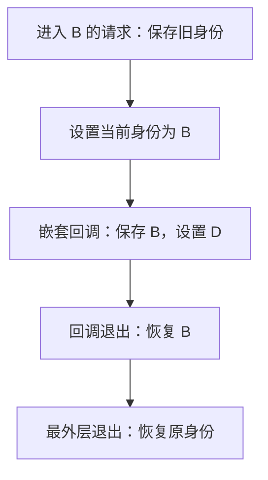

# 13｜有了 Handle，为什么还要检查权限

上一章：[生命周期](12-lifetime.md) · 下一章：[异步事务](14-oneway.md)

Client B 已经拿到“文件服务”的 Handle，发来 `read` 请求时还在 Parcel 里写上 `uid=0`。Server A 能正确找到对象，也能在 B 退出时清理事务；可是，A 应不应该按管理员身份读取文件？如果 B 再把这个对象交给 C，原先允许 B 访问的决定是否也允许 C？本章要给这两次操作分别找到可信身份和授权位置。

> **实现边界：**这是接续第 09–12 章的设计阅读稿。当前 [mini-binder 驱动](../../driver/mini_binder.c)仍停在 C08：单 Server、私有 Ref 和对象转换；设备模式为 `0600`，ioctl/mmap 检查打开者的 TGID，但没有向服务提供事务凭据，也没有管理器、FD、死亡通知或本章策略。下文的策略和身份字段尚无可执行 ABI；Linux 凭据小实验可以独立运行，Android 部分是固定版本静态阅读。

## 1. 生命周期正确，仍然可能把事情做错

第 12 章的设计解决“谁还持有对象、谁负责结束事务”。这里增加一个约束：不可信参与者即使持有合法引用，也不能让服务执行超出授权的方法。内存中的 Node 没有悬空，只证明驱动还能安全查表，并不证明读取某个用户的文件是合法操作。

先把攻击面分开：恶意 Client 可以伪造普通字段、传错 Handle、修改发送内存和耗尽队列；恶意 Server 可以不回复、扣住接收缓冲或返回坏数据；合法服务也可能在代理请求时用错身份。长度校验防止越界，身份采集回答“谁发起”，策略回答“允许做什么”，配额限制“最多占多少”。四者互相补充。

例如，B 有查看状态的权限，且确实持有对象引用；它把 `code` 改成“重置设备”，并没有破坏引用表。单凭 Handle 有效就执行该方法，会把可寻址性误当成全部业务权限。反过来，即使调用者是管理员，畸形 offsets 也必须拒绝，不能跳过格式校验。

## 2. 首次需要的知识：身份从哪个边界进入

`getuid()` 返回执行它的进程的真实 UID，`geteuid()` 返回其有效 UID。Server 调用这两个函数，得到的是 Server 自己的身份。Client 把结果写入 Parcel，得到的仍是 Client 可修改的普通数据；函数本身不会为远端字段提供证明。

内核执行系统调用时能读取当前任务的凭据。Linux 用 `struct cred` 表示一组凭据，凭据通过引用管理，改变身份时通常替换凭据对象。若一个异步动作稍后才检查身份，应保存所选择时刻的快照或持有凭据引用，不能到执行时误读另一个线程的 `current`。

另一个容易混淆的时间点是 `open()`：文件的 `f_cred` 保留打开时的凭据。进程打开设备后改变身份，并不自动把这个快照改成新身份。因此，“打开者是谁”和“当前这次提交者是谁”是两个问题；协议必须明确选择，不能只给字段起名 `uid` 就结束设计。

UID 还有命名空间。内核的 `kuid_t` 表示内核身份；向某个 user namespace 显示的整数可能不同，不能拿两个容器中都显示为 0 的 UID 直接比较。PID 也有命名空间和复用问题：日志里的 PID 可帮助定位一次运行，不能成为长期授权凭据。需要保留任务关联时，持有 `struct pid` 等内核对象，而不是保存一个数字等以后重新查找。

这些凭据证明的范围仍有限：它们不证明用户点击过按钮，不证明 Parcel 业务字段正确，也不代替应用账号、资源所有者和方法权限。可信的入口身份只是授权的输入。

## 3. 三个方案，分别把信任放在哪里

| 方案 | 能解决的问题 | 新场景下的代价或不足 |
| --- | --- | --- |
| 在 Parcel 中声明 UID，再由服务相信它 | 实现简单，适合已经认证的应用协议内部携带声明 | 本场景没有保护声明的认证层，B 可直接伪造。 |
| 只控制设备文件的打开权限 | 能阻止无资格的用户进入整个通信通道 | 同一通道承载多种服务，不能据此区分 `read` 与 `reset`，也不能限制某次转交。 |
| 内核提供可信元数据，入口、转交和方法分别授权 | 能在真正知道对象和操作的位置判断权限 | 需要定义凭据时刻、策略更新、失败回滚和审计边界。 |

本章采用第三种，同时保留设备入口限制。持有 Handle 可以作为访问能力的一部分，但授予它的规则、是否允许再转交、哪些方法仍需额外判断，都必须明确。需要严格限制委托时，可授予只暴露部分方法的代理对象，而不是指望一个全功能 Handle 自动缩小权限。

## 4. 可运行观察：伪造字段不改变内核附带的凭据

下面使用 Linux Unix 域 Socket 的 `SO_PASSCRED`，隔离“消息正文”和“内核附带凭据”的区别。它不是 Binder，也不检验 mini-binder 策略；默认生成的 `SCM_CREDENTIALS` 使用发送者的真实 UID/GID，不能直接等同于稍后设计的有效 UID。无需 root、设备或 Android 环境。

在普通 Linux shell 中运行完整代码。临时目录只放本次源码和二进制，shell 退出时清理；`timeout` 给异常情况设置五秒上限。

```sh
lab_dir=$(mktemp -d)
trap 'rm -rf "$lab_dir"' EXIT
cat >"$lab_dir/peer.c" <<'C'
#define _GNU_SOURCE
#include <stdint.h>
#include <stdio.h>
#include <string.h>
#include <sys/socket.h>
#include <sys/wait.h>
#include <unistd.h>

int main(void)
{
    int pair[2], enabled = 1, status;
    pid_t child;
    if (socketpair(AF_UNIX, SOCK_SEQPACKET, 0, pair) ||
        setsockopt(pair[0], SOL_SOCKET, SO_PASSCRED,
                   &enabled, sizeof(enabled))) return 2;
    child = fork();
    if (child < 0) return 2;
    if (child == 0) {
        uint32_t claim = getuid() == 0 ? 65534U : 0U;
        close(pair[0]);
        ssize_t n = write(pair[1], &claim, sizeof(claim));
        close(pair[1]);
        _exit(n == sizeof(claim) ? 0 : 2);
    }
    close(pair[1]);
    uint32_t claim = 0;
    struct iovec data = { .iov_base = &claim, .iov_len = sizeof(claim) };
    union { struct cmsghdr align; char bytes[CMSG_SPACE(sizeof(struct ucred))]; } control;
    struct msghdr msg = { .msg_iov = &data, .msg_iovlen = 1,
        .msg_control = control.bytes, .msg_controllen = sizeof(control.bytes) };
    struct ucred peer = {0};
    int found = 0;
    ssize_t n = recvmsg(pair[0], &msg, 0);
    close(pair[0]);
    if (waitpid(child, &status, 0) != child) return 2;
    if (n != sizeof(claim) || (msg.msg_flags & (MSG_TRUNC | MSG_CTRUNC)) ||
        !WIFEXITED(status) || WEXITSTATUS(status)) return 2;
    for (struct cmsghdr *c = CMSG_FIRSTHDR(&msg); c; c = CMSG_NXTHDR(&msg, c)) {
        if (c->cmsg_level == SOL_SOCKET && c->cmsg_type == SCM_CREDENTIALS &&
            c->cmsg_len == CMSG_LEN(sizeof(peer))) {
            memcpy(&peer, CMSG_DATA(c), sizeof(peer));
            found = 1;
        }
    }
    if (!found) return 2;
    printf("claimed=%u kernel_uid=%u sender_matches_child=%d\n",
           claim, (unsigned)peer.uid, peer.pid == child);
    return peer.uid == getuid() && claim != peer.uid && peer.pid == child ? 0 : 1;
}
C
cc -std=c11 -O2 -Wall -Wextra -Werror "$lab_dir/peer.c" -o "$lab_dir/peer"
timeout 5s "$lab_dir/peer"
```

成功判据是退出码 0、`claimed` 与 `kernel_uid` 不同、`sender_matches_child=1`。实际 UID 不写死：root 运行时正文故意声明 65534，普通用户运行时声明 0。退出码 1 表示观察与假设不符，2 表示实验设置或系统调用失败，超时通常为 124。不要把系统调用失败当成“成功阻止攻击”。

本实验只证明这条本地 Socket 路径可以把凭据与普通字节分开。它没有运行跨 UID 服务，没有证明 SELinux 策略，也没有让凭据自动变成资源权限。接下来的设计仍需明确 mini-binder 从哪里采集、向谁提供、由谁判断。

## 5. mini-binder 的身份契约：先确定时刻，再设计字段

最小策略先限制在初始 user namespace 内，使用明确配置的测试 UID，不为容器内 UID 0 设置隐含特权。支持其他 user namespace 时再扩展映射契约；首次实现可以明确拒绝超出范围的上下文。

打开上下文保留 `open_cred` 引用，表示谁建立了通道；仍用所持有的 TGID 对象校验 ioctl/mmap 的使用者。事务提交时，另取 `get_current_cred()` 快照，表示这次操作的提交者。本教学策略要求其有效 UID 与 `open_cred` 相同；改变有效 UID 后须重新打开，旧上下文返回 `EPERM`。这是选定的保守规则，并非真实 Binder 的完整规则。

以下是内部接口语义，没有分配新 ioctl 号：

| 概念接口或记录 | 输入与持有 | 成功、撤销与失败 |
| --- | --- | --- |
| `capture_sender` | 当前任务；取得凭据引用、TGID 关联和源 open_id | 建立不可由 payload 改写的事务身份；失败不发布事务。 |
| `allow_transaction` | 提交者身份、已固定的目标、操作类别 | 允许后才提交队列；拒绝为 `EPERM`，没有请求槽或转交副作用。 |
| `allow_transfer` | 同一提交者、实际接收者、Node 或 file | 每项转换检查，后项失败按账本逆序撤销成功前缀。 |
| 接收元数据 | 事务身份的数值视图，不含内核指针 | 由驱动输出，和普通 Parcel 分开；输出失败保持可重试或回滚的既定状态。 |
| 事务销毁 | 凭据、任务关联、目标及转换账本 | 归还所有持有；若接收缓冲仍使用这些元数据，其持有随缓冲保留。 |

服务看到的是本次事务的身份快照，不能去查询“目前这个 PID 的 UID”来替代它。已接受事务在排队中不会因为 PID 复用变成另一个调用者。日志可同时记录 open_id、事务 ID 和显示用 PID；这些编号不授予权限。

身份采集也不消除 TOCTOU。先限制头部长度并复制输入快照，再从该快照校验对象表；解析、授权和转换必须针对同一批实际对象。不能先检查 B 的 Handle 1，解锁后又按可能已复用的 Handle 1 取得另一个 Node。固定目标和转换账本继承 C08 的持有规则。

## 6. 最小策略矩阵：每层只作自己有信息的决定

设测试身份 `U_app`、`U_service`、`U_admin` 是三个配置值，服务有 `read_status` 和 `reset` 两个方法。矩阵中的允许只是教学选择，不对应 Android 预置 UID。

| 关口 | 最小允许条件 | 拒绝点与责任人 |
| --- | --- | --- |
| 打开设备 | 部署允许的 UID、文件权限和命名空间条件满足 | VFS/驱动在建立上下文前拒绝；`0600` 本身不构成多用户测试环境。 |
| 成为管理器 | `U_admin`，且该通信域尚无管理器 | 驱动检查引导特权；注册名字的业务策略仍由管理器执行。 |
| 注册/查询名字 | 管理器按服务名和提交者身份决定 | 用户态管理器拒绝越权注册或查询；驱动不解释服务名。 |
| 发起事务 | 活的私有引用、准许的源/目标组合、配额充足 | 驱动在队列提交前拒绝；Handle 有效仍是必要条件。 |
| 转交对象 | 发送者确实持有对象，且策略允许授予实际接收者 | 驱动在创建接收方 Ref 时检查；不能只检查外层调用目的地。 |
| 转交 FD | 文件引用有效，接收方允许 FD，文件访问策略通过 | 驱动在安装前检查；失败归还 file 和预留 FD。 |
| 执行业务方法 | `read_status` 允许已授权应用；`reset` 只允许 `U_admin` | 服务在产生业务效果前检查可信事务身份和资源归属。 |

管理器允许查询，不意味着目标服务允许所有方法；服务允许调用，也不意味着可以把收到的 FD 转交给任何人。对象引用和文件是可以继续传播的权限，应在传播发生的位置检查。

策略撤销须写明时间语义。本章选择：新提交、新转交在提交点读取当前策略；已有队列不自动倒退，执行敏感方法前服务再检查业务策略。已经安装的 FD 或授予的 Ref 不因“改了配置”自动消失。若要求立即撤销访问，应通过可撤销代理、服务端会话或另一个显式撤销协议实现。

## 7. 重入调用：线程上的身份需要成对恢复

假设 A 处理 B 的请求时同步调用 C，等待期间又收到 D 的回调。服务线程先处于“当前调用者 B”，回调分发时临时变成 D，返回后必须恢复 B；离开最外层分发时恢复原有线程状态。一个全局 `last_uid` 无法表示这个嵌套关系。



这里恢复的是用户态分发上下文，不是改变 Linux 线程凭据。B→A→C 时，C 的直接内核调用者通常是 A；如果业务需要表达“代表 B”，必须设计并验证委托协议，不能让 A 随意把 payload 的 B 当成内核认证身份。

有些框架允许服务暂时清除线程上的来访者身份，以自身身份检查或调用本地业务。清除必须局限在已授权的操作内，并在所有返回、异常和回调路径恢复。它不是补做授权的替代品，也不会让驱动把当前 Linux 任务变成另一个用户。

## 8. 设计推演：拒绝必须不留下权限和配额

以下是尚未实现的策略推演。前提是 B 的可信身份为 `U_app`、payload 自称 `U_admin`，B 持有状态对象 X；接收方有 4 个空闲槽，本策略给 B 的在途额度为 2。初始活请求、临时 Ref 和占用槽均为 0。

| 步骤 | 操作 | 预期状态或结果 |
| --- | --- | --- |
| 1 | B 调 `read_status`，携带伪造 UID 字段 | 服务使用 `U_app` 判断，允许；只增加一份请求责任。 |
| 2 | B 调 `reset` | 外层引用查找可成功，服务返回业务拒绝；不得发生 reset 效果。 |
| 3 | B 向策略禁止的 C 转交 `[X, X]` | `EPERM`；C 的 Ref 单位、pending 和槽占用均不增加。 |
| 4 | 两笔获准请求停在可控接收点，B 提交第三笔 | 第三笔为 `EAGAIN`；占用仍为 2，不能先入队再报告拒绝。 |
| 5 | 取消或完成原两笔，并分别清理已交付缓冲 | 在途额度归还；无悬空身份引用，临时增量回到初值。 |

失败判据包括：仅伪造 payload 就通过 `reset`；拒绝的转交遗留 Ref；排队后改用另一进程的身份；重复失败逐次吃掉额度。真正实现跨 UID 测试时，测试环境必须能建立不同身份及允许的设备入口；不能把同一 UID 下换几个 PID 当作跨 UID 授权证据。

配额至少覆盖上下文、活事务、字节、Ref、对象数和 FD，而非只有“队列条数”。先预留、成功提交、失败退还形成同一账目。每发送者上限限制单个恶意 Client，每接收者上限保护服务，总量上限保护内核；已有 C08 的 16 槽和 64 事务提供部分边界，但没有完成这些策略层次。

退出仍遵循第 12 章的区分：撤销可寻址身份，结束在途事务，清理仍归内核的槽，再等待其他持有退出。已交付缓冲不能因发送者离开而直接回收。拒绝路径的审计只记录必要身份和理由，不把 Parcel 内容、cookie 或文件内容全部打进日志。

## 9. 固定源码对照：真实 Binder 的身份不只有一个来源

基线为 Linux v6.6 和 AOSP Android 14 提交 `bfcf75076e562945bae131a4929f29a90d0d2481`。以下结论来自代码阅读，不表示本教程运行了启用 SELinux 的 Android 镜像。

| 教学问题 | 教学机制 | 固定源码入口 | 相同点与差异 |
| --- | --- | --- | --- |
| 谁建立通信上下文 | 保留 open_cred | [binder_open](https://github.com/torvalds/linux/blob/v6.6/drivers/android/binder.c#L5612)、[cred 字段](https://github.com/torvalds/linux/blob/v6.6/drivers/android/binder_internal.h#L346) | v6.6 从 `filp->f_cred` 取得引用；不能说每次事务都用 current_cred 替换它。 |
| 谁可成为管理器 | 单独的引导授权 | [binder_ioctl_set_ctx_mgr](https://github.com/torvalds/linux/blob/v6.6/drivers/android/binder.c#L5109) | 同时有安全钩子和当前有效 UID 的管理器 UID 检查，职责不同于普通方法授权。 |
| 可否向该进程调用 | 提交前检查源/目标 | [security_binder_transaction 调用](https://github.com/torvalds/linux/blob/v6.6/drivers/android/binder.c#L3066)、[SELinux 实现](https://github.com/torvalds/linux/blob/v6.6/security/selinux/hooks.c#L2026) | 传入两端 proc 的打开凭据；SELinux 另比较 current SID 与源 SID，必要时检查 impersonate，再检查 call。mini 尚无 LSM 集成。 |
| 接收者看到什么 UID/PID | 事务快照和命名空间视图 | [采集 sender_euid](https://github.com/torvalds/linux/blob/v6.6/drivers/android/binder.c#L3191)、[交付元数据](https://github.com/torvalds/linux/blob/v6.6/drivers/android/binder.c#L4658) | v6.6 采集的是 `task_euid(proc->tsk)`；输出时按接收者 user/PID namespace 转换，不能简写为“current 的 getuid”。 |
| 可否转交对象和文件 | 每项检查与回滚 | [对象转换](https://github.com/torvalds/linux/blob/v6.6/drivers/android/binder.c#L2153)、[文件转交](https://github.com/torvalds/linux/blob/v6.6/drivers/android/binder.c#L2287)、[SELinux 文件检查](https://github.com/torvalds/linux/blob/v6.6/security/selinux/hooks.c#L2053) | 真实文件策略还考虑接收域、FD 使用及文件权限，不能缩成 UID 相同。 |
| 安全上下文从哪里来 | 可选可信扩展元数据 | [txn_security_ctx 路径](https://github.com/torvalds/linux/blob/v6.6/drivers/android/binder.c#L3198) | v6.6 从 proc->cred 取 secid；不应把 payload 字符串当作 SELinux SID。 |
| 嵌套分发怎样恢复 | 保存/设置/恢复线程身份 | [IPCThreadState 分发](https://github.com/aosp-mirror-neo/platform_frameworks_native/blob/bfcf75076e562945bae131a4929f29a90d0d2481/libs/binder/IPCThreadState.cpp#L1381)、[恢复](https://github.com/aosp-mirror-neo/platform_frameworks_native/blob/bfcf75076e562945bae131a4929f29a90d0d2481/libs/binder/IPCThreadState.cpp#L1471) | libbinder 保存来访者字段，执行后恢复；这属于用户态上下文。 |

这里的 `security_binder_*` 是 LSM 分发入口，例如 [security_binder_transaction](https://github.com/torvalds/linux/blob/v6.6/security/security.c#L812)把两端凭据交给已启用的安全模块。检查函数名存在，不等于当前内核一定加载了 SELinux 或配置了某条策略；真实效果要结合内核配置和策略运行证据判断。

v6.6 的普通 one-way 事务不保留同步 `from` 线程，这条交付路径的 `sender_pid` 为 0；同步事务的 PID 显示也受接收者命名空间限制。因而依赖非零 PID 才能授权的服务会错误拒绝或误判。UID/SID 的选择也须按所研究版本逐条确认，不能从一个字段推导完整信任模型。

libbinder 的 [clearCallingIdentity](https://github.com/aosp-mirror-neo/platform_frameworks_native/blob/bfcf75076e562945bae131a4929f29a90d0d2481/libs/binder/IPCThreadState.cpp#L484) 与 [restoreCallingIdentity](https://github.com/aosp-mirror-neo/platform_frameworks_native/blob/bfcf75076e562945bae131a4929f29a90d0d2481/libs/binder/IPCThreadState.cpp#L567)操作线程上的来访者状态；这个版本的 token 不足以恢复 SID。不要根据“restore”这个名字假定所有身份字段均可原样恢复。

## 10. 练习与带理由的核对

1. **B 持有 Handle，但 `reset` 被拒绝，是否说明 Ref 转换失败？**不是。Ref 解决对象寻址和持有，方法授权是在已知调用者、方法及资源之后做的独立判断。
2. **日志发现 PID 复用，能否把旧事务归给新进程？**不能。事务保存的是已选定时刻的身份和持有；重新按整数 PID 查询会改变授权主体。
3. **把 `getCallingUid` 的结果写入下一次 Parcel，就能替 B 委托吗？**不能。下游看到的普通字段可被中间服务修改；委托须有明确的信任关系、授权范围和验证方式。
4. **策略拒绝第二个对象，为什么不能删除第一个对象对应的整个 Ref？**该 Ref 可能原已存在。回滚只归还本次转换增加的单位，既不能遗留新授权，也不能撤掉先前合法持有。

安全检查使每次接受都具有明确边界，却没有消除队列的成本。如果 B 不需要业务回复，希望发送通知后立即继续，内核该在什么时候返回成功，又该限制多少积压？[下一章](14-oneway.md)把这个问题展开为 one-way 的顺序、背压与资源责任。
