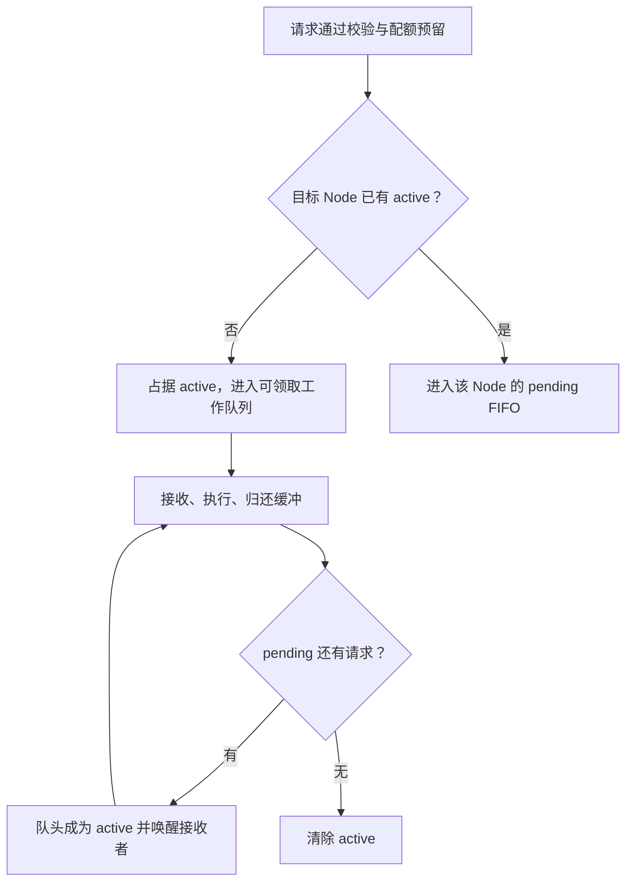

# 14｜不等回复的通知，仍然需要排队和归还

上一章：[安全与授权](13-security.md) · 下一章：[并发与稳定性](15-concurrency.md)

Client B 每隔 10 ms 向日志对象 X 发送一次 `record(seq, text)`。Server A 处理一条需要 40 ms，B 只希望继续界面工作，不需要日志方法的返回值。把同步 CALL 的等待去掉之后，四倍于消费能力的请求会留在哪里？如果下一条是“关闭日志”，它会不会抢在前一条写入之前执行？本章设计一个有界的 one-way 通道来回答这些问题。

> **实现边界：**本章是设计阅读稿。当前 [C08 mini-binder](../../include/uapi/mini_binder.h)没有 one-way 标志、每 Node 异步队列、线程池或异步预算；既有 CALL_REF 仍等待终态。第 09–13 章的多 owner、线程、FD、生命周期与授权机制也尚未落到实际驱动。下面的接口、数值和时序均明确作为设计推演；现有队列模型可运行，但不实现 Binder one-way。

## 1. 上一章的授权，并不能限制获准请求的到达速度

第 13 章决定谁能提交、转交和执行方法。现在假设 B 的身份真实、权限满足，正文和对象表也都合法；它仍可能比 A 快得多。若每条通知分配一块内存，允许提交的次数不受限，合法请求也能耗尽接收端内存。

沿用开头的固定负载：到达率为每秒 100 条，单个串行执行者每秒只能处理 25 条。持续输入时，积压的净增长约为每秒 75 条。把回复省掉只改变调用者的等待行为，不会把 40 ms 的服务工作变成 10 ms；即使机器一时能容纳所有字节，也没有稳定队列长度。

此外，`record(1)` 和 `record(2)` 属于同一对象状态，而状态对象 Y 的 `notify` 可以独立执行。新增需求不是“所有异步请求都排成一个全局队列”，而是明确哪些请求必须保持先后，以及哪些可以使用其他工作线程。

## 2. 首次需要的知识：成功至少有三个时刻

**提交成功**表示通信层接受了这条请求及其资源责任；**方法执行结束**表示服务分发函数返回；**业务效果完成**表示日志落盘、界面更新或其他约定效果已经发生。这三个事件可以相距很远。

同步 RPC 也不天然保证持久化，仍须看方法契约；one-way 进一步省掉了这条调用的业务回复。它不是一个“结果永远为成功”的同步方法。如果业务必须知道“磁盘已经写入”，应增加确认、查询或回调协议，并为该协议设计身份、顺序和退出处理。

这里的背压指接收方通过有界额度使提交者观察到消费能力不足。可以阻塞提交者，也可以拒绝本次提交，或按明确规则合并旧状态；选择必须成为协议的一部分。静默丢弃一条已报告接受的“扣款”不属于可以随意替换的策略。

还要区分接收缓冲和业务任务。服务收到一个 Parcel 后，可以把业务数据复制到自己的工作队列并归还 Parcel。内核只能看到缓冲已归还，看不到工作队列是否已处理完。早归还会解除内核的一部分限流，应用若建立无界二级队列，仍然可能耗尽内存。

## 3. 三个合理方案及其适用条件

| 方案 | 对调用者的效果 | 成本和约束 |
| --- | --- | --- |
| 继续同步调用 | 请求返回之前调用线程等待 | 接受、业务结果易关联，适合必须取结果的操作；慢服务直接影响调用线程。 |
| Client 建立工作线程和有界队列，由它同步调用 | 界面线程只等本地入队 | 可以隔离界面延迟、控制本地积压；仍需管理线程、退出和本地提交失败，多个 Client 各有队列。 |
| 通信协议支持 one-way | 调用者等待通信层接受，不等待业务回复 | 服务端共享异步额度和排序规则；调用者要另行处理过载、服务死亡和业务确认。 |

本章选择协议级 one-way，因为需要在多个 Client 之间共享接收端额度，并以目标对象决定排序。客户端有界队列仍可与它组合；选择 one-way 不会免除客户端队列自身的上限和清理责任。

## 4. 接口契约：接受以后谁负责

概念提交接口写为 `submit(target_handle, code, parcel, ONE_WAY)`，它没有出现在当前 UAPI 中。与同步 CALL 相同，它只查提交者的私有 Ref，固定目标 Node，复制输入快照，检查授权，并把对象或 FD 转换到接收者上下文。它不建立等候业务回复的同步调用栈。

最小接口只返回提交成功或提交错误，不输出一个必须回写到用户地址的新事务号。需要业务去重时，由应用在正文内携带请求标识；这个标识不能代替内核事务身份或调用权限。

| 返回或操作 | 本章规定的意义 |
| --- | --- |
| 提交返回 0 | 请求已进入目标的活跃位置或 pending 队列，资源由通信层接管。 |
| `EAGAIN` | 本次未接受，配额不增加；调用者可按策略等待、合并或稍后重试。 |
| `ENOMEM` / `EFAULT` | 准备阶段失败；私有临时内存、转换前缀和预留额度全部撤销。 |
| `EPIPE` / `EPERM` | 目标已死或授权不满足；不能以自动重试绕过授权，也不能继续使用旧目标。 |
| 对 one-way 请求执行 REPLY | 返回 `EINVAL`，不创建回复槽；接收方仍须归还请求槽。 |
| 对已交付请求 FREE | 归还该槽及其对象责任，并推动同 Node 的下一条异步请求。 |

提交点放在所有可失败准备之后、队列发布之处；在同一锁域里完成额度提交和队列链接。信号在提交前可使操作以未接受结束；提交后不能再把同一请求当作“从未接受”撤回。进程可能在内核接受后、用户态观察返回之前被杀死，因而业务重试仍可能重复，不能承诺恰好一次效果。

一个已经接受的请求不依赖发送线程继续等待。发送者 close、取消本地任务或退出，不自动撤销它。队列记录固定目标和转换结果；清理额度所需的发送者计费对象也要保留到请求释放，不能解引用已经销毁的 Client 上下文。

## 5. 顺序单位是 Node，以及它的活跃缓冲

本章为每个 Node 增加两个状态：`async_active` 表示已有一条异步请求处于活跃位置；`async_pending` 是其余请求的 FIFO。活跃请求可以尚未领取、正在服务线程执行，或执行已返回但接收缓冲尚未 FREE。



最先接受的请求把 active 置位，之后的同 Node 请求先放入 pending；不是等服务调用 RECEIVE 才置位。否则两个工作线程可能同时从进程队列领取 X 的两条请求。

只有活跃请求的缓冲被归还时才推进队头。单纯 RECEIVE 不推进，业务函数返回但仍持有 Parcel 也不推进。这样，同 Node 的下一条异步分发通常会等上一条分发归还缓冲；若应用提前归还并把工作转到别处，业务效果的先后就要由应用保证。

| 情况 | 可以推导的顺序 | 不能推导的顺序 |
| --- | --- | --- |
| 一个线程依次成功提交 X1、X2，普通 FIFO 模式 | 驱动先接受 X1，再接受 X2；X1 释放活跃缓冲后才放行 X2 | X1 所启动的后台任务一定先完成。 |
| 两个线程并发向 X 提交 | 由实际队列提交点产生一个顺序 | 按调用开始时间、日志打印先后或应用序号自动排序。 |
| 向不同 Node X、Y 提交 | 各 Node 自己维护异步顺序 | X 与 Y 之间的总顺序；是否并行还取决于线程池。 |
| 向 X 混合同步和异步请求 | 同步请求遵循同步路由，异步请求遵循本节 FIFO | 同步请求构成异步屏障，或与所有异步调用互斥。 |

多个 Handle 若指向同一个 Node，就共享该 Node 的异步序列；不能按 Handle 数字建立彼此独立的队列。相反，同一服务内两个不同 Node 即使指向类似业务，也不会自动共享顺序。

## 6. 状态与资源账目

第 06 章把终结、回复和缓冲归还分开。one-way 没有业务回复，仍需要独立记录“是否已接受”“是否已交付”“谁持有缓冲”，不能把状态压成一个 `done`。

| 状态 | 谁能操作 | 仍保留的责任 |
| --- | --- | --- |
| PREPARING | 提交线程独占，未对接收者发布 | 输入快照、临时转换资源和预留配额；失败全部回滚。 |
| PENDING | Node FIFO 持有记录 | 目标持有、接收槽、嵌入对象/文件账本、异步额度。 |
| ACTIVE_QUEUED | 接收工作队列持有记录 | 同上，且占据唯一 active；接收输出失败保持可重试。 |
| DELIVERED | 接收者持有槽，记录关联该槽 | 无回复等待者；FREE 或接收者最终退出负责清理。 |
| RELEASED / DROPPED | 已完成清理，记录不可再查 | 不再持有槽、目标、转换资源或额度；不得第二次推进队列。 |

教学实现可先把异步记录一直保留到 FREE，使队列状态和缓冲所有者容易核对。真实 Binder 可能更早释放某些事务结构，保留足够的缓冲/Node 关系；结构体寿命不同不改变资源责任。

FREE 的概念步骤是：验证 token 属于当前上下文及已交付槽；摘除唯一 active 关联；归还账本和对应额度；选择 pending 队头转为 active；必要时把它加入接收工作队列并唤醒。重复 FREE 返回未知 token 错误，不重复扣款、不再放行一条。锁和回收的具体协作留给下一章。

嵌入 HANDLE 与 LOCAL 对象仍按描述符逐项持有，即使它们和调用目标恰好是同一 Node。加入 FD 后，还要区分排队时的 file 引用、接收时安装的 FD 和接收者日后关闭文件的责任；释放消息不会自动关闭接收者已接管的 FD。

## 7. 有界预算：条数、槽和公平性同时计费

继承 C08 每接收上下文 16 个 4096 字节槽。设计先规定：其中最多 8 个槽可以被异步请求占用；单个发送者对该接收者最多 4 条异步在途请求；单 Node 最多 3 条，**均包含活跃和排队请求**。这些是本章便于核算的教学值，不是 Android 常量。

异步槽预算因此最多为 32768 字节 backing；一个 1 字节正文仍按一个 4096 字节槽占用。对象、FD 和记录元数据另设上限，不能把 backing 字节上限说成驱动总内存上限。16 个槽也仍被同步请求、回复和 grant 共用，异步额度剩余不保证物理槽一定可用。

把异步上限限制为 8，可避免异步流量独占全部 16 槽，但不是同步调用一定成功的保证。同步流量本身也能耗尽总槽数，用户态二级队列、CPU 和文件表也不由这个数字保护。

预留发生在发布之前。并发准备者必须把 reserved 也算进容量判断，否则十个线程都可能看到“还剩一个”，随后同时提交。失败释放 reserved，成功把它转成 in-use；不可在入队后才补记配额。

队列满时选择明确拒绝，本次不接受。调用方可以对“当前温度”合并成最新值，对“记录每笔账务”保留本地有界日志再等待确认。两种业务不可共用一个静默覆盖规则。重试应有截止时间、退避和业务去重，不能用无间隔循环继续压垮接收者。

per-Node 上限保护热点对象，per-sender 上限限制单方占用，接收者总量上限保护该进程。它们不会自动提供调度公平性；若需要公平执行，应另行规定不同活跃 Node 间的轮转，不能把 FIFO 本身当成公平证明。

## 8. 设计推演：两个对象、两个线程与一个不肯 FREE 的请求

这是确定性推演，不是当前 mini-binder 日志。前提为上述 16/8/4/3 额度，所有请求都占一个槽；目标 X、Y 属于 A，A 有两个接收线程；B 按表顺序提交，所有校验通过。暂时禁止服务归还任何槽，以便看清提交边界。

| 步骤 | B 的操作 | X 状态 | Y 状态 | B/接收端异步占用 |
| --- | --- | --- | --- | --- |
| 0 | 初始 | 无 active，pending 0 | 无 active，pending 0 | 0 / 0 |
| 1 | 接受 X1 | active=X1，pending 0 | 无 | 1 / 1 |
| 2 | 接受 X2、X3 | active=X1，pending=[X2,X3] | 无 | 3 / 3 |
| 3 | 尝试 X4 | Node 已达 3，`EAGAIN`，状态不变 | 无 | 3 / 3 |
| 4 | 接受 Y1 | 不变 | active=Y1 | 4 / 4 |
| 5 | 尝试 Y2 | 不变 | B 已达 4，`EAGAIN`，状态不变 | 4 / 4 |

现在允许两线程分别领取 X1、Y1。X2 不能被空闲线程提前领取；Y1 则可独立执行和 FREE。Y1 归还后占用变成 3/3，B 再次提交 Y2 并成功，占用恢复为 4/4。先前被拒绝的那次 Y2 没有自动变成待处理请求；这是一次新的接受。

让 X1 的业务方法返回，但显式保留它的接收缓冲。即使两个接收线程都空闲，X2 仍不得被放行。保持 Y2 未归还，再用一个显式控制事件归还 X1，active 才变成 X2，pending 剩 X3，占用从 4/4 降到 3/3。X3 仍等 X2 的 FREE，而不是等 X1 的业务回复。

若 X1 先把工作交给磁盘线程再 FREE，X2 可以开始，但 X1 的磁盘效果可能尚未完成。“提交顺序正确、分发顺序正确、最终效果乱序”可以同时成立；若 `close_log` 必须等待全部写入，服务须在自己的日志队列中实现这个屏障。

通过条件是每步额度与表一致，同 Node 不出现两份 active，Y 不因 X 的 pending 被强制串行，FREE 后额度恢复。失败判据是 X4/Y2 被接受却没有计费、单纯 RECEIVE 就放行 X2、重复 FREE 额外放行 X3，或 A 退出后额度永久不还。实际测试须用控制 pipe/屏障停在这些位置，并给整个测试设置截止时间。

## 9. 可运行的较小观察：有界队列会拒绝第三条

仓库已有普通 C 队列模型，可以先验证“容量不足是一种正常协议结果”。在仓库根目录执行：

```sh
make build/request_queue
timeout 5s ./build/request_queue fifo
```

模型容量为 2：101、102 入队，103 因 `queue_full` 被拒绝；随后按顺序领取，却按 102、101 的顺序回复，并拒绝重复回复。正确实验退出 0；模型内部预期失败没有被拒绝时退出 1，命令用法错误为 2。观察完整输出，不能只搜索某一条“成功”。

这个模型的队列仅统计尚未领取的同步请求，接收后会空出队列位置，且没有真实线程、Node 或映射。因此它**不能**证明本章的“在途额度包含已交付缓冲”，也不能证明 same-Node one-way 排序。它提供一个已存在、可运行的容量反例；第 8 节的更强语义仍是设计推演。程序结束无后台服务；生成文件可留供其他章节使用。

## 10. 失败、退出与业务可靠性

接收描述符输出失败时，活跃请求仍归队列，不能既保留旧 active 又把 pending 放行。对象转换失败时，反向归还已成功的转换前缀；还没接受的请求不计入业务送达数量。未授权的请求与配额不足的请求也必须分别统计，避免把策略问题解释成性能过载。

发送者退出后，已接受通知可以继续执行；需要的目标持有、转换结果和计费桶仍然有效。接收者最终退出则使目标失效，清理 active 和 pending、归还未交付的文件/对象持有以及槽预算。没有同步等待者可收业务回复，因此“先前提交返回 0”并不被追溯改写为业务失败通知。

死亡通知只能告诉观察者对象已失去 owner，不能精确报告此前每条通知是否产生效果。若 A 在写入后、记录确认前退出，B 重试可能重复；若 A 在执行前退出，原请求可能丢失。需要可靠效果时，要在应用层选择幂等键、持久日志、确认与去重保存期，而不是给 one-way 加一个“可靠”形容词。

本章不做超时自动删队列，也不实现冻结进程的特殊更新/合并协议。将来加入这些行为，必须同时定义丢弃了哪条、怎样释放其账本、调用方能否观察，以及会不会破坏普通 FIFO 的承诺。

## 11. 固定源码对照：推进发生在缓冲释放路径

下面固定 Linux v6.6 与 AOSP Android 14 提交 `bfcf75076e562945bae131a4929f29a90d0d2481`。真实 Binder 的协议事件、用户态分发和预算分别位于不同层，不能只读 `TF_ONE_WAY` 的判断就推导全部语义。

| 教学问题 | 教学机制 | 固定源码入口 | 相同点与差异 |
| --- | --- | --- | --- |
| 调用者不等业务回复 | ONE_WAY 提交 | [IPCThreadState::transact](https://github.com/aosp-mirror-neo/platform_frameworks_native/blob/bfcf75076e562945bae131a4929f29a90d0d2481/libs/binder/IPCThreadState.cpp#L807) | 真实实现区分等待 reply 与等待提交完成；mini 当前只有同步 CALL。 |
| 一个对象只有一个活跃异步序列 | active 与 pending | [binder_node 字段](https://github.com/torvalds/linux/blob/v6.6/drivers/android/binder_internal.h#L264)、[binder_proc_transaction](https://github.com/torvalds/linux/blob/v6.6/drivers/android/binder.c#L2751) | `has_async_transaction` 决定进入进程工作队列还是 Node.async_todo；排序对象是 Node。 |
| 接受不等于执行结束 | 独立提交完成事件 | [one-way 提交路径](https://github.com/torvalds/linux/blob/v6.6/drivers/android/binder.c#L3634) | 驱动排入完成工作；不是业务方法完成确认，也不证明效果持久化。 |
| FREE 推进下一条 | 释放 active 后提取队头 | [BC_FREE_BUFFER](https://github.com/torvalds/linux/blob/v6.6/drivers/android/binder.c#L3970)、[binder_free_buf](https://github.com/torvalds/linux/blob/v6.6/drivers/android/binder.c#L3767) | 从 async_todo 取下一条到 proc.todo；若无队头则清 active。mini C08 的 FREE 尚无这些动作。 |
| 异步不能占无限空间 | 接收端异步预算 | [预算初始化](https://github.com/torvalds/linux/blob/v6.6/drivers/android/binder_alloc.c#L781)、[分配检查](https://github.com/torvalds/linux/blob/v6.6/drivers/android/binder_alloc.c#L410)、[归还预算](https://github.com/torvalds/linux/blob/v6.6/drivers/android/binder_alloc.c#L659) | v6.6 起始为映射空间的一半，计入对齐数据和缓冲元数据；不是本章固定 8 槽，也不是独立保证同步成功的保留池。 |
| 用户态不发送业务 reply | 分发后归还请求 Parcel | [one-way 分支](https://github.com/aosp-mirror-neo/platform_frameworks_native/blob/bfcf75076e562945bae131a4929f29a90d0d2481/libs/binder/IPCThreadState.cpp#L1436)、[freeBuffer](https://github.com/aosp-mirror-neo/platform_frameworks_native/blob/bfcf75076e562945bae131a4929f29a90d0d2481/libs/binder/IPCThreadState.cpp#L1602) | libbinder 不发送业务回复，Parcel 释放通过命令缓冲发送 BC_FREE_BUFFER；归还命令何时被驱动消费也影响推进。 |
| 接收端退出清队列 | 清理 active/pending 责任 | [binder_node_release](https://github.com/torvalds/linux/blob/v6.6/drivers/android/binder.c#L5753) | 真实实现清理 async_todo 并处理引用/死亡；不保证每条已接受请求都执行。 |

上述 FIFO 讨论以普通、未被替换的 one-way 事务为前提。v6.6 在目标冻结且设置 `TF_UPDATE_TXN` 时，还可能在 [pending 队列替换过时事务](https://github.com/torvalds/linux/blob/v6.6/drivers/android/binder.c#L2792)。本章没有采用这项特性，不能用普通 FIFO 规则概括该版本所有标志组合。

同样，[oneway spam 检测](https://github.com/torvalds/linux/blob/v6.6/drivers/android/binder_alloc.c#L526)是在剩余额度较低时识别占用者的诊断机制；它不能直接解释成“每发送者固定最多四条”。真实阈值、空间管理与错误转换应从固定版本继续追踪。

## 12. 练习与带理由的核对

1. **把 X1 的接收描述符交给线程之后，能否立即放行 X2？**按本章协议不能。X1 仍占 active；FREE 才表明缓冲责任已经交还，也才推进队头。
2. **两个 Handle 都指向 X，能否让它们各排一条 active？**不能。Handle 是调用者私有名字，异步排序跟随它们共同指向的 Node。
3. **B 的四条请求都已交付但没有 FREE，能否再接受第五条？**不能。在途计费包含已交付缓冲，否则接收者不断领取即可绕过额度。
4. **同步 `flush()` 排在 one-way `write()` 后调用，是否自动保证落盘？**没有这种通用屏障。须定义 flush 与服务工作队列如何关联，且确认其效果范围。
5. **服务死亡后重试所有已成功提交的通知能否避免丢失和重复？**不能同时保证。提交成功与业务效果分离，重试须配合应用层去重或其他可靠性协议。

现在每一次 FREE 都可能同时改变引用、队列、预算和可唤醒线程；退出路径也要完成相同的账目。如果多个 CPU 同时提交、释放和销毁目标，哪些动作必须作为一个整体？[下一章](15-concurrency.md)从当前大互斥锁出发审查这些竞争。
