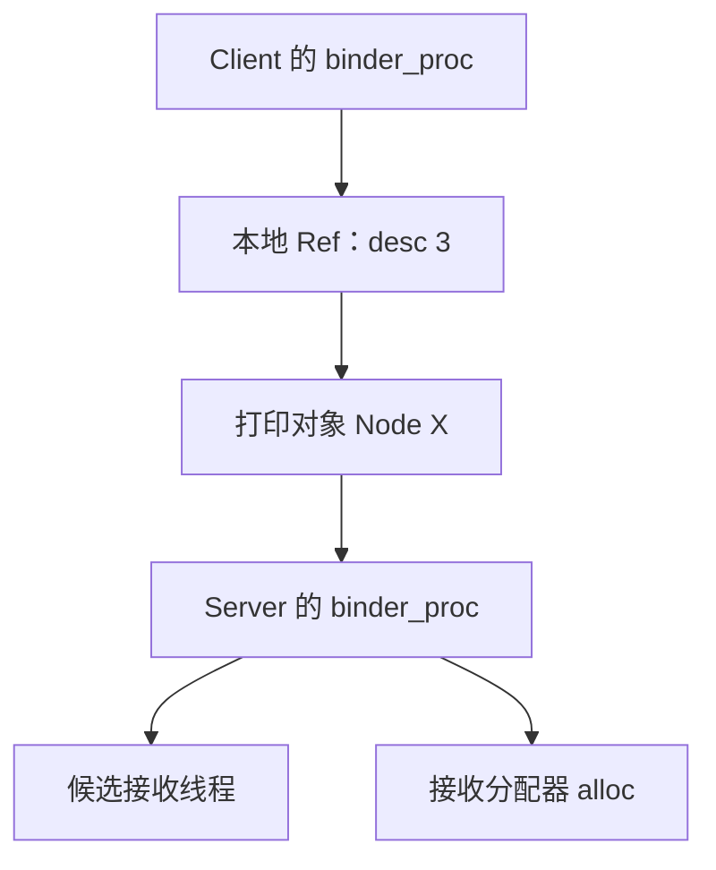

# 16｜带着一次调用，找到真实 Binder 的各个部件

Client 已经拿到打印对象的 Handle 3，准备调用 `print("photo.jpg")`。如果现在打开真实 Binder 源码，第一件事该找什么？我们需要知道：3 在谁的表里查，查到的对象归谁，哪个线程接收请求，文件名放在哪里，以及 Client 退出后谁收尾。

本章就沿这个场景建立一张源码地图。先按职责认识少量结构，再沿请求和退出两条路径检查它们的联系。读完应能从“客户端找不到对象”或“接收缓冲一直不释放”这样的现象，定位应该读哪部分代码。

**阅读边界：**[前一章](15-concurrency.md)整理的是教学扩展的并发设计；当前 mini-binder 实际实现仍到 C08。这里对照上游 Linux **v6.6** 与固定 [AOSP Android 14 提交](../reference/aosp-userspace.md)，使用静态源码分析；没有把两个版本构建成运行过的 Android 系统。已有 VM 的真实 Binder 探测只验证设备和协议版本，不能充当本章打印服务的运行记录。

## 1. 先用五个问题分工

设调用者为 C，打印对象 X 的拥有者为 S。名字服务已完成发现，不再参与这次业务调用；先不加入 FD、回调或 oneway。

| 当前问题 | 需要保存的状态 | 真实结构 |
| --- | --- | --- |
| C 的 Handle 3 指向谁？ | C 的私有描述符表，以及到目标对象的关系 | `binder_proc`、`binder_ref` |
| X 由谁实现？ | 发布者、用户态身份信息和引用状态 | `binder_node` |
| S 的哪个执行流接手？ | 可接进程工作线程、线程专属待办和嵌套关系 | `binder_thread`、`binder_work` |
| 谁等待这次回复？ | 请求来源、目标、同步栈和传输状态 | `binder_transaction` |
| 文件名和回复放哪里？ | 接收者映射区中的分配与释放状态 | `binder_alloc`、`binder_buffer` |

这些结构把不同变化速度的状态分开。Ref 可以消失而在途调用继续固定目标；业务线程可以退出而进程中还有别的线程；一笔传输的事务记录可以释放，而接收者尚未 FREE 的缓冲仍存在。合成一个“请求对象”会使这些情况难以解释。

先记职责，再看字段。红黑树是高效查表的数据结构，不是引入 Ref 的动机；双向链表也不是事务顺序的业务保证。

## 2. binder_proc：一次打开建立的通信记录

[binder_open](https://github.com/torvalds/linux/blob/v6.6/drivers/android/binder.c#L5612)分配 `binder_proc`，保存打开者线程组、文件凭据、设备通信域，初始化分配器，最后挂到 `filp->private_data`。后续 ioctl 通过打开文件找到它。

因此不要把它理解成内核的 `task_struct`，也不要断言一个 PID 永远只有一份记录。同一进程独立打开设备两次，会走两次打开路径；`dup()` 增加同一个打开文件的引用，不会再次执行 binder_open。跨 Binder 设备打开还属于不同通信域。

在 [binder_proc 定义](https://github.com/torvalds/linux/blob/v6.6/drivers/android/binder_internal.h#L402)中，先看这几组字段：

- `refs_by_desc`、`refs_by_node`：同一张远程引用关系的两个索引，分别按本地编号和目标 Node 查找。
- `nodes`：这个通信记录拥有的本地对象节点。
- `threads`、`waiting_threads`、`todo`：线程记录、可选择的等待线程和进程级工作。
- `alloc`、`context`、`cred`：接收内存分配器、所属设备通信域和保存的凭据。
- `is_dead`、`tmp_ref`：退出状态和内核临时使用责任，不能用“已经 close”替代这些条件。

`binder_context` 管一个设备域的 Context Manager；`binder_proc` 管某次打开的通信状态。两者名称都含 context 的概念，作用范围却不同。第 09 章的服务名表又是用户态管理器自己的业务状态，不在这两者中。

## 3. binder_ref 和 binder_node：从编号走到拥有者

Client 发来的 3 只能在 Client 所属 proc 的 Ref 表中解释。[binder_get_ref_olocked](https://github.com/torvalds/linux/blob/v6.6/drivers/android/binder.c#L1015)按描述符找记录；查找失败不能退回“试试是不是全局 Node ID”。Handle 0 的 Context Manager 特例有自己的分支。

[binder_ref](https://github.com/torvalds/linux/blob/v6.6/drivers/android/binder_internal.h#L314)把持有者 proc、目标 node、本地 desc、强弱计数和死亡通知记录联系起来。按 Node 的索引用于复用同一远程对象的本地 Ref，而非每接收一次对象就无条件建立一个新 Handle。

[binder_node](https://github.com/torvalds/linux/blob/v6.6/drivers/android/binder_internal.h#L230)属于对象拥有者，保存 `ptr`、`cookie`、引用状态和异步工作状态。`ptr/cookie` 是真实用户态协议交付和对象关联的信息，不是内核可以直接跳转执行的函数地址；Node 也没有复制打印机对象的全部业务状态。



图中箭头表示关联，不能一律解释成 C 语言对象所有权。例如 Node 保存 owner proc 的关联，并不保证远程 Ref 能阻止那个进程退出；退出后 Node 还可能为了死亡引用的清理继续存在。

同样，调试日志里的 Node `debug_id` 是取证标识，不是任何进程都能导入的目标 Handle。调试编号、本地 Handle 与用户对象指针即使数值偶然相等，也不共享查找规则。

## 4. binder_thread 和工作项：队列里不全是业务请求

[binder_get_thread](https://github.com/torvalds/linux/blob/v6.6/drivers/android/binder.c#L4884)取得当前调用线程的通信记录。驱动可以创建这份记录，但业务线程仍由用户态创建；分配一个 `binder_thread` 不会凭空出现执行打印代码的线程。

[binder_thread](https://github.com/torvalds/linux/blob/v6.6/drivers/android/binder_internal.h#L476)重点看 `todo`、`transaction_stack`、`wait` 和 looper 状态。进程级工作可交给符合条件的线程，定向回复和同步调用链相关工作则需要线程级关联。等待外层回复的线程也可能处理嵌套回调，这正是第 10 章等待循环不能只接受“最终结果”的原因。

[binder_work](https://github.com/torvalds/linux/blob/v6.6/drivers/android/binder_internal.h#L149)还表示引用通知、提交完成、错误和死亡通知。把 todo 中的每一项都当作一次服务方法，会误读通知处理与事务计数。

候选线程条件可从 [binder_available_for_proc_work_ilocked](https://github.com/torvalds/linux/blob/v6.6/drivers/android/binder.c#L560)开始读。它检查同步栈、线程待办和 looper 状态；“线程现在睡着了”不足以证明它可以接任意进程请求。

这里保留两个黑盒：调度器何时真正运行被唤醒线程，以及用户态线程池如何决定业务并行度。驱动队列交付与 CPU 调度是相邻而不同的层，不能用一次 wakeup 推出确定的执行时延。

## 5. transaction 与 buffer：控制和数据分开跟

[binder_transaction](https://github.com/torvalds/linux/blob/v6.6/drivers/android/binder_internal.h#L514)保存来源线程、目标进程/线程、两侧栈关联、flags、code 和接收 buffer。同步请求与同步回复分别产生传输处理；不要把一次用户层调用画成一个永远不变的内核事务结构。

请求 buffer 来自 **Server 的 alloc**，回复 buffer 来自 **Client 的 alloc**。[binder_alloc_new_buf](https://github.com/torvalds/linux/blob/v6.6/drivers/android/binder_alloc.c#L562)管理的是接收者映射区域中的分配。Client 交给 ioctl 的发送地址，与 Server 读到的接收地址处于不同地址空间，不需要数值相同。

数据路径仍有用户到接收 backing 的复制，还要处理特殊对象与 offsets；映射的价值是使接收者可以直接读取驱动准备好的区域，不能把它概括为整条 RPC 零复制。

接收者释放 Parcel 引用后，libbinder 的 free 回调生成 BC_FREE_BUFFER；驱动再核对这个地址是否属于当前分配器、是否已交付、是否允许用户释放，释放对象责任并归还区域。请求回复了，不能因此跳过请求 buffer 的释放；业务还想使用其中字符串，不能在 FREE 后继续解引用旧地址。

## 6. 先画责任，再读锁

同一个 Client 可以在另一个线程释放 Ref；Server 可以在接收前退出。查到一根指针后，只要准备放锁继续使用，就必须回答“哪份持有阻止它此时被释放”。

| 受保护的关系 | 主要锁域 | 放锁继续使用时要追踪什么 |
| --- | --- | --- |
| proc 的 Ref 索引 | `proc->outer_lock` | 目标 Node 的稳定持有与退出处理 |
| Node 引用及跨 proc 关系 | `node->lock` | Node 临时引用、owner 是否已清空 |
| proc/线程待办和同步栈 | `proc->inner_lock` | proc/线程临时引用和事务是否已摘链 |
| 接收区域分配 | 分配器自己的同步 | buffer 是否仍分配、VMA 是否仍有效 |

[binder.c 文件头](https://github.com/torvalds/linux/blob/v6.6/drivers/android/binder.c#L9)明确给出主要顺序：outer → node → inner。它还约束不同 proc 的嵌套；不能把三个名字抄成“任意进程都按此顺序随便拿锁”的万能规则。具体函数后缀和结构注释说明调用者应已持什么锁。

真实路径用短 spinlock 临界区与临时引用协调工作；当前 mini 的 `mb_lock` 是允许睡眠的 mutex，一些用户复制仍在其保护下。这两种选择的可睡眠条件、竞争成本与退出路径不同，不宜机械改名照搬。

## 7. 沿 Handle 3 走一遍入口

这是一条静态追踪路线，字母表示阅读步骤，不是日志中的事务 ID：

1. **A：找到调用者。** binder_ioctl 从文件取 proc，取得当前 thread，BINDER_WRITE_READ 交给写读协议处理。
2. **B：解释命令。** binder_thread_write 识别 BC_TRANSACTION，读取 `binder_transaction_data`；code 与普通参数仍归业务协议。
3. **C：固定目标。** binder_transaction 查 C 的 Handle 3，取得 X 和其 owner S 的稳定使用责任，执行相关安全检查。
4. **D：准备接收数据。** 从 S 的 alloc 分配，复制普通数据及 offsets，转换对象/FD，失败按成功前缀清理。
5. **E：提交工作。** 根据同步栈与可用线程决定工作目的，Client 栈保存等待关系。
6. **F：交付用户态。** S 的线程读取待办，驱动交付 BR_TRANSACTION 和 S 地址空间内的数据位置；用户态才调用实现对象。

回复、缓冲归还和失败分支要继续追踪，不能在 F 停下就宣称读懂完整调用。下一章会把 A–F 展开成可逐事件核对的完整表。

## 8. 换一条线：进程退出后发生什么

假设 S 在请求已交付、还未回复时退出。C 的强引用不会让操作系统拒绝终止 S，也不能让堆上的业务对象继续执行。

[binder_thread_release](https://github.com/torvalds/linux/blob/v6.6/drivers/android/binder.c#L4934)处理线程关联，避免事务继续指向已经不可运行的线程；[binder_deferred_release](https://github.com/torvalds/linux/blob/v6.6/drivers/android/binder.c#L5818)处理 proc 层退出与所属资源。远端还持有的死亡 Node/Ref 信息可能继续用于报告错误、交付通知和最终清理。

关闭一个 fd、最终文件 release、VMA close、用户进程退出是不同入口。[binder_release](https://github.com/torvalds/linux/blob/v6.6/drivers/android/binder.c#L5737)安排延迟释放，不等于每次 close 都在原调用栈中立即销毁全部结构；[binder_vma_close](https://github.com/torvalds/linux/blob/v6.6/drivers/android/binder.c#L5563)则让分配器知道原映射已失效。

退出时要查三张账：未处理的工作怎样结束，接收内存及嵌入资源怎样归还，其他进程还指向哪些死亡元数据。只看 `kfree(proc)` 的位置，会漏掉前面为安全到达该位置而做的大部分工作。

## 9. 和当前 mini 逐项对应

| 本书已经实现的结构 | 可以借此理解真实结构 | 不能直接等同的部分 |
| --- | --- | --- |
| `mb_context` | 每次打开保存通信状态 | 仍有单 Server 模式和 TGID 使用约束，没有真实 looper/线程树 |
| `mb_node` | 稳定对象身份和 owner 退出后的元数据 | 用户态标识与真实 ptr/cookie、强弱通知均不同 |
| `mb_ref` | 私有 Handle、同 Node 复用与释放 | user/buffer 单位不是完整 Android strong/weak 协议 |
| `mb_transaction` | 固定目标、关联回复、终结及清理 | 事务 ID 模型不等于真实线程同步栈及全部错误事件 |
| `mb_region`、`mb_slot` | 映射、分配和独立 FREE | 固定槽分配器不等于真实可变大小 buffer、异步预算和 FD 修正 |

源码入口是 [mini 驱动](../../driver/mini_binder.c)和 [UAPI](../../include/uapi/mini_binder.h)。比较时先问职责是否相近，再问接口和时间点是否相同。结构名相似不是 ABI 兼容证据。

## 10. 用手边源码验证这张地图

仓库已有 P04 下载的 Linux 源码时，在根目录运行：

```sh
rg -n '^struct binder_(proc|thread|node|ref|transaction)' build/kernel/linux-6.6/drivers/android/binder_internal.h
rg -n 'binder_get_ref_olocked|binder_alloc_new_buf|binder_proc_transaction' build/kernel/linux-6.6/drivers/android/binder.c
rg -n 'binder_thread_release|binder_deferred_release|binder_vma_close' build/kernel/linux-6.6/drivers/android/binder.c
```

输出应分别找到结构定义、目标/数据/队列的连接点和退出入口。逐个打开命中行附近的函数，核对上面的责任表；匹配结果只是定位证据，不能单凭符号出现就认为语义得到验证。命令不修改源码，无需清理内核状态。没有源码时按 [P04](p04-environment.md)准备环境，或打开文内固定版本链接阅读。

当前 [binder_probe.c](../../tests/kernel/binder_probe.c)只做 open 和 BINDER_VERSION，并比较编译头与运行协议号。已有报告中的 BINDER_PROBE_PASS 支持“真实设备能响应版本查询”，不能证明创建了对象、进行了同步调用或观察了调度。本章没有另外声称完成这些实验。

如果进一步做真实调用观测，应先固定服务/客户端构建与镜像，确认 tracefs 可用事件，再记录一次无回调、无特殊对象的请求。trace 里的 `debug_id`、发送/接收线程和 buffer 事件用来关联执行；业务成功还需服务入口及返回值。不要把厂商设备的一组 debugfs 路径视为所有版本都有的稳定 ABI。

## 11. 阅读练习与解析

1. **Client 传来的 Handle 有效，Server 却已经退出，应该先查什么？** 查 Ref 到 Node 的关系与取得 owner 持有的路径，再查目标死亡分支；Handle 在表里不等于 owner 活着。只查用户态函数分发会跳过失败发生的位置。
2. **Server 已回复，接收空间却一直减少，是事务栈问题吗？** 先查 Parcel 借用是否结束、BC_FREE_BUFFER 是否送出和 buffer 是否归还。回复关系与接收空间有独立责任，不能仅凭栈弹出认定内存已释放。
3. **同 PID 两次 open，Handle 3 是否可以通用？** 不可以据此推断。两次独立打开建立不同 proc 记录，描述符应回到对应表中解释；复制 fd 才共享原打开文件。
4. **想把全部 Ref 查找改成无锁，是否只需给计数加 atomic？** 不够。查表到加引用之间记录可能被释放，还需定义索引删除、读者保护和最终回收；计数原子性只覆盖其中一步。

这些练习的答案来自关系和状态，而非背字段。下一章从已经找到的入口出发，追完一次 `add(1, 2)`，同时检查控制事件、两份接收 buffer 和嵌入资源各走到哪里。

[继续：第 17 章完整调用链](17-call-trace.md)。
