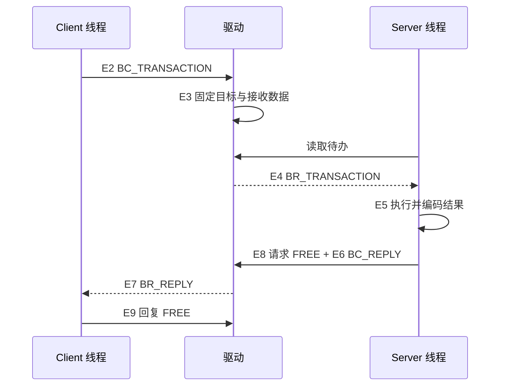

# 17｜从参数到结果，追完一次 add 调用

Client 调用 `add(1, 2)`，Server 返回 `3`。这次先不增加新功能，我们要回答一个具体问题：从客户端准备参数，到它真正读到 `3`，请求、回复和两边的缓冲分别经过哪里？如果最后没有得到结果，又该从哪个事件继续查？

上一章已经把 proc、thread、node、ref 和 alloc 放到同一张地图中。本章选一条最短的同步路径，给事件编号，再分别追踪数据、对象和文件。先把普通加法走通，之后只改变一个条件，看回调、oneway 和目标死亡会怎样偏离这条主线。

**版本和证据：**以下对应上游 Linux **v6.6** 与 [AOSP Android 14 固定提交](../reference/aosp-userspace.md)的 kernel Binder 分支。业务例子的 `ADD` 操作号、参数及结果是阅读场景，未生成或运行一个真实 Android 加法接口。实际 mini 驱动仍到 C08，已经运行的加法演示见[既有报告](../reports/m0-m1-progress.md)。两者协议与日志不能互换。

## 1. 先固定起点，避免把发现也混进来

假定 Client C 已持有 Server S 内加法对象 X 的强引用，Client 本地 Handle 为 3；两者都已打开同一 Binder 域的设备并完成所需映射。S 有一个可接请求的用户线程。首次服务发现与线程启动已经完成，不属于本次待测量的调用时间。

业务约定是：请求按接口约定写入两个整数 1 和 2，S 先校验接口及参数，再计算并编码整数 3。真实 AIDL 或手写协议还可能包括接口 token、状态头和其他字段；不能由“两个整数”推出整份 Parcel 必定只有 8 字节。

我们记录四类信息：

| 跟踪线 | 每个事件需要问什么 |
| --- | --- |
| 控制 | 这是提交请求、交付请求、提交回复，还是交付回复？ |
| 线程 | 当前由 C 的调用线程、S 的接收线程，还是延迟清理工作执行？ |
| 数据 | 地址属于发送者还是接收者，谁保证它仍有效？ |
| 资源 | 哪一份事务、buffer、Ref 或文件持有在此取得或释放？ |

系统调用进入内核不会自动切换到 Server 的线程。C 提交请求时由 C 的当前线程运行驱动代码；S 读取工作时才由 S 的线程进入驱动，然后返回 S 的用户态执行方法。

## 2. 用九个事件把主线串起来

下面的 E1–E9 是正文的事件编号，不是 trace 的 debug ID，也不是用户 ABI 中的新字段。

| 事件 | 谁做什么 | 完成后能确认什么 |
| --- | --- | --- |
| E1 | C 的代理准备请求 Parcel，调用 BpBinder | 用户态已有待发送的业务字节。 |
| E2 | IPCThreadState 组织 BC_TRANSACTION，进入写读 ioctl | 命令进入驱动处理，尚不能说 S 已执行。 |
| E3 | 驱动查 Handle，固定目标，准备 S 的请求 buffer | 参数与特殊资源具备可交付的接收者表示。 |
| E4 | S 的线程取得 BR_TRANSACTION | 请求已交给 S 用户态，业务仍可能拒绝。 |
| E5 | S 解码并执行加法，编码回复 | 本次例子的业务已算出 3。 |
| E6 | S 发送 BC_REPLY，驱动准备 C 的回复 buffer | 回复沿原同步调用关系路由。 |
| E7 | C 的线程取得 BR_REPLY 并解码 | C 现在才有足够信息取得业务结果。 |
| E8 | S 归还请求 buffer | 请求数据及其临时资源责任终止。 |
| E9 | C 归还回复 buffer | 回复数据及其临时资源责任终止。 |

E8 的实际时点要按用户态版本读。本次固定 AOSP 的同步分发在 sendReply 前清掉请求 Parcel 的数据，故释放命令可先于或与回复一批送出；它不是保证永远发生在 E7 之后的第八个时间点。编号用于区分职责，只有明确依赖才能连成顺序。



图把同一次写读 ioctl 内的命令拆成逻辑事件，不能据箭头数量统计系统调用次数。BC 与 BR 是双方协议命令方向；内核不会直接调用服务对象的 add 函数。

## 3. E1–E2：代理准备字节，库准备驱动命令

[BpBinder::transact](https://github.com/aosp-mirror-neo/platform_frameworks_native/blob/bfcf75076e562945bae131a4929f29a90d0d2481/libs/binder/BpBinder.cpp#L333)在 kernel Binder 路径把本地 Handle、code、Parcel 和 flags 交给 IPCThreadState。该文件另有 RPC Binder 路径，本章不能把跨主机或会话实现的行为拼进来。

[IPCThreadState::transact](https://github.com/aosp-mirror-neo/platform_frameworks_native/blob/bfcf75076e562945bae131a4929f29a90d0d2481/libs/binder/IPCThreadState.cpp#L807)组织事务，再根据 TF_ONE_WAY 决定等待方式。同步调用即使用户没有提供 reply 指针，也会使用临时回复 Parcel 等待；“我不读取返回值”不会自动变成 oneway。

[writeTransactionData](https://github.com/aosp-mirror-neo/platform_frameworks_native/blob/bfcf75076e562945bae131a4929f29a90d0d2481/libs/binder/IPCThreadState.cpp#L1231)分别填入数据地址/长度和对象 offsets 地址/长度，把 BC_TRANSACTION 与事务结构写入 `mOut`。这里填入的 sender 身份字段不能作为远程可信身份；内核交付身份有自己的生成路径。

随后 talkWithDriver 通过 BINDER_WRITE_READ 传输输出命令并接收事件。命令可以批量发送，read/write consumed 字段分别记录已消费范围。不能把“调用了 writeTransactionData”当作驱动已经读完发送内存的证据。

发送 Parcel 至少要活到驱动完成相应消费；不能在 `writeTransactionData()` 刚把命令记入 mOut 后就释放它。公开同步 `transact()` 完成后的发送对象可以按接口约定销毁。数据校验错误、无法构造命令和 ioctl 失败也要与远端业务返回错误区分。

## 4. E3：目的地由 Handle 决定，方法由用户态解释

[binder_ioctl_write_read](https://github.com/torvalds/linux/blob/v6.6/drivers/android/binder.c#L5049)调用写协议处理，[BC_TRANSACTION/BC_REPLY 分支](https://github.com/torvalds/linux/blob/v6.6/drivers/android/binder.c#L4014)进入 binder_transaction。普通非零 target 按 C 的 Ref 表解析；Handle 0 是管理器引导的特殊分支。

[binder_transaction 的目标选择](https://github.com/torvalds/linux/blob/v6.6/drivers/android/binder.c#L3016)取得 Node、目标 proc 及必要的稳定持有，再做安全检查与同步栈检查。驱动使用 code 传递方法编号，不认识“ADD”在业务上意味着整数相加。

[接收分配](https://github.com/torvalds/linux/blob/v6.6/drivers/android/binder.c#L3226)使用 S 的 alloc。请求数据与 offsets 被复制并验证，特殊对象逐项转换；转换一半失败时，只清理由已成功前缀取得的资源。S 不会得到可以任意修改 C 发送区的指针。

提交前失败不能留下可领取的半个请求；提交后还要处理目标线程或进程退出。[同步提交分支](https://github.com/torvalds/linux/blob/v6.6/drivers/android/binder.c#L3611)把事务接入调用者同步栈，并把目标工作提交给进程/线程路径。查表、固定、构造和可见提交是不同阶段。

## 5. E4–E5：Server 收到后才开始业务

[binder_thread_read](https://github.com/torvalds/linux/blob/v6.6/drivers/android/binder.c#L4374)交付待办。如果是调用目标，会写入 Node 的本地 ptr/cookie、code、flags、接收地址与可信身份字段，生成 BR_TRANSACTION 或带安全上下文的对应事件。控制头仍需复制到读取者，映射不取消所有复制。

libbinder 的 [executeCommand](https://github.com/aosp-mirror-neo/platform_frameworks_native/blob/bfcf75076e562945bae131a4929f29a90d0d2481/libs/binder/IPCThreadState.cpp#L1354)用接收地址建立借用数据的 Parcel，保存外层调用身份，再设置本次身份。对普通本地目标先尝试取得用户态强引用，然后调用 BBinder::transact；Node 的内核存活不替代这一步。

[BBinder::transact](https://github.com/aosp-mirror-neo/platform_frameworks_native/blob/bfcf75076e562945bae131a4929f29a90d0d2481/libs/binder/Binder.cpp#L359)处理通用事务后，把普通业务 code 交给 onTransact。接口分发器校验并解码，最终执行 add。整数相加发生在 S 的用户态代码中。

若接口 token 不对、参数截断或调用者无权限，S 可以在此返回业务/接口错误。驱动此前成功交付只证明通信走到了 E4，不保证 E5 一定算出 3。业务日志应同时记录请求关联和实际结果，不能只留下“进入 transact”。

## 6. E6–E7：回复找的是原调用线程

S 的 sendReply 组织 BC_REPLY。驱动按 S 的同步栈顶取得被回复的调用，并核对两侧栈关系；BC_REPLY 不是让 S 任意提供一个 Client PID 就可以回消息的通用发信命令。

[binder_transaction 的 reply 分支](https://github.com/torvalds/linux/blob/v6.6/drivers/android/binder.c#L2945)固定等待者，为 C 分配回复 buffer，处理回复内的特殊资源，再将 BR_REPLY 对应的工作交给 C 的等待线程。请求传输的记录与回复传输的记录不能只凭相同函数名视为同一个实例。

C 的 [waitForResponse](https://github.com/aosp-mirror-neo/platform_frameworks_native/blob/bfcf75076e562945bae131a4929f29a90d0d2481/libs/binder/IPCThreadState.cpp#L1004)在读到 BR_REPLY 后，把接收数据交给 reply Parcel；若有 TF_STATUS_CODE，则按该分支读取状态并清理。接口层还需按约定解释状态和业务结果，才能把 3 返回给本地调用者。

这个等待循环也会处理其他命令。同步等待中遇到 BR_TRANSACTION 可能意味着需要执行回调；只把它写成“不断 read，直到出现 reply”会掩盖第 10 章的重入行为。

## 7. BR_TRANSACTION_COMPLETE 到底完成了什么

它表示驱动协议中的提交完成工作，与 BR_REPLY 的业务回复职责不同。不能在 Client 收到 COMPLETE 时就把 result 标成 3。

尤其不能机械把时间线画成“先 COMPLETE，Server 才开始”。v6.6 的普通同步提交刻意延后这项工作，避免调用方立即返回用户态，使目标更快开始处理，以降低事务延迟；它可能直到回复或错误路径才交给调用者。来源是[同步提交的延后工作分支](https://github.com/torvalds/linux/blob/v6.6/drivers/android/binder.c#L3614)。

对同步 reply 等待，AOSP waitForResponse 遇到 COMPLETE 后继续等真正回复。对不需要业务回复的 oneway 等待，COMPLETE 才可能结束相应的提交等待。语义与等待条件共同决定返回，事件名称本身不保证业务效果。

同理，打印服务已经执行成功却在回复交付前退出时，Client 只得到失败也不能推断“没打印”。事务终结一次和外部副作用恰好执行一次仍是不同保证。

## 8. E8–E9：沿两份 buffer 各查一次账

| buffer | 分配器 | 用户态临时使用者 | 归还触发 |
| --- | --- | --- | --- |
| 请求 | S.alloc | S 的请求 Parcel | 请求 Parcel 放弃借用，free 回调生成 BC_FREE_BUFFER |
| 回复 | C.alloc | C 的回复 Parcel | reply 不再需要其数据时生成自己的 BC_FREE_BUFFER |

固定 AOSP 的[同步分发清理](https://github.com/aosp-mirror-neo/platform_frameworks_native/blob/bfcf75076e562945bae131a4929f29a90d0d2481/libs/binder/IPCThreadState.cpp#L1437)在 sendReply 前执行 `buffer.setDataSize(0)`，以归还请求占用的空间；注释直接说明这是为了避免客户端收到回复后再发请求时旧空间尚未释放。实际何时 flush 输出命令，还要沿 sendReply/talkWithDriver 检查批处理。

[freeBuffer](https://github.com/aosp-mirror-neo/platform_frameworks_native/blob/bfcf75076e562945bae131a4929f29a90d0d2481/libs/binder/IPCThreadState.cpp#L1602)把地址写入 BC_FREE_BUFFER，而非直接在用户态 free 那段映射。[binder_free_buf](https://github.com/torvalds/linux/blob/v6.6/drivers/android/binder.c#L3767)解除关联、推进需要推进的异步工作、释放嵌入资源责任，再归还分配区。

因此“已经生成 FREE 命令”“驱动已经消费 FREE”“buffer 已归还”也要区分。测试应在确认驱动消费后看活资源，不要要求每次用户层 Parcel 析构时所有远端计数都已同步归零。

## 9. 给请求加一个对象，重走数据线

现在 C 附上回调对象 Y，S 要在请求处理结束后保存它。普通业务字段仍由用户态解释，offsets 指出的特殊描述符则由驱动处理。

1. C 发送 LOCAL Y：驱动确认来源并为 S 建立或复用 Ref，把描述符改成 S 的 Handle。
2. S 在请求 buffer 活着时解出对象。要长期保存，用户态代理/强引用与驱动持有协议必须完成相应协作。
3. 请求 FREE 归还消息临时责任，不能撤销应用已经合法取得的长期对象持有。
4. 如果稍后把该远程对象发回原 owner，驱动可能转换回本地 BINDER 表示，而非保留 S 的 Handle。

实际入口是 [binder_translate_binder](https://github.com/torvalds/linux/blob/v6.6/drivers/android/binder.c#L2129)、[binder_translate_handle](https://github.com/torvalds/linux/blob/v6.6/drivers/android/binder.c#L2182)与 [buffer 对象释放](https://github.com/torvalds/linux/blob/v6.6/drivers/android/binder.c#L1935)。第 08 章已经实验了这些关系的教学子集，真实 strong/weak 及 owner 通知不能直接拿 user/buffer 两个计数代替。

## 10. 再加一个 FD，追踪安装而不是整数

C 附带已打开照片文件的 fd 7。S 的 7 可能正是另一个文件，所以请求中的整数必须被解释为发送者文件表入口，不能原样当 S 的 fd。

[binder_translate_fd](https://github.com/torvalds/linux/blob/v6.6/drivers/android/binder.c#L2255)检查是否接受 FD，fget 取得 `struct file` 引用，经过安全检查后保存待修正记录。此时还没有在 C 的线程里替 S 随便装一个 fd。

等到 S 的线程领取，[binder_apply_fd_fixups](https://github.com/torvalds/linux/blob/v6.6/drivers/android/binder.c#L4333)在接收上下文预留新编号、改写接收数据，并在成功预留/改写后安装。中途失败要归还已预留编号和文件引用，S 不能收到一半有效的 FD 对象。

完整调用还需跟用户态接收对象的 fd 所有权：最终 close 谁来做、Parcel 拥有哪些 fd、是否转出给应用。已经成功交付的普通单 FD 不能一概当成由 BC_FREE_BUFFER 关闭；buffer cleanup 对不同对象类型和失败阶段的责任应读对应分支。第 11 章的 Socket 示例只证明 Linux 文件传递基本语义，不代表 mini 已实现上述路径。

## 11. 只改变一个条件时，主线怎样偏离

| 条件变化 | 从哪里分支 | 不应再期待什么 |
| --- | --- | --- |
| S 处理中同步回调 C | 等待线程 executeCommand 和驱动祖先栈路由 | C 完全不执行其他业务便等到外层回复 |
| 请求有 TF_ONE_WAY | 异步提交与 Node 队列，用户态不发送普通回复 | 每个请求都沿 E6–E7 得到业务返回值 |
| S 在排队前后退出 | 目标取得、工作提交或退出清理 | 有 Ref 就保证本次执行成功 |
| C 退出但 S 已领取 | 调用来源失效与接收 buffer 清理 | S 的用户态业务副作用会自动撤销 |
| 回复 FD 安装失败 | C 领取回复时的 fd fixup | “S 已算完”必定意味着 C 能成功取得回复 |

每次加一个分支再查相应资源，能避免把理想时序图当成协议的全部。失败事件应与 ioctl 返回值、用户库状态和业务异常分别关联；它们可能处在不同层。

## 12. 在本地做一次有界的源码追踪

准备好 P04 的内核源码与已有 AOSP 阅读缓存后，在仓库根目录执行：

```sh
bash tools/reference/fetch-aosp.sh
rg -n 'writeTransactionData|waitForResponse|sendReply|freeBuffer' build/reference/aosp-frameworks-native/IPCThreadState.cpp
rg -n 'case BC_TRANSACTION|case BC_REPLY|case BC_FREE_BUFFER' build/kernel/linux-6.6/drivers/android/binder.c
rg -n 'binder_apply_fd_fixups|trace_binder_transaction_received' build/kernel/linux-6.6/drivers/android/binder.c
```

先核对缓存哈希，再从命中入口打开完整分支。记录 E2–E9 的函数、当前线程与资源持有，每次跨函数返回都查错误分支。命令不运行 Android 加法服务，也不会改变设备状态；网络不可用时不能把获取失败写成源码已验证。

若要生成运行证据，需要另建固定版本的真实服务/客户端并保留构建、设备策略、参数和清理步骤。tracefs 的 `binder_transaction` 可关联发送，`binder_transaction_received` 可关联交付，buffer release 与 FD send/recv 可补资源线；具体事件及字段先读该内核的 `events/binder/*/format`。没有权限时应报告缺少观察入口，不修改宿主策略来凑日志。

观测的通过条件至少包括：两侧实际 PID/TID 与目标关联正确、业务入口读到 1/2、结果读到 3、请求/回复释放可解释。缺少任何一条，只报告已观察的那部分；调试 ID 丢失或线程时钟顺序也应保留，不能人工补成“理想日志”。

## 13. 练习：结果没到，先问最后看见哪一步

1. **只看到 COMPLETE，没有 BR_REPLY，能排除什么？** 不能据此证明业务完成。先确认同步/oneway 类型，再查目标交付、服务处理、回复提交与来源退出；事件不是业务成功证书。
2. **Server 日志写了 result=3，Client 报 FAILED_TRANSACTION，是否矛盾？** 不矛盾，回复分配、对象转换或领取时的 FD 安装仍可能失败。查 E6/E7，勿直接重放有副作用的方法。
3. **请求地址与回复地址相同，是否同一 buffer？** 地址需结合所属 alloc 和存活区间解释；不同进程地址可重合，同一分配器的地址也可复用。关联应同时用进程、事务和分配记录。
4. **S 一返回方法就能丢弃所有接收对象吗？** 先看是否保存了长期引用、是否仍借用请求内存、FD 由谁接管。语言对象、消息 buffer 和内核引用要分别交账。

完整调用链不是记住六个函数名，而是每一条线都能从取得走到交付或清理。[最后一章](18-design-review.md)用这套办法回看全书的设计选择，并检查换用 Rust 后哪些责任仍然存在。
