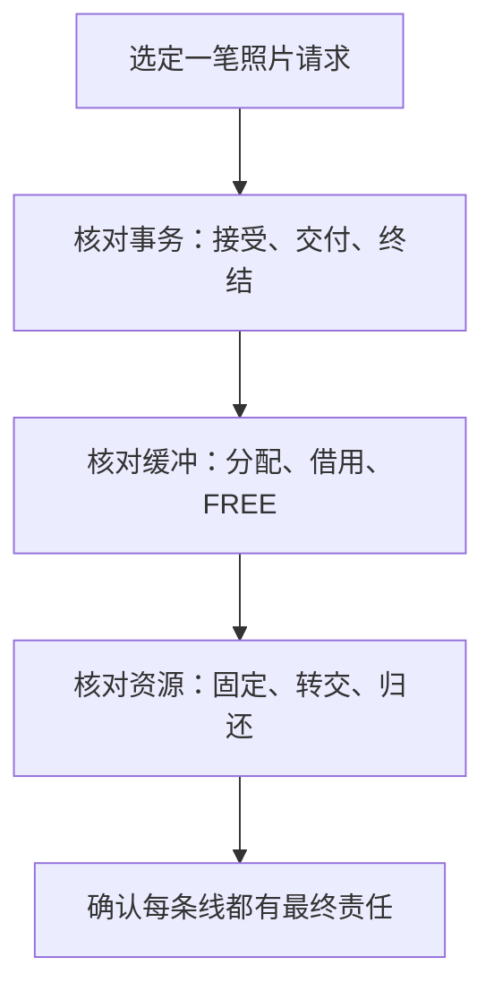

# 18｜重新检查这些设计，再看 Rust 改变了什么

照片应用现在想完成这样一件事：找到打印服务，把照片文件和进度回调交给它，提交打印任务，然后退出。服务随后还要继续打印，按顺序处理同一打印机的任务，并在应用仍在线时报告进度。我们能把前面出现过的 Handle、FD、oneway 和死亡通知拼起来，就宣布它一定正确吗？

本章用这个需求回查整本书。先复跑几个已经存在的反例，确认每个机制究竟解决了什么；再把当前 mini-binder、后续设计和固定版本 Android Binder 放在同一张表里，找出仍缺少的条件；最后分别阅读用户态 Rust 绑定和内核 Rust 驱动，检查所有权工具改变了哪些实现责任，哪些协议问题仍须由我们决定。

**证据边界：mini-binder 的实际代码仍到 C08。** 第 09–15 章给出了后续协议设计，第 16–17 章阅读 Linux v6.6 与固定 Android 14 用户态源码；本章另取 Linux v6.18 的 Rust 驱动作比较。普通模型可以运行，这些源码比较没有经过本仓库的 Android/Rust 构建或端到端验收。完整版本及验证记录见[本轮报告](../reports/remaining-chapters-draft.md)。

## 1. 把“想打印照片”拆成可检查的承诺

先看应用退出前，通信层究竟能承诺什么。

| 需求中的动作 | 至少需要确认的事实 | 单靠什么还不够 |
| --- | --- | --- |
| 找到打印服务 | 查询结果转换为本上下文的引用，绑定明确对象实例 | 知道名字或记住别人的 Handle 数字。 |
| 把照片交过去 | 固定正确文件，在接收线程安装 FD，定义应用与 Parcel 的关闭责任 | 在 payload 里写发送者 FD 整数。 |
| 提交打印 | 接受点、配额、队列归属和取消规则明确 | ioctl 返回成功或看到 COMPLETE。 |
| 应用退出后继续工作 | 服务已独立接管所需数据、文件和对象；任务政策允许脱离调用者 | 持有指向已退出应用的回调引用。 |
| 按同一打印机排序 | 指定排序域、并发入口与推进时机 | 使用 oneway，或者恰好只有一个线程。 |
| 报告打印成功 | 服务确认外部设备的实际结果，并按业务协议持久记录或回应 | 请求已经交付、方法已经返回、缓冲已经 FREE。 |

这张表里同时有通信协议与业务协议。驱动可以知道某笔事务进入了队列，却不知道纸张是否真正输出。服务若要支持断线查询，需要给打印任务另设业务 ID 和状态；把事务 ID 当作跨进程重启的永久任务号，会混淆两种寿命。

## 2. 回到每次增加机制的具体原因

前面的简单版本并没有因为后来增加功能就变成错误设计。要问的是：原来的前提是否仍成立，以及新增机制带来了哪些责任。

| 原来的需求和做法 | 新条件怎样使它不够用 | 增加的机制与成本 |
| --- | --- | --- |
| 同一线程调用 add 并接收返回值 | 计算搬到另一个进程，普通变量隔离 | 显式 IPC；定义消息格式、结果关联和对端退出。 |
| 固定客户端和服务用 Socket 交换字节 | 希望统一接收映射、对象转换和调度 | 内核通信协议；增加驱动、ABI 与系统策略的维护。 |
| 一个请求占着全局槽，等完再处理下一个 | 多个调用重叠，回复顺序改变 | 独立 Transaction；增加有界记录、关联键和终结规则。 |
| code 只表示一种方法 | 两个计数器有相同方法，却有独立状态 | Node 区分对象；增加 owner、发布及在途持有。 |
| 直接传全局 Node 数字 | 不应允许任何进程猜到数字就调用 | 私有 Ref 和转换；增加 user/buffer 账目、校验及失败回滚。 |
| 启动器提前把所有引用分配好 | 晚启动客户端需要按名字发现服务 | 管理器及 bootstrap；增加注册授权、重启与陈旧实例处理。 |
| 服务线程等远程回复时不做别的事 | 同步调用链回调原线程 | 线程栈与事件泵；增加重入、回复资格和退出清理。 |
| 请求只含普通字节 | 照片已经在一个打开文件里 | FD 转交；增加文件持有、目标表安装和 close 责任。 |
| 用户态对象只靠局部作用域销毁 | 远端、消息与本地对象寿命互相交叉 | 强弱及 owner 协作；增加死亡订阅和确认协议。 |
| 所有参与者可信、处理速度相近 | 不可信发送者、慢服务、并发退出出现 | 凭据、策略、背压和锁域；增加策略更新、额度及竞态证明。 |

给一个只做两次整数加法的受控实验加入全部生产机制，会遮住它要验证的问题；把同样简化直接用于多租户打印服务，则会留下真实缺口。评价设计要同时写出工作负载、信任关系和失败假设。

## 3. 复跑反例，检查理解有没有偷换

以下命令都已存在于仓库，须在 Linux 的仓库根目录运行。`make` 产生普通用户态程序，不加载模块，也不需要 root。

```sh
make
./build/fork_private
./build/nodes method
./build/nodes registry
./build/references raw
./build/references transfer
./build/transactions reorder
```

| 实验 | 应观察到什么 | 能检验的结论 |
| --- | --- | --- |
| fork_private | child 为 3，parent 仍为 -1；本次两个虚拟地址相同 | 等到计算完成，没有把私有变量变成结果通道。 |
| nodes method | B 第一次调用期望 1 却得到 2；A 下一次得到 3 | 只区分方法、共享一份状态，不能表示两个独立对象。 |
| nodes registry | Node 101、102、103 分别得到 3、101、42；未知方法 ENOSYS | 先确定对象身份，再解释方法，才能分开业务状态。 |
| references raw | C 的 Handle 1 返回 Y 的 101；把 B 的 2 当自己的编号则 EBADF | 同一个整数在不同上下文中不能独立表示同一远程对象。 |
| references transfer | C 得到 Handle 2 调 X 返回 1；B 的 Handle 1 再调 X 得到 3；C 的 1 仍调 Y 得到 101 | 转换保留对象身份，接收者使用自己的编号，两份引用可指向同一状态。 |
| transactions reorder | 后提交的事务先完成，各调用仍取得自己的结果；最终活记录和两类槽均为 0 | 结果按事务关联，不能按回复到达顺序匹配；终结与槽释放各自结账。 |

所有命令正确演示其指定现象时都退出 0，包含故意呈现错误方案的 nodes method。退出 0 的含义由实验断言决定，不能读成“这个方案适合生产”。输出中的进程号、地址和动态标识以实际运行结果为准；不要把日志样例当作这些数字的稳定 ABI。

这些程序退出后没有后台服务或持久设备资源。构建产物保留在忽略的 `build/`；不需要为了完成一次阅读删除整个内核构建目录。更完整的前提、失败判据与对象账目见[实验入口](../labs/index.md)。普通模型不能证明驱动锁正确，也不能证明第 09–15 章已经实现。

## 4. 当前代码与后续设计分别到了哪里

阅读到本章时，容易把“前文已经解释清楚”误认为“代码已经具有这个能力”。下面按同一需求逐项对齐。

| 维度 | 当前 mini-binder C08 | 第 09–15 章设计 | 本书核查的真实 Binder 来源 |
| --- | --- | --- | --- |
| 协议与兼容 | 自定义 ioctl、Parcel、错误码和 feature；不兼容 Binder ABI | 显式新模式与迁移边界，操作名尚未冻结为编号 | v6.6 BC/BR 命令与 UAPI；Android14 libbinder 负责封装与解释。 |
| 接收分配 | 有界只读接收映射和请求/回复槽 | 配额随多 owner、FD、异步工作扩展 | binder_alloc 独立管理分配、映射和释放，不能把教学槽号等同于它的地址。 |
| 对象与路由 | Node、私有 Ref、事务内 LOCAL/HANDLE 转换；唯一业务 Server | 多 owner 收件队列、受控 bootstrap、用户态名字表 | Node 所有者、proc 内 Ref、context manager 和独立 ServiceManager。 |
| 线程 | 阻塞 CALL_REF；没有同步回调事件泵 | 入站/出站栈、定向回调、空闲 worker、预算及退出规则 | proc/thread 工作队列和同步事务链；用户态等待期间分发协议工作。 |
| 文件 | 不支持 FD 特殊对象 | file 快照、延迟安装、EFAULT 重试与终结失败分开 | v6.6 FD fixup；实际先安装、后复制事件，顺序不同于教学草案。 |
| 引用寿命 | user/buffer 持有、活性及退出回滚 | 独立强弱维度、owner 确认、retire、死亡订阅 | 内核节点/引用计数与用户态对象协作；弱提升须核查具体路径和版本。 |
| 身份与授权 | 设备 0600 和打开者 TGID 检查，尚无服务端事务凭据 | 上下文身份、事务凭据、逐层授权及转交策略 | 打开文件凭据、事务身份、命名空间映射、LSM 与用户态策略分别参与。 |
| 异步与排序 | 不支持 oneway | 有界接受、同 Node 活跃工作与 FREE 推进、背压 | v6.6 Node 异步队列；不等于业务完成、持久队列或全局顺序。 |
| 并发与调度 | 全局 mutex 保护主要元数据；已有等待与失败路径 | 分域锁、稳定持有、准备/提交/交付状态；尚未重构 | 多锁域、延后清理及线程工作调度；还有本书未展开的优先级等机制。 |
| 验证 | 101 项用户态验收及既有 C08 VM 记录 | 本轮普通小实验与设计审读；扩展驱动验收待做 | 固定源码静态阅读及早期驱动协议探测；没有完整 Android RPC 验收。 |

比如第 12 章允许的弱提升是一个明确受限的教学子集，不能据此宣布兼容所有 Android 弱引用协议。v6.6 的 [BC_ATTEMPT_ACQUIRE 分支](https://github.com/torvalds/linux/blob/v6.6/drivers/android/binder.c#L3963)直接返回 EINVAL；读到用户态库里出现 promote 或旧的回调路径，仍须继续追它到底经过哪一层、哪些前提。语言对象引用、代理存活与驱动命令不是同一件事。

## 5. 有结果以后，还要检查哪份账

把照片请求看成三条交叉但不合并的线：事务决定接受、交付及终结；缓冲决定哪些字节仍可借用；资源决定对象与文件由谁持有。服务已经算出结果，不会自动把后两条线结清。下面按复核顺序，逐项追查这三份账目：



在同步正常路径，回复必须对应已经接受并交付的请求，但请求 FREE 与回复提交的具体顺序由协议和库决定。第 17 章的固定 Android14 路径在 sendReply 前清空请求 Parcel；这与“必须先收到业务回复才能 FREE 请求”正好是不同的时序，不能从教学示意图推成普遍规则。

在失败路径，尤其要分别问：已经发生的业务副作用怎么办；尚在驱动账本里的资源怎么回滚；已经交付给接收者的资源由谁释放。应用放弃等待不等于打印停止，发送者退出也不允许驱动抢回接收者仍在使用的已交付槽或 FD。重试打印需要服务端业务 ID、去重和结果查询，通信层的单一终态不能替代它们。

复核任意扩展时，可以先写四个不变量：编号只在声明的上下文解释；每份持有有唯一归还者；终结竞争只有一个胜者；借用不能越过其资源寿命。然后分别安排正常、拒绝、半途失败、输出失败与退出交错。只有“正常打印一次”无法覆盖这四个不变量。

## 6. Rust Binder 这个名字指哪一层

用 Rust 编写调用者，与用 Rust 实现内核驱动，是两项不同的工程。本章分别固定来源，不能把一项的源码存在当作另一项的运行证据。

| 对照对象 | 固定来源 | 本次核查范围与合入状态 |
| --- | --- | --- |
| 用户态 Rust 绑定 | AOSP frameworks/native，Android14 提交 `bfcf75076e562945bae131a4929f29a90d0d2481`，`libs/binder/rust/` | 已在该 AOSP 提交中；阅读 crate 声明、构建依赖、代理和 Parcel 包装。它建立在 Binder NDK 库之上。 |
| 内核 Rust 驱动 | 上游 Linux v6.18，提交 `7d0a66e4bb9081d75c82ec4957c50034cb0ea449`，`drivers/android/binder/` | 已在该上游发布标签中；核查 Kconfig/Makefile、入口与 Process/Thread/Transaction/Node 的相关片段。 |
| 本书主要 C 驱动对照 | 上游 Linux v6.6，`drivers/android/binder.c` 等 | 保留前两章基线；没有把 v6.18 的结构或行为倒写成 v6.6 的事实。 |

v6.18 的 [ANDROID_BINDER_IPC_RUST 配置](https://github.com/torvalds/linux/blob/7d0a66e4bb9081d75c82ec4957c50034cb0ea449/drivers/android/Kconfig#L19)依赖 `RUST && MMU && !ANDROID_BINDER_IPC`，因此该配置下 C、Rust 两个 Binder 驱动选择互斥。[顶层 Makefile](https://github.com/torvalds/linux/blob/7d0a66e4bb9081d75c82ec4957c50034cb0ea449/drivers/android/Makefile)把 Rust 选择接到 binder 子目录；[子目录 Makefile](https://github.com/torvalds/linux/blob/7d0a66e4bb9081d75c82ec4957c50034cb0ea449/drivers/android/binder/Makefile)把 Rust 主入口和 `rust_binderfs.o`、`rust_binder_events.o`、`page_range_helper.o` 这些 C 辅助对象一起链接。

所以，这里已有可选的上游内核实现，且包含 Rust/C 边界。源码和构建接线只能支持这两个结论；本次没有编译该驱动、确认任何手机采用它、证明全部特性与 C 版相同，或者测量性能优劣。评估设备部署还要查设备内核提交、配置、用户态版本及实际运行路径。

## 7. 用户态 Rust：让代理持有与 Parcel 借用更明确

固定 AOSP 的 [crate 声明](https://github.com/aosp-mirror-neo/platform_frameworks_native/blob/bfcf75076e562945bae131a4929f29a90d0d2481/libs/binder/rust/src/lib.rs#L17)明确说，它提供建立在 Binder NDK 库之上的安全 Rust 接口，主要供 Rust AIDL 后端使用。[构建文件](https://github.com/aosp-mirror-neo/platform_frameworks_native/blob/bfcf75076e562945bae131a4929f29a90d0d2481/libs/binder/rust/Android.bp)中的依赖也把它连接到 NDK 绑定。它并没有把内核事务处理改写成 Rust。

以 [SpIBinder](https://github.com/aosp-mirror-neo/platform_frameworks_native/blob/bfcf75076e562945bae131a4929f29a90d0d2481/libs/binder/rust/src/proxy.rs#L44)为例，包装内含非空 AIBinder 指针；from_raw 的安全契约要求调用者已经拥有一份强引用。其 [Clone 与 Drop](https://github.com/aosp-mirror-neo/platform_frameworks_native/blob/bfcf75076e562945bae131a4929f29a90d0d2481/libs/binder/rust/src/proxy.rs#L222)分别调用 AIBinder_incStrong、AIBinder_decStrong。这让通常的作用域退出自动归还该包装拥有的单位，错误分支不必手写同一套 decrement。

这份语言层持有不应按一比一关系解释为每次 clone 都新建驱动 Ref 或各发一次 ioctl。NDK/C++ 层还有代理和计数协作，需继续往下追。真正提交事务的 [submit_transact](https://github.com/aosp-mirror-neo/platform_frameworks_native/blob/bfcf75076e562945bae131a4929f29a90d0d2481/libs/binder/rust/src/proxy.rs#L270)调用 AIBinder_transact，安全注释明确写出：数据 Parcel 的所有权移交给调用，回复所有权交回调用者，Binder 参数的所有权不随这次调用转移。

[Parcel 与 BorrowedParcel](https://github.com/aosp-mirror-neo/platform_frameworks_native/blob/bfcf75076e562945bae131a4929f29a90d0d2481/libs/binder/rust/src/parcel.rs#L47)又区分了拥有 AParcel 与带生命周期的借用视图。borrowed 返回值与原 Parcel 借用相关联；[Parcel::drop](https://github.com/aosp-mirror-neo/platform_frameworks_native/blob/bfcf75076e562945bae131a4929f29a90d0d2481/libs/binder/rust/src/parcel.rs#L690)删除其拥有的 AParcel。这帮助表达“借用不能活得比来源更久”，但前提仍是原始指针进入包装时满足 FFI 契约。

同理，[WpIBinder::promote](https://github.com/aosp-mirror-neo/platform_frameworks_native/blob/bfcf75076e562945bae131a4929f29a90d0d2481/libs/binder/rust/src/proxy.rs#L490)调用 AIBinder_Weak_promote，返回 Option。它是这个用户态包装的提升接口；仅凭函数名不能推导内核接收 BC_ATTEMPT_ACQUIRE，更不能推导服务进程不会退出。

## 8. 内核 Rust：结构换了表达，责任仍可逐项找到

打开 v6.18 的 [Transaction](https://github.com/torvalds/linux/blob/7d0a66e4bb9081d75c82ec4957c50034cb0ea449/drivers/android/binder/transaction.rs#L28)，可以直接看到如下字段。下面只是原结构中的摘录，不是可独立编译的教程程序：

```rust
pub(crate) from: Arc<Thread>,
pub(crate) to: Arc<Process>,
allocation: SpinLock<Option<Allocation>>,
```

from/to 显式持有线程与进程记录；allocation 的可选值与锁表达了“有无这份分配”和并发访问边界。结构还保存目标 Node、父事务、code、flags 与发送者 UID。C 版里必须追清的对象关系仍然存在，不能因为出现 Arc 就停止阅读事务如何提交、交付或取消。

[find_target_thread](https://github.com/torvalds/linux/blob/7d0a66e4bb9081d75c82ec4957c50034cb0ea449/drivers/android/binder/transaction.rs#L192)沿父事务寻找属于目标进程的线程，仍在解决第 10 章的同步回调路由。[submit](https://github.com/torvalds/linux/blob/7d0a66e4bb9081d75c82ec4957c50034cb0ea449/drivers/android/binder/transaction.rs#L240)取得目标进程锁，并分别处理 oneway 和普通提交；错误分支显式先 drop 锁，再 drop 工作项。局部变量的析构时机本身也参与锁设计，不能只看有无手写 free。

Process 的内部状态仍保存死亡状态、线程、节点、引用、可用线程、待办和已交付死亡通知等信息。Thread 保存当前同步事务与专属工作。Node 则保留 owner 与强弱计数协议状态；[NodeRef::drop](https://github.com/torvalds/linux/blob/7d0a66e4bb9081d75c82ec4957c50034cb0ea449/drivers/android/binder/node.rs#L870)还要归还该 Ref 的协议计数。这些计数表示 Binder 的语义责任，不能全部替换为一个 Arc 的内存引用数。

最后读 [rust_binder_open/release](https://github.com/torvalds/linux/blob/7d0a66e4bb9081d75c82ec4957c50034cb0ea449/drivers/android/binder/rust_binder_main.rs#L356)：open 将进程持有放入 file.private_data，release 再从这个外部表示取回。unsafe extern C 入口依靠 C 辅助代码、VFS 调用约定和指针有效性保证；每个 SAFETY 注释都在声明外部必须满足的前提。把危险操作集中到这些边界，有利于审查，但仍需检查前提是否由真实调用者保证。

## 9. Rust 能帮忙排除什么，仍不能替谁做决定

| 问题 | 类型、借用与析构可以帮助的部分 | 仍需协议或运行验证的部分 |
| --- | --- | --- |
| 请求槽释放后还读取参数 | 让借用视图受槽拥有者寿命约束 | 原始映射、FFI、手动释放入口是否遵守约束。 |
| 错误分支忘还引用 | 用拥有资源的包装在作用域退出归还 | 哪个阶段真正移交所有权，是否还需要给用户态发计数通知。 |
| 对象被并发释放 | 稳定持有使对应记录内存在使用期间可存活 | 记录已经标死后是否仍应允许调用；内存存活不等于服务活着。 |
| 跨线程访问状态 | 锁封装、Send/Sync 契约帮助限制访问方式 | 锁顺序、持锁远程调用、重入和等待链会不会死锁。 |
| 队列无限增长 | 封装有界队列和额度令接口更清楚 | 容量取值、同 Node 排序、背压和服务吞吐是否满足工作负载。 |
| 调用者伪造权限 | 类型可以区分可信元数据与业务字段 | 凭据从哪里采集、策略是否正确、撤销何时生效。 |
| 回复丢失后重试打印 | Result/Option 明确暴露失败与缺失 | 副作用是否已经发生，业务怎样去重与查询。 |
| 与已有用户态互通 | 对 FFI 和编码边界作集中封装 | 布局、命令、错误、兼容路径及真实交互是否符合 ABI。 |

安全 Rust 也能表达两把锁互相等待，或者在没有权限的业务分支里返回敏感数据；两者都不要求发生内存违规。unsafe impl Send/Sync 还要求实现者证明跨线程契约，而不是给一个包装写上关键字就自动获得证明。评审时应同时读安全 API 和其内部边界。

## 10. 如果继续开发，先让一个新需求完整成立

接下来不必一次实现全部设计。以第 09 章为例，可以先固定一个通信域、一个受控管理器和两个 owner，形成“登记—查询—直接调用—退出清理”的小闭环。每一步同时补错误和资源观察，再叠加线程、FD 或死亡通知；不要把四层同时改动后的成功日志当成各层独立证据。

若改用 Rust 实现 mini 的一部分，也先选清晰的资源边界，例如拥有接收槽的对象与受其寿命约束的参数视图。比较它是否减少了重复清理、能否阻止具体误用，再去讨论整体迁移。析构中发 ioctl 会遇到失败、线程上下文与重入问题；用户态进程被强制终止也不能依赖普通语言析构完成驱动退出清理。

走向生产还需要更广的验证：固定 ABI 与版本协商，区分不同错误和重试资格；对额度耗尽、部分复制、并发退出做可控注入；结合 lockdep/KASAN 等工具与长期负载检查；在真实凭据和设备策略下检验授权；最后以固定工作负载测量吞吐、尾延迟和资源上界。本轮没有运行这些新扩展的验收，因此相应任务继续留在[任务总表](../plans/task-backlog.md)。

## 11. 扩展练习：评价的是证据与取舍

这些题没有唯一字段布局或函数拆分答案。每题至少比较两种方案，写清正常路径、一个失败窗口、一条退出路径，以及如何判定通过。

| 新需求 | 可比较的方案 | 应提交的证据与评价标准 |
| --- | --- | --- |
| 打印服务重启后，应用查询旧任务 | 内存任务表、持久任务日志、外部任务监督器 | 明确任务 ID 的实例域和恢复点；演示“已经打印但回复丢失”，不能因通信失败重复执行。 |
| 两个同进程对象都能提交同一台打印机 | 每 Node 排序、服务内按打印机排序、独立调度对象 | 证明排序覆盖实际共享设备；不同 Node 的 oneway 有序不能直接推出同一打印机全序。 |
| 回调里再次调用打印服务 | 锁外调用加版本校验、消息化处理、明确拒绝重入 | 给出等待图和状态不变量；在固定同步点触发回调，检查没有持锁等待导致的环。 |
| 把三个 FD 一起交付，第二个预留失败 | 终结整笔、显式可重试准备协议 | 清楚说明接收者是否见到有效事件；逐项归还预留与文件，资源回到基线。 |
| 用 Rust 包装映射槽，防止 FREE 后使用 | 生命周期借用、复制到自有缓冲、运行时状态句柄 | 给出会被拒绝的具体误用及合法用例；说明原始指针/FFI 能否绕过，成本在哪里。 |
| 对比 C 与 Rust 驱动性能 | 同硬件同负载的可重复实验、受控模型中的局部比较 | 固定提交/配置/消息/并发度，记录错误率与分位延迟；仅凭源码行数、语言名或一次吞吐不能得结论。 |

## 12. 回答最初的问题

最初我们只想让一个进程取得另一个进程算出的 `3`。普通变量不会因等待而合并，传字节需要约定格式，重叠请求需要事务，独立状态需要对象身份，对象转交需要私有引用；当服务晚启动、发生回调、接收文件或突然退出时，原有前提又各自暴露了下一处缺口。

现在遇到一个陌生 Binder 结构或新的实现语言，可以从具体失败继续问：谁想完成哪件事，当前最简单的办法会在哪里失败，新机制把责任交给了谁，又用什么观察证明责任确实完成。能沿着一次请求走到结果，并沿每份资源走到释放或明确移交，才真正把这套通信设计读通了。
