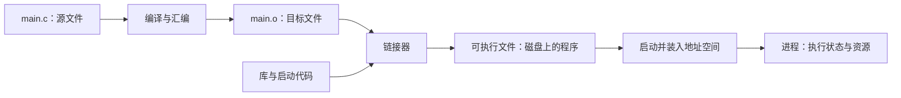

# P01｜从 main.c 到 Linux 进程

本章先回答一个问题：同一个变量，在两个进程里为什么可以有相同地址，却保存不同的值？随后换成线程，并观察退出状态，区分“计算已经完成”“数据可以共享”和“结果已经传回”这三件事。

实验需要 Linux、C 编译器、Make、pthread 和 Python 3，不需要 root 或 Android 设备。所有命令在仓库根目录执行；完整取证与清理说明见[边界实验](../labs/intro-boundaries.md)。

## main.c、可执行文件和进程分别是什么？

源文件保存 C 文本，CPU 不会直接执行它。编译器把源文件转换成目标代码；链接器把目标文件与所需库连接起来，解析函数和变量等符号，生成可执行文件。`cc` 通常是协调这些阶段的驱动程序，一条命令可以完成多个阶段。



本仓库 `make` 把源码编译并链接到 `build/`。例如 `build/local_add` 是可重复启动的文件；运行它才产生相应执行实例。通常由 shell 创建执行上下文，再通过 `exec` 装入程序；`exec` 替换现有进程的程序映像，本身不是“再创建一个进程”。`main()` 是 C 程序入口约定的一部分，也不是进程执行的第一条机器指令，库启动代码等会先运行。

进程拥有地址空间等资源；线程是在这些资源上运行的执行流。一个程序可以多次运行，一个进程也可以有多个线程，因此源文件、程序、进程和线程不能一一对应。后面分别用 `fork()` 与 `pthread_create()` 观察它们的区别。

## 从一个没有通信问题的程序开始

阅读 [local_add.c](../../examples/intro/local_add.c)：

```c
static int add(int a, int b)
{
    return a + b;
}
```

`main()` 调用 `add(1, 2)`，接收结果。这里不需要我们设计消息格式、接收地址或回复匹配：调用约定、编译器生成的指令和同一执行线程已经提供了相关基础。函数返回后，调用方继续执行。

在仓库根目录运行：

```sh
make
./build/local_add
```

预期输出 `result=3`，退出码为 0。失败判据是结果不为 3 或程序非零退出。该实验只验证本地调用，不涉及 IPC，也不需要清理持久资源。

## 第一个尝试：让子进程计算

假设我们把计算放到另一个进程中，是不是让它给 `result` 赋值就够了？

`fork()` 是创建子进程的系统接口。成功后，父子进程从同一个调用位置继续执行，但返回值不同：父进程得到子进程 PID，子进程得到 0。失败时返回 -1，不会产生子进程。

阅读 [fork_private.c](../../examples/intro/fork_private.c)。它在 fork 前将 `result` 设为 -1，子进程将其改为 3，父进程等待子进程退出后再打印自己的值。

```sh
./build/fork_private
```

输出的形式如下，PID 和地址以实际运行结果为准：

```text
child result=3 address=0x... pid=...
parent result=-1 address=0x... pid=...
```

重点观察三件事：两个 PID 不同；本实验里变量的虚拟地址相同；父进程最终仍然看到 -1。程序返回 0 表示观察到预期的隔离行为，并不是表示父进程拿到了计算结果。

## 是不是父进程读得太早？

这是首先应该排除的解释。程序通过 `waitpid()` 等待指定子进程退出，然后才读取父进程的 `result`。即使确定子进程已经完成计算，父进程仍然看到 -1。

因此，我们没有遇到“多等一会儿就好”的问题。增加 `sleep()` 不能把两个私有变量变成同一份数据。

`waitpid()` 还负责回收子进程退出状态。等待遇到 `EINTR` 时重试，其他错误则报告失败。程序检查子进程是否正常退出，避免把子进程崩溃误认为隔离实验成功。

## 地址为什么相同？

C 指针中的地址通常是进程使用的虚拟地址。解释一个地址，需要同时知道它属于哪个地址空间。

fork 后，子进程继承父进程的地址空间布局。对于这里的普通私有内存，Linux 通常通过写时复制实现：最初可以共享底层物理页，发生写入后分离。但对应用可见的语义是父子进程各自持有私有状态。

本实验观察到“同址不同值”，支持地址不能脱离进程上下文解释这个结论；它没有直接观察物理页，也不能据此统计复制页数。不要把两个相同的 `%p` 输出理解成共享内存证明。

## 第二个尝试：线程共享变量就够了吗？

阅读 [thread_shared.c](../../examples/intro/thread_shared.c)，运行：

```sh
./build/thread_shared
```

预期三行依次为：

```text
event=before_create result=-1 address=0x... pid=...
event=worker_write result=3 address=0x... pid=...
event=after_join result=3 address=0x... pid=...
```

本次输出中的地址和 PID 在三行内部相同，数值不应写死。主线程先打印初值，再把 `&result` 传给工作线程；工作线程修改同一变量并返回。主线程在 `pthread_join()` 成功后才读取，所以最后得到 3。它与 fork 对照的关键差别是共享地址空间，而不是线程执行得更快。

不过，共享仅解决“是不是同一变量”，还没有解决“什么时候可以读”。本例选 join，是因为主线程只需等待一次工作结束：它既等待线程完成，也为工作线程先前的写入与后续读取建立同步关系。用 `sleep()` 猜测工作已完成没有这种保证；用 `volatile` 也不能替代线程同步。如果双方要持续读写、不能等到线程退出，应考虑互斥锁等机制，并付出锁管理与争用成本。这里没有通过无锁数据竞争来证明共享。

| 方案 | 本例能否成立 | 代价与边界 |
| --- | --- | --- |
| `pthread_join()` 后读取 | 能；一次计算结束后观察共享结果 | 等待整个工作线程退出，不适合代替持续服务的每次回复 |
| 互斥锁配合条件通知 | 能，但本例不必引入 | 需定义条件、持锁范围和唤醒；适合后续持续协作 |
| 主线程 `sleep()` 后读取 | 不能作为正确同步方案 | 调度时机和内存可见性均不能靠等待时长证明 |

`result` 位于主线程栈上，但主线程在 join 前不离开它的作用域，因此传给工作线程的指针始终有效。join 后工作线程已退出，不再持有该指针。pthread 函数返回错误编号，代码用返回值和 `strerror()` 报错，而不是直接套用 `errno` 判断。

失败判据：事件顺序不符、join 后仍为 -1、三行 PID/地址不同或非零退出。程序成功 join 后结束，无后台线程；这个实验只说明指定同步路径，不证明所有共享访问都安全。

## 为什么没有简单地返回一个整数？

我们可以换个方案：不共享变量，让子进程把计算值作为退出码。阅读 [fork_status.c](../../examples/intro/fork_status.c)，运行：

```sh
./build/fork_status --exit
./build/fork_status --signal
```

正常退出模式先打印 `child_result=300`，父进程再打印 `event=exited exit_status=44 parent_result=-1`。`_exit(300)` 交给等待者的正常退出状态只保留低 8 位，所以 `WEXITSTATUS` 得到 `300 & 255`，也就是 44。父进程中的变量仍是 -1：观察到退出状态没有合并两个地址空间。

信号模式恢复并解除屏蔽 `SIGTERM`，然后主动触发它，不使用非法内存访问。Linux 上预期 `event=signaled signal=15 parent_result=-1`。代码先用 `WIFEXITED` 或 `WIFSIGNALED` 区分退出方式，再分别取 `WEXITSTATUS` 或 `WTERMSIG`；不能把信号终止当成业务返回码。

两个外层实验都应退出 0，表示正确观察到所指定的现象，不能因此说两个子进程都正常退出。失败判据是把 44 当成 300、把信号退出误归正常、父变量发生变化或实验非零退出。父进程均用 `waitpid()` 回收指定子进程。

`fork()` 自身失败是另一条路径：返回 -1，没有产生子进程，应当立即报告错误。不能继续调用 `waitpid(-1, ...)`，因为 -1 在该接口里表示等待任意子进程。

运行 `./build/fork_failure` 可以受控验证这一分支：程序只将自己的进程数量软限制设为 0，尝试一次 fork，预期 `event=fork_rejected errno=11 child_created=0`，返回 0 表示拒绝符合预期。这个限制不会修改父 shell 或其他进程，不需要真的耗尽宿主资源。以 root 运行时示例先在自身降为非特权 UID；特殊容器能力配置可能需要另行诊断。完整前提和清理见[实验手册](../labs/intro-boundaries.md)。这只覆盖一种 EAGAIN，不代表所有创建失败原因。

退出状态适合报告有限的进程结束信息，不适合替代通用函数结果：范围小，每次回复还要结束子进程。服务需要持续处理请求，结果也可能是字符串、数组或对象。线程返回值同样只属于线程结束协议，不能单靠 join 构造持续跨进程服务。

我们真正需要的是一种双方约定的数据交换方式。管道、Socket、共享内存都可以参与设计。它们的存在说明，进程隔离不等于进程无法通信；通信需要显式机制。

## 源码里另外两个值得注意的细节

- 子进程在 `_exit()` 前显式刷新标准输出。`_exit()` 不会替我们刷新 C 标准库缓冲区；省略刷新可能让被测试程序的输出消失。
- 这里没有往无效地址写入来制造崩溃。读者无需依赖未定义行为，就能观察私有地址空间的结果。

## 与 Android Binder 的关系

Binder 不能靠“把服务端函数地址交给客户端，然后跳过去”完成 RPC。客户端执行的指令仍在客户端上下文中。即使它获得一个相同数值的地址，也没有因此获得服务进程的执行权。

为区分进程和驱动通信状态，本节核查了本地 Linux v6.6 源码中的以下路径；链接固定为相同上游标签，不代表所有 Android 设备，也不是本章运行了真实 Binder 的证据。

| 本章问题 | Linux v6.6 源码入口 | 已核查行为与对应边界 |
| --- | --- | --- |
| 驱动是否只按 PID 建一个通信对象？ | [binder_open，5612 行](https://github.com/torvalds/linux/blob/v6.6/drivers/android/binder.c#L5612) | 每次进入该打开路径分配新的 `binder_proc`，记录打开者线程组、打开文件凭据和设备 context，再保存到 `filp->private_data`；不是单纯的 PID→唯一对象表。 |
| 同 PID 的重复打开是否被拒绝？ | [existing_pid 检查，5655 行](https://github.com/torvalds/linux/blob/v6.6/drivers/android/binder.c#L5655) | 已有同 PID 记录不会阻止新记录加入；这里用于避免重复创建进程日志项，不能误读为“返回已有 proc”。 |
| 同进程各线程如何进入协议？ | [binder_ioctl，5328 行](https://github.com/torvalds/linux/blob/v6.6/drivers/android/binder.c#L5328)、[binder_get_thread_ilocked，4845 行](https://github.com/torvalds/linux/blob/v6.6/drivers/android/binder.c#L4845) | ioctl 从文件取出通信上下文，再在该上下文中按 `current->pid` 查找/建立线程状态。用户态线程由应用创建，驱动只维护通信记录。 |
| 继承 fd 就获得新的 Binder 上下文吗？ | [binder_alloc_init，1069 行](https://github.com/torvalds/linux/blob/v6.6/drivers/android/binder_alloc.c#L1069)、[binder_mmap，5586 行](https://github.com/torvalds/linux/blob/v6.6/drivers/android/binder.c#L5586) | 分配器记录打开时的 `current->mm`；mmap 要求当前线程组是打开者，并设置 `VM_DONTCOPY`。不能把本章 Socket 的 fork 继承模型原样套给 Binder。 |

独立 `open()` 与 `dup()` 也不同：后者增加对同一个打开文件对象的引用，不再执行一次 `binder_open()`，因此不是自动多出一份 `binder_proc`。fork 继承 fd 同样不会替子进程重新执行打开路径。v6.6 的 ioctl 入口没有用一个通用的“非打开者立即拒绝”检查概括所有命令，因此也不能把 mmap 的限制泛化成所有继承 ioctl 必定失败；具体操作要继续追踪，本章没有验证这类用法。

这些关系解释的是通信上下文的归属，不是完整 Linux 进程模型或 Binder 生命周期证明。最终文件释放时，[binder_release，5737 行](https://github.com/torvalds/linux/blob/v6.6/drivers/android/binder.c#L5737)安排延迟释放工作，不意味着任意一次 `close(fd)` 当场释放全部通信资源。

后续的 Node 和 Ref 将解决对象身份与跨进程引用问题。现在只需保留一个约束：**远程对象的标识不能被当作本地可解引用指针直接使用。** 具体源码基线见 [Android 对照](../reference/android-binder.md)。

## 实验验收与下一步

```sh
make test
```

本次自动验收通过；[test_process.py](../../tests/test_process.py)检查线程事件顺序、共享地址与 PID、join 后的值、退出码截断与信号终止，[test_intro.py](../../tests/test_intro.py)检查 fork 私有结果等路径。fork 同址现象仍需按输出观察，不能把未直接测量的物理页行为写成测试结论。

本章实验只创建短暂子进程和工作线程，分别通过 waitpid 与 join 回收；无持久通信路径。`make clean` 删除用户态实验程序，保留内核源码和构建缓存；不再需要完整环境时可以另行删除生成的构建目录。

尚缺独立初学者的干净环境重放记录；本稿不表示整章发布验收完成。

## 练习：先预测，再用机制解释

1. 把线程程序的 join 改成“等一秒”，偶尔仍打印 3，能否接受？不能。一次调度结果没有建立同步关系，既不能保证完成，也不能证明读写安全；应保留 join，或设计锁和条件协议。
2. 子进程 `_exit(300)` 后，父进程能否凭 44 还原原结果？不能。多个整数有同样低 8 位；要传完整值，应增加显式通信，而不是猜测。
3. 同一进程独立打开 Binder 设备两次，和复制一个 fd，是同一件事吗？不是。前者在已核查路径建立不同通信记录，后者共享打开文件对象。进一步追问：如果把某份上下文中的 Handle 数字交给另一份，它还能代表同一对象吗？这正是后面引用有效域要解决的问题。

下一步不急于写驱动。先利用现有 Socket，把参数送过去、结果送回来，看看一次跨进程调用究竟需要哪些约定。
