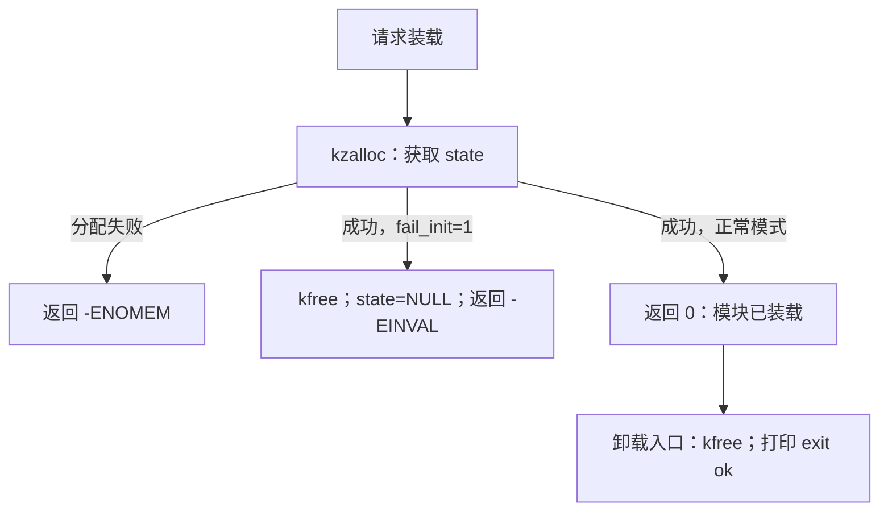

# P03｜第一个 Linux 内核模块

普通 C 程序由自己的线程运行 `main()`。驱动却要在进程打开设备、提交命令、关闭资源时被内核调用：谁安装这些入口，失败后谁清理？本章先用一个不提供 RPC 的模块，把这条生命周期讲清楚。

本章实验在 QEMU 客户机内装载模块，宿主只构建和启动。环境尚未准备时先执行 [P04](p04-environment.md) 的构建步骤；这里没有已经发布的预构建镜像下载入口。完整源码见 [mini_hello.c](../../examples/modules/hello/mini_hello.c) 与 [Kbuild 文件](../../examples/modules/hello/Makefile)。

## 1. 为什么模块没有 main？

用户态程序可请求内核服务，但不能把一段普通用户函数注册成可信内核处理代码。我们需要一种把代码加入内核、由内核在指定时机调用的机制。这里有两个合理选择：

| 方案 | 能解决什么 | 本章取舍 |
| --- | --- | --- |
| 编译进内核 | 启动时初始化，无须单独装载文件 | 每次改小实验通常要重建并重启内核；真实系统可选择这种部署方式。 |
| 可加载模块 | 将驱动构建成 `.ko`，运行中请求装载/卸载 | 适合快速观察成功、失败与清理；要求运行内核支持模块并与构建环境匹配。 |

本章选模块，不是因为驱动天生必须以模块形式存在。`module_init()` 注册初始化入口；成功返回 0 表示初始化成立，负错误码表示失败。`module_exit()` 注册成功装载后的卸载入口。`insmod` 是用户态装载工具，不是模块中的函数；内核检查并装入目标代码，调用初始化入口。

模块没有独立的普通用户进程地址空间，也不从 `main()` 起跑。代码链接到内核提供的符号和环境中；不能在这里调用 libc 的 `printf()`、`malloc()`，或直接使用用户态头文件代替内核接口。

## 2. 先把问题缩成一笔资源账

可以先按普通 C 的资源管理习惯推演：分配状态，执行可能失败的下一步，成功则保留给后续工作，失败则在返回前释放。这个推演只说明所有权，不是额外的已执行用户态实验，也没有模拟内核并发。

模块实际使用 `kzalloc(64, GFP_KERNEL)` 获得 64 字节清零状态。`GFP_KERNEL` 允许分配路径睡眠；本例初始化上下文允许这样做，不意味着以后可以把相同调用随意放进自旋锁临界区。



这里最容易漏掉的是失败分支：初始化返回错误后，不应指望卸载入口替失败的初始化回收资源。代码因此在 `fail_init` 分支自行 `kfree()`，清空指针，再返回 `-EINVAL`。成功模式则把资源保留到 `mini_hello_exit()`。这是两条互斥的清理责任，不是“最后总会调用 exit”。

| 状态/事件 | 谁持有这 64 字节 | 结束方式 |
| --- | --- | --- |
| 分配失败 | 无人，未取得资源 | 直接返回 `-ENOMEM`。 |
| 分配后主动失败 | 初始化函数暂时持有 | 自行释放，返回 `-EINVAL`，不等待 exit。 |
| 初始化成功 | 模块状态持有 | 卸载入口释放。 |

示例尚未注册设备、启动线程或安排延迟工作，所以释放次序很短。以后增加这些资源，必须按取得顺序分析反向回滚，不能把当前一条 `kfree()` 当成通用答案。

## 3. Kbuild 在替我们做什么？

`examples/modules/hello/Makefile` 只有：

```make
obj-m := mini_hello.o
```

它告诉内核构建系统生成外部模块；不是单独执行 `cc mini_hello.c`。构建要使用目标内核的配置、生成头文件、符号与工具规则：

```sh
make -C build/kernel/out M="$PWD/examples/modules/hello" modules
```

`-C` 进入准备好的内核输出目录，`M=` 指向外部模块目录。`tools/qemu/build-rootfs.sh` 已包含这一步，无须先在宿主装载模块。目标是运行客户机的 Linux 6.6，不是宿主 `uname -r` 所报告的另一套内核。

`MODULE_LICENSE("GPL")` 声明模块许可证信息，不是安全性证明；`__init`、`__exit` 告诉内核相关生命周期属性，也不能替我们写清理代码。示例用 `pr_info()` 写入内核日志；用户态 `dmesg` 读取日志，权限由运行环境决定。实验以客户机 root 的 `/init` 执行，宿主不需要因此获得模块装载权限。

## 4. 实验：先成功，再主动失败，再成功

按 [P04](p04-environment.md) 准备内核后，在仓库根目录执行：

```sh
bash tools/qemu/build-rootfs.sh
ACCEL=tcg bash tools/qemu/run.sh
```

执行过程在客户机的 [init](../../tools/qemu/init) 中。下面是 init 自动完成的动作说明，不是让读者在宿主运行这些 `insmod`：

1. 装载 `/mini_hello.ko`，检查 `/proc/modules` 有 `mini_hello`。
2. 卸载，要求命令成功。
3. 用 `fail_init=1` 装载，要求 `insmod` 失败，并检查模块未留在 `/proc/modules`。
4. 再次正常装载、卸载，检查 `init rollback` 与 `exit ok` 日志存在。
5. 执行后续字符设备检查；所有断言完成后打印 `MINI_LAB_PASS` 并关机。

`fail_init` 是只读模块参数，装载时决定本次初始化是否主动失败。预期出现 `mini_hello: init ok`、`mini_hello: exit ok`、`mini_hello: init rollback`，失败装载对应 `Invalid argument`。日志可能经内核控制台和工具重复呈现，不把次数、时间戳或 PID 写死。

为什么还要“失败后重新装载”？仅看到失败信息，不能排除环境已损坏；重新成功增加了可恢复性的证据。但它仍不能单独证明不存在任何泄漏。已检查的是显式释放路径、模块注册状态和重新装载行为，还没有用分配失败注入或泄漏检测器穷尽所有路径。

## 5. 怎样判定实验通过？

2026-11-06 查询阶段的 TCG/KVM 记录都包含正常初始化、回滚、退出和最终 `MINI_LAB_PASS`，归档与校验信息见[阶段报告](../reports/m0-m1-progress.md)；运行基线与产物摘要见 [P04](p04-environment.md)。这些是本机实验结果，不是已发布的通用镜像承诺。后续主线运行会覆盖默认日志，因此历史结论引用阶段归档，不以当前同名日志冒充当时记录。

运行器还检查 QEMU 退出码、缺失成功标记、`MINI_LAB_FAIL`、panic、Oops、BUG 和 WARNING。默认宿主截止时间为 120 秒；超时算失败，不能把“输出过 init ok”当作整个实验通过。`loading out-of-tree module taints kernel` 是外部模块的标记，不等于上述 BUG/WARNING 断言失败，也不证明该模块正确。

每次启动是新的客户机内核，避免把上次 dmesg 当成本次事件；日志文件按加速模式写入 `artifacts/qemu-tcg.log` 或 `qemu-kvm.log`，会覆盖同名上次结果，需要长期比较时先归档。正常清理由 init 卸载模块并关机；异常时运行器终止客户机，下一次从新 VM 重放，宿主未装载教学模块。

## 6. 回到真实 Binder：注册不等于 RPC 可用了

本节核查的是上游 Linux **v6.6**，不是全部 Android 设备。真实 Binder 的构建形式甚至与本例不同：该标签 [ANDROID_BINDER_IPC](https://github.com/torvalds/linux/blob/v6.6/drivers/android/Kconfig#L4) 是 `bool` 配置，[Makefile](https://github.com/torvalds/linux/blob/v6.6/drivers/android/Makefile#L5)据它选择 Binder 目标；不应从 `MODULE_LICENSE` 字样误断言它在该版本可直接作为 `.ko` 装载。

| 教学问题 | Linux v6.6 入口 | 相同点与边界 |
| --- | --- | --- |
| 没有 main，何时初始化？ | [binder_init，6555 行](https://github.com/torvalds/linux/blob/v6.6/drivers/android/binder.c#L6555)、[device_initcall，6625 行](https://github.com/torvalds/linux/blob/v6.6/drivers/android/binder.c#L6625) | 内核按初始化机制调用入口；真实驱动在这里准备分配器、日志与设备/文件系统，复杂度远超过一个状态块。 |
| 初始化中途失败如何处理？ | [binder_init 错误路径，6609 行](https://github.com/torvalds/linux/blob/v6.6/drivers/android/binder.c#L6609) | 按已取得资源执行清理；不能靠教学示例推导所有真实路径已被验证。 |
| 注册了入口是否能远程 add？ | [binder_fops，6476 行](https://github.com/torvalds/linux/blob/v6.6/drivers/android/binder.c#L6476) | 文件操作只是接入协议的入口；还需要用户态线程、数据协议和业务分发，驱动不会自行执行 add。 |

本章没有真实 Binder 的业务调用实验；它只让后续“注册设备→打开→处理命令→释放”有一条可解释的生命周期。

## 7. 练习与下一步

1. 如果失败分支删掉 `kfree()`，但正常卸载仍释放一次，是否足够？不够。失败的初始化不能依赖成功装载后的卸载入口，资源会失去清理者。
2. 如果只看到 `init ok` 就杀掉 VM，能否确认正常卸载？不能。还需确认退出路径和外层结果；客户机销毁回收了整体内存，不等于驱动主动释放逻辑正确。
3. 若后来先分配状态再注册设备，注册失败时谁释放状态？初始化失败路径负责；还要区分“设备从未注册”与“设备已公开后下一步失败”的回滚责任。

本稿尚未包含独立初学者重放、真实内存分配失败和泄漏检测验收，也没有可下载的预构建发布物。接下来先用 [P04](p04-environment.md) 解释这套环境为何可运行，再进入[第 02 章](02-character-device.md)，让用户进程获得一个有边界的内核入口。
