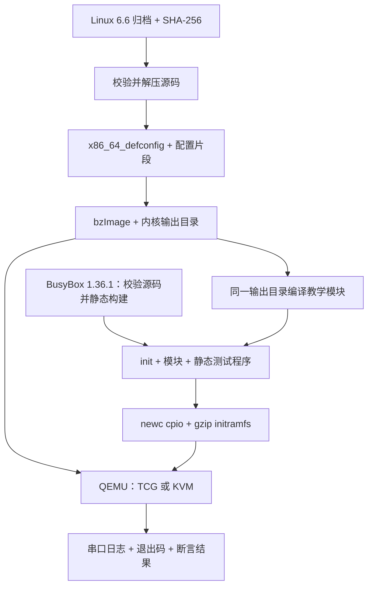

# P04｜搭建 Linux 内核实验环境

驱动错误可能让整个内核运行实例失效。环境设计因此不是“选一个启动命令”：我们需要限制故障影响、固定输入、保存证据，并能把失败与通过分开。本章把 [P03](p03-module.md) 使用的 VM 从源码构建出来。

## 1. 先选故障边界，再选工具

| 方案 | 优点 | 本书接受的代价或限制 |
| --- | --- | --- |
| 宿主直接装载模块 | 路径短，可直接操作设备 | 会影响工作机器；本书不采用这一执行路径。 |
| VM 中运行自行构建内核 | 可重启，内核/配置/模块关系可控制 | 要构建内核、rootfs，并处理启动与日志。 |
| 预构建镜像 | 读者可以先观察行为 | 必须提供来源、校验值、许可和重建方式；当前尚未发布下载产物。 |

选择 QEMU VM 的目标是故障可恢复和证据可追踪，不是宣称 VM 没有任何共享资源影响。运行脚本没有配置外部网络或挂载宿主目录，串口输出写到宿主日志；故障后的重试使用新的客户机内核。

## 2. 从源码到实验，需要哪些东西？



`bzImage` 是供 x86 引导的内核产物，不能单独提供 shell 和测试命令。initramfs 是引导时展开的初始文件系统，里面的 `/init` 负责挂载必要伪文件系统、装载模块、运行断言和关机。本例用静态 BusyBox 提供少量命令，减少动态链接器和共享库依赖，但没有因此获得完整 Android 用户空间。

内核输出目录中的配置和生成文件也用来编译外部模块。只拿宿主头文件编译出 `.ko`，再塞进不同内核，不是可验证的版本匹配方法。

## 3. 固定输入，执行构建

完整输入约定见[环境清单](../../tools/kernel/manifest.md)，执行代码见 [build.sh](../../tools/kernel/build.sh)、[配置片段](../../tools/kernel/config)、[build-busybox.sh](../../tools/qemu/build-busybox.sh)和 [build-rootfs.sh](../../tools/qemu/build-rootfs.sh)。宿主需要支持静态链接的 C 工具链、Make、flex、bison、bc、libelf/OpenSSL 开发文件、curl、xz、bzip2、cpio、gzip、`file` 与 QEMU。

以下构建命令面向当前工具版本。若重放本章下方的历史查询结果，应按[第 02 章](02-character-device.md)使用 `6406d8d` 快照及其旧命令；该快照当时使用宿主静态 BusyBox，不能把新旧构建材料混合后称为同一环境。

在仓库根目录执行：

```sh
JOBS=8 bash tools/kernel/build.sh
bash tools/qemu/build-busybox.sh
bash tools/qemu/build-rootfs.sh
```

第一步获取 Linux 6.6 归档，默认使用镜像站，仍以固定 SHA-256 校验。也可以指定官方源：

```sh
KERNEL_MIRROR=https://cdn.kernel.org/pub/linux/kernel JOBS=4 bash tools/kernel/build.sh
```

获取地址不是完整性证据，哈希比较才用于判断是否为选定归档。当前固定值是：

```text
linux-6.6.tar.xz
d926a06c63dd8ac7df3f86ee1ffc2ce2a3b81a2d168484e76b5b389aba8e56d0
```

内核配置从 `x86_64_defconfig` 合并片段，再执行 `olddefconfig`。脚本只在输出目录尚无 `.config` 时执行配置阶段，后续修改片段不会自动重配已有输出。需要重新实验配置时使用新的输出目录或按清单重建 `build/kernel/out`，先保留旧证据；不能仅改片段就报告新配置已运行。

归档、源码、输出和 rootfs 放在忽略的 `build/`，构建记录写到忽略的 `artifacts/`。重新使用已有解压源码时，脚本不会核查每个源码文件未被修改；归档哈希也不能证明工作源码目录未变化。严谨重建应使用干净源码并保存 Git/源码修改信息。

第二步从 `https://busybox.net/downloads/busybox-1.36.1.tar.bz2` 获取固定 BusyBox 1.36.1 归档，校验 SHA-256 `b8cc24c9574d809e7279c3be349795c5d5ceb6fdf19ca709f80cde50e47de314`。配置从 defconfig 生成，再设置 `CONFIG_STATIC=y`、关闭 TC；后者避免部分新宿主内核头文件移除旧 CBQ 定义导致构建失败。完整配置及二进制哈希记录在 `artifacts/busybox-build.txt`，本机已构建出静态二进制。已有 BusyBox `.config` 同样会被复用，不能改脚本后假设旧输出自动重配。

第三步使用内核输出目录编译模块和静态测试/演示程序，组装 initramfs。BusyBox 默认取本仓库源码构建的 `build/busybox/busybox-1.36.1/busybox`，不再默认依赖宿主 `/usr/bin/busybox`。确需使用其他静态版本时，可显式设置 `BUSYBOX=/absolute/path/to/static-busybox`，并另记来源、版本、哈希和运行结果；`BUSYBOX=/usr/bin/busybox` 只是一种覆盖，不代表宿主一定有可用的相同版本。

rootfs 脚本仍检查静态链接，不满足时在启动 VM 前失败。固定源码与配置推进了输入可追溯性，但宿主编译器、libc、文件时间和构建状态仍会影响产物，因此不承诺跨宿主字节一致的镜像。下方旧查询记录的 BusyBox 1.30.1 与旧 initramfs 哈希保留为历史证据，不能替代新默认环境的报告。

## 4. TCG 与 KVM 分别怎样验证？

```sh
ACCEL=tcg bash tools/qemu/run.sh
ACCEL=kvm bash tools/qemu/run.sh
```

TCG 用软件模拟处理器，适合没有可用 KVM 的机器，通常更慢。KVM 使用宿主硬件虚拟化，需要虚拟化能力与 `/dev/kvm` 访问权限；用当前普通用户运行 `test -r /dev/kvm`、`test -w /dev/kvm` 可先检查入口权限，但这仍不能替代真实启动。脚本不会把显式选择的 KVM 失败悄悄改成 TCG。

当前脚本固定 q35、512 MiB、两个 vCPU、串口控制台、无外部网卡。`-kernel` 与 `-initrd` 选择刚构建的产物；`rdinit=/init` 选择测试入口，`oops=panic panic=1` 让严重内核错误进入可识别终止路径。默认宿主截止为 120 秒，可按机器调整：

```sh
VM_TIMEOUT=180 ACCEL=tcg bash tools/qemu/run.sh
```

增加截止只扩大等待窗口，不修复客户机死锁。成功要求 QEMU 返回 0，日志没有失败/内核诊断标记，并且包含 `MINI_LAB_PASS`。单独看到 Linux 启动、模块日志或某个子测试 PASS 都不足够。

日志分别写入 `artifacts/qemu-tcg.log` 和 `artifacts/qemu-kvm.log`，同模式再次运行会覆盖。正常情况下 init 先卸载模块再关机；宿主 `timeout` 在截止后先发送 TERM，必要时再强制结束 QEMU。客户机失败后重新启动，不继续使用疑似损坏的内核状态。

## 5. 本机已观察到什么？

2026-11-06 的本机记录使用 Linux 6.6.0、Ubuntu GCC 11.4.0、GNU Make 4.3、BusyBox 1.30.1。以下为查询设备阶段已核查的产物摘要，不是要求每次重建都相同的预期哈希：

| 产物 | 当次 SHA-256 |
| --- | --- |
| `bzImage` | `0a89e91f9df01bd2250d2dd11d62bc4b2fed7279c4c1c31cf46475f237950309` |
| 完整内核 `.config` | `8d1c658fd777db0dfd8a697d2c15a8c7d359f7086e2366a89d5889d347c59b81` |
| 静态 BusyBox | `b3c1009e1b5c927e537487c80639cdf404f69e3eb49371d9be5d841672be3ff9` |
| initramfs | `2409cb3acda5121e49d1a7c409658c3a3224c7fdacc3755d97507f5df9d53717` |

查询阶段 TCG、KVM 两份日志均包含：

```text
MINI_LAB_BOOT
mini_hello: init ok
mini_hello: exit ok
mini_hello: init rollback
mini_binder: device registered ABI=1
DEVICE_TEST_PASS open_id=1
mini_binder: device removed live_contexts=0
MINI_LAB_PASS
```

这只是关键事件摘要，省略了重复信息、内核时间和工具输出，不能拿摘要代替原始日志。原始记录归档为 `artifacts/evidence/query-tcg.log`、`artifacts/evidence/query-kvm.log`，校验与版本说明见[阶段报告](../reports/m0-m1-progress.md)。`open_id=1` 是当次输出，不作为跨版本固定验收字段。后续 RPC 演进会覆盖默认日志并改变 rootfs，旧哈希不再描述新镜像。

当前构建的自行核对入口如下；历史查询结果应核对阶段报告及归档，不能拿新镜像与旧哈希混用：

```sh
cat artifacts/kernel-build.txt
cat artifacts/busybox-build.txt
cat artifacts/rootfs-build.txt
sha256sum build/kernel/out/arch/x86/boot/bzImage build/kernel/out/.config build/initramfs.cpio.gz
```

日志通过说明指定环境中这些断言成立，不证明所有硬件、全部竞争路径或生产性能；TCG 与 KVM 都通过也不是两个独立驱动实现的证明。

## 6. 故障如何定位，而不误报通过？

| 现象 | 先检查什么 | 本轮证据边界 |
| --- | --- | --- |
| 归档校验失败 | 下载来源、文件是否完整、固定校验值 | 构建脚本有拒绝路径；没有故意篡改归档做动态注入。 |
| 模块不能装载 | 本次客户机版本、模块构建目录、内核日志中的原因；有宿主 modinfo 时可检查 vermagic | 当前模块由同一输出目录构建且已装载成功；未故意构造版本不匹配镜像。 |
| BusyBox 不是静态文件 | `BUSYBOX` 路径与 `file` 输出 | 脚本显式拒绝；没有声称所有 BusyBox 配置都可运行本实验。 |
| 找不到 `/init`、串口无预期输出 | initramfs 内容、可执行权限、`rdinit`、串口参数 | 缺少最终成功标记会失败，不能用开机横幅替代测试。 |
| KVM 启动失败 | 权限、宿主虚拟化支持、QEMU 错误 | 已在本机验证 KVM；不保证其他宿主无需调整。 |
| VM 不退出或内核告警 | 超时状态、串口尾部、失败标记和完整日志 | 运行器能够拒绝这些结果；本章未穷尽所有故障类别注入。 |

运行器负例已实际验证断言失败、缺少成功标记、panic、超时与启动失败，命令为 `bash tools/qemu/test-runner.sh`，结果见[阶段报告](../reports/m0-m1-progress.md)。模块版本不匹配与缺少配置尚未专门构造，不能由这些负例代为证明。

调试入口为 `bash tools/qemu/debug-boot.sh`。脚本以 `-S` 暂停客户机，GDB 连接本机端口并在 `start_kernel` 设置硬件断点，命中后取得调用栈，再断开并清理该 VM。本机已实际命中并记录 `#0 start_kernel`。配置仍为 `CONFIG_DEBUG_INFO_NONE=y`，这里只验证函数符号与栈，不能声称已具备源码行调试能力。KASAN、lockdep、泄漏检查及分配故障注入尚未通过；调试内核与性能测量环境以后应分别建立。

## 7. 真实 Binder 编进去了，为什么还没有端到端实验？

当前片段启用 `CONFIG_ANDROID_BINDER_IPC=y`、`CONFIG_ANDROID_BINDERFS=y`。Linux v6.6 的 [binder_init](https://github.com/torvalds/linux/blob/v6.6/drivers/android/binder.c#L6583)在 Binderfs 开启时不走旧的静态设备创建分支，而调用 [init_binderfs](https://github.com/torvalds/linux/blob/v6.6/drivers/android/binderfs.c#L798)注册文件系统。

当前 init 已挂载 Binderfs 到 `/dev/binderfs`；配置提供名为 binder 的设备，探测程序 [binder_probe.c](../../tests/kernel/binder_probe.c) 使用本次源码导出的 UAPI 打开 `/dev/binderfs/binder`，调用 BINDER_VERSION。TCG、KVM 均观察到 `BINDER_PROBE_PASS protocol=8 userspace_bits=64`。因此“配置已编进内核”“某设备节点已建立”“驱动协议探测通过”“Android 服务调用完成”是四个不同门槛，当前到达第三项。`/dev/mini_binder` 的 ABI 1 和真实 Binder 的协议版本 8 相互独立；尚无真实 Binder RPC 或 libbinder/ServiceManager 运行验收。

驱动阅读基线、可启动内核、AOSP 用户态版本分别记录；它们恰好同处一个仓库目录也不会自动等价。没有发布预构建镜像之前，P03 的读者仍需按本章自行构建。

## 8. 练习与验收边界

1. 只改配置片段后重跑脚本，为什么可能仍是旧配置？脚本检测已有 `.config` 后跳过配置生成，应检查最终完整配置与哈希。
2. 若先打印 PASS 再 panic，能否通过？不能；运行器还检查 QEMU 状态和内核诊断。只搜索成功关键词是不完整的判定。
3. 归档哈希一致，能否保证 initramfs 一致？不能。用户态工具、模块源码、编译器、文件时间和构建状态也在输入链上。

当前已建立从源码、模块到 TCG/KVM 自动验收的本机路径，并验证固定 BusyBox、运行器负例、函数断点与真实 Binder 协议探测；新版环境的证据单独记录在阶段报告。预构建发布、尚未覆盖的版本/配置故障和独立初学者干净重放仍是 M0 发布前的待验收项。
